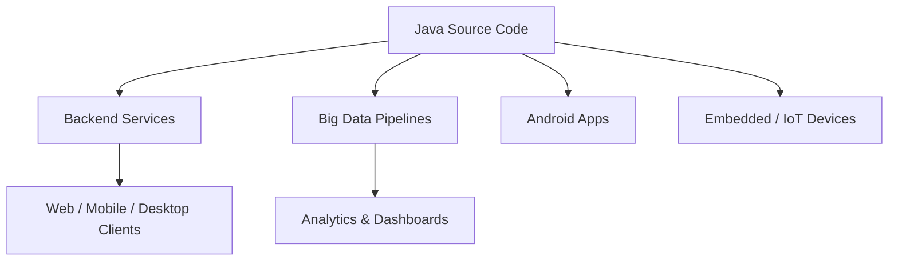

# Applications of Java


## 1. Introduction

Java is not just a language — it is an **ecosystem** used across nearly every computing domain. From the phone in your pocket to the servers that process your credit-card payments, Java is everywhere.

---

## 2. Why This Topic Is Important

- It answers the motivational question: **"Why should I learn Java?"**
- Knowing Java's application domains helps you choose a career direction (Android, backend, big data, etc.).
- Interviewers ask: *"Where is Java used in the real world?"*
- It demonstrates the market value of the skills you are building.

---

## 3. Real-World Analogy

Think of Java as **electricity** — you don't see it, but it powers almost everything: the alarm clock, the microwave, the phone charger, the hospital equipment, and the traffic lights. Java is the invisible electricity of the software world.

---

## 4. Theory

Java dominates the following domains:

| Domain | Real-World Use | Examples |
|--------|----------------|----------|
| **Android Apps** | 100% of Android native apps are Java-based | Google apps, banking apps |
| **Enterprise Backend** | Server-side business logic for companies | ERP, CRM, HR systems (SAP, Oracle) |
| **Banking & Finance** | Core banking, trading, payment systems | Stock exchanges, ATMs |
| **Big Data** | Distributed data processing | Hadoop, Apache Spark, Kafka |
| **Web Development** | Server-side frameworks | Spring Boot, Jakarta EE |
| **Scientific Computing** | Research and engineering apps | NASA, simulations |
| **Embedded Systems** | Small devices and IoT | Smart cards, sensors |
| **E-Commerce** | Online marketplaces | Amazon, Flipkart backends |
| **Government & Defense** | National systems | Tax systems, military logistics |
| **Healthcare** | Hospital and medical systems | Patient records, imaging |
| **Gaming** | Game engines and tools | Minecraft (written in Java) |
| **Cloud & DevOps** | Infrastructure tooling | Jenkins (CI), Netflix, LinkedIn, Uber |

### Famous Java-Powered Companies
- **Netflix** — video streaming backend
- **Uber** — ride-sharing services
- **LinkedIn** — social network backend
- **Amazon** — e-commerce and AWS tooling
- **Twitter/X** — handles massive throughput with JVM technologies
- **Minecraft** — one of the best-selling games, written in Java

---

## 5. Syntax

Applications are written with the same Java we are learning. A typical enterprise application:

```java
public class BankingApp {
    public static void main(String[] args) {
        System.out.println("Enterprise-grade backend application in Java");
    }
}
```

The *scale* and *architecture* change, not the language.

---

## 6. Flow Explanation



One language, many surfaces.

---

## 7. Memory Representation

Not applicable — this is an application-domain topic, not a runtime topic.

---

## 8. Simple Example

```java
public class AppShowcase {
    public static void main(String[] args) {
        String[] domains = {"Android", "Banking", "Big Data", "Web", "IoT", "Gaming"};
        for (String d : domains) {
            System.out.println("Java powers: " + d);
        }
    }
}
```

---

## 9. Intermediate Example

```java
public class JavaEverywhere {
    public static void main(String[] args) {
        String[][] apps = {
            {"Minecraft", "Gaming"},
            {"Netflix", "Streaming"},
            {"Uber", "Ride-sharing"},
            {"Amazon", "E-commerce"}
        };
        for (String[] app : apps) {
            System.out.printf("%-12s is powered by Java (%s)%n", app[0], app[1]);
        }
    }
}
```

---

## 10. Advanced Example

```java
import java.util.HashMap;
import java.util.Map;

public class MarketAnalysis {
    public static void main(String[] args) {
        Map<String, Double> popularity = new HashMap<>();
        popularity.put("Enterprise Backend", 34.0);
        popularity.put("Android", 28.0);
        popularity.put("Big Data", 18.0);
        popularity.put("Web", 12.0);
        popularity.put("Embedded", 8.0);

        System.out.println("Java usage by domain:");
        for (Map.Entry<String, Double> e : popularity.entrySet()) {
            System.out.printf("%-20s %.1f%%%n", e.getKey(), e.getValue());
        }
    }
}
```

---

## 11. Output

For the **Advanced Example**:

```
Java usage by domain:
Big Data              18.0%
Web                   12.0%
Embedded               8.0%
Android               28.0%
Enterprise Backend    34.0%
```

*(Output order may vary — HashMap has no guaranteed order.)*

---

## 12. Common Mistakes

| Mistake | Correction |
|---------|------------|
| Saying "Java is only for Android" | Android is one of many domains; enterprise backend is the biggest |
| Thinking Java is dying | Java ranks in the top 3 languages worldwide (TIOBE, 2026) |
| Believing Java is only for desktop apps | Modern Java is server-side, big data, and cloud-first |
| Assuming JavaScript replaced Java | Different domains: JS is frontend, Java is backend/enterprise |
| Ignoring the ecosystem | Frameworks (Spring, Kafka, Hadoop) are what make Java powerful |

---

## 13. Best Practices

- Pick a domain early: backend (Spring Boot) is the biggest hiring area.
- Build projects in the domain you want — recruiters value relevant projects.
- Learn the ecosystem tools of your domain (Kafka for streaming, Hadoop for big data).
- Follow market trends: cloud-native Java (Quarkus, Micronaut) is growing.

---

## 14. Interview Questions

**Q1. Where is Java used in the real world?**
*Android development, enterprise backend systems, banking, e-commerce, big data (Hadoop/Spark), IoT, and more.*

**Q2. Why do banks prefer Java?**
*Because it is robust, secure, stable, and has strong community support for high-availability systems.*

**Q3. Name 3 big companies using Java.**
*Netflix, Amazon, and LinkedIn (also Uber, Twitter/X, and many others).*

**Q4. Is Java good for web development?**
*Yes — with frameworks like Spring Boot, Java builds the backend of many of the world's biggest websites.*

**Q5. Which domain should a new Java learner target?**
*Backend development with Spring Boot — it has the most jobs and uses core Java heavily.*

---

## 15. Practice Exercises

1. Research and list 5 local/global companies that use Java.
2. Explain in 3 sentences why Android apps are written in Java.
3. Categorize these into Java domains: Amazon, Minecraft, Hadoop, ATM software, Uber.
4. Write a paragraph about the future of Java (cloud, AI, virtual threads).

---

## 16. Coding Challenges

1. **Easy:** Print the 6 major application domains of Java using a loop.
2. **Medium:** Create a `HashMap<String, String>` of famous apps to domains and print it neatly.
3. **Hard:** Write a program that asks the user which career domain they like and prints the key Java skills required for it.

---

## 17. Summary

- Java powers **Android, enterprise backend, banking, big data, web, gaming, IoT**, and more.
- Giants like **Netflix, Amazon, Uber, LinkedIn** rely on Java.
- The biggest career domain is **backend development (Spring Boot)**.
- Java remains a top-3 language worldwide — learning it is a career-safe investment.

➡️ Continue to: [JVM, JRE, and JDK](JVM-JRE-JDK.md)