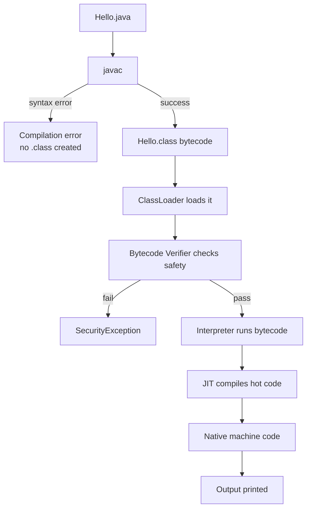

# Compilation Process

## 1. Introduction

When you write Java and press "run," a multi-step process transforms your readable source code into instructions your computer can execute. This process — **compilation and execution** — is the secret behind Java's portability.

---

## 2. Why This Topic Is Important

- You must understand the difference between a **compiler** and an **interpreter**.
- Knowing the process helps you debug errors (compile-time vs runtime errors).
- Interviewers love: *"Explain the Java compilation process step by step."*
- It explains why Java is called both compiled and interpreted.

---

## 3. Real-World Analogy

Think of a **restaurant recipe**:

1. You write the recipe in English (source code).
2. A translator converts it into a standard "kitchen instruction" format (bytecode) — usable in any kitchen.
3. When an order comes in, the chef (JVM) reads the instructions and cooks the dish (machine code) using the kitchen's specific equipment.

The recipe is written once; each kitchen adapts it.

---

## 4. Theory

### Step-by-Step Compilation

**Step 1 — Write source code** in a `.java` file:
```java
public class Hello { ... }
```

**Step 2 — Compile with `javac`** (JDK tool):
- The compiler reads `.java` and produces `.class` bytecode.
- If there is a syntax error, compilation **fails** and no `.class` file is created.
- Syntax errors are caught here — this is *compile-time checking*.

**Step 3 — Class loading** (JVM runtime):
- The JVM's ClassLoader loads the `.class` file into memory.

**Step 4 — Bytecode verification**:
- The verifier checks the bytecode for security violations (forged pointers, illegal access).

**Step 5 — Execution**:
- The interpreter reads bytecode; the **JIT compiler** optimizes hot paths by compiling them to native machine code.
- The program runs and produces output.

### Why Bytecode?
Bytecode is a **middle language** — not tied to any processor. The JVM for each OS translates it locally. That is why you can compile on Windows and run on Linux.

---

## 5. Syntax

```powershell
# 1. Compile (produces Hello.class)
javac Hello.java

# 2. Run (JVM loads, verifies, executes)
java Hello
```

> **⚠️ Note:** `java Hello` uses the class name, **not** `Hello.class` and **not** `Hello.java`.

---

## 6. Flow Explanation



---

## 7. Memory Representation

During execution, each thread gets a stack; all threads share the heap. The `.class` metadata lives in the method area. (Refer to [Java-Architecture.md](Java-Architecture.md) for the full memory map.)

---

## 8. Simple Example

```java
public class CompileSteps {
    public static void main(String[] args) {
        System.out.println("Compiled with javac, executed by JVM.");
    }
}
```

Compile and run:

```powershell
javac CompileSteps.java
java CompileSteps
```

---

## 9. Intermediate Example — Two Phases in Action

```java
public class TwoPhases {
    public static void main(String[] args) {
        // COMPILE TIME: the compiler checks this constant expression
        int sum = 10 + 20;
        System.out.println("Compile-time math: " + sum);

        // RUNTIME: this only throws when the program runs
        int[] nums = {1, 2};
        try {
            System.out.println(nums[5]);
        } catch (ArrayIndexOutOfBoundsException e) {
            System.out.println("Runtime error caught: index out of bounds");
        }
    }
}
```

---

## 10. Advanced Example — Inspect the Bytecode

```java
public class InspectBytecode {
    public static void main(String[] args) {
        int a = 5;
        int b = 7;
        int result = a + b;
        System.out.println("Sum = " + result);
    }
}
```

After compiling, disassemble with the JDK tool:

```powershell
javac InspectBytecode.java
javap -c InspectBytecode      # prints the bytecode instructions
```

---

## 11. Output

For the **Intermediate Example**:

```
Compile-time math: 30
Runtime error caught: index out of bounds
```

For `javap -c`, you'll see low-level instructions like `iconst_5`, `istore_1`, `iadd`.

---

## 12. Common Mistakes

| Mistake | Correction |
|---------|------------|
| Running `java Hello.class` | Use `java Hello` (class name without extension) |
| Thinking compile errors and runtime errors are the same | Compile errors = syntax; runtime errors = logic/data issues |
| Believing JIT compiles all code | JIT compiles **hot code** only, based on usage profiling |
| Assuming `.class` files are executable | They need the JVM to run |
| Deleting `.class` files after compilation | You need them to run the program; keep source and class files together |

---

## 13. Best Practices

- Fix compile errors before thinking about logic — the compiler is your first reviewer.
- Use an IDE to see compile errors instantly as you type.
- Always keep source (`.java`) and class files in sync; rebuild after editing.
- Read `javap -c` occasionally to appreciate what your code really does.

---

## 14. Interview Questions

**Q1. Explain the Java compilation process.**
*Source → `javac` → bytecode (.class) → ClassLoader → verifier → interpreter/JIT → machine code.*

**Q2. Why is Java both compiled and interpreted?**
*It is compiled to bytecode by `javac`, then interpreted/executed by the JVM, with JIT compiling hot code to native.*

**Q3. What is the role of the bytecode verifier?**
*It validates bytecode for security before execution, rejecting forged pointers or illegal code.*

**Q4. What are compile-time vs runtime errors?**
*Compile-time = syntax errors found by `javac`. Runtime = errors during execution (exceptions).*

**Q5. What does `javap` do?**
*It is the disassembler — shows the bytecode instructions of a compiled class.*

---

## 15. Practice Exercises

1. Compile `CompileSteps.java` and verify both `.java` and `.class` files exist.
2. Introduce a syntax error (remove a semicolon) and observe the compile-time failure.
3. Run `javap -c` on your compiled class and identify 3 instructions.
4. Write down the full pipeline from source to output in 6 steps.

---

## 16. Coding Challenges

1. **Easy:** Write a program with a deliberate compile-time error, then fix it.
2. **Medium:** Write code that produces an `ArrayIndexOutOfBoundsException`, catch it, and explain which phase (compile/runtime) the problem belongs to.
3. **Hard:** Create two classes where class A's `main` creates class B. Compile only A (`javac A.java`) and observe that `javac` auto-compiles B.

---

## 17. Summary

- Pipeline: **source → javac → bytecode → classloader → verifier → interpreter/JIT → output**.
- Bytecode is platform-neutral; the JVM is platform-specific.
- Compile-time errors are syntax; runtime errors are exceptions.
- JIT compiles hot bytecode for performance.
- `javap -c` shows bytecode; `java` uses class names, not file names.

➡️ Continue to: [First Java Program](First-Java-Program.md)