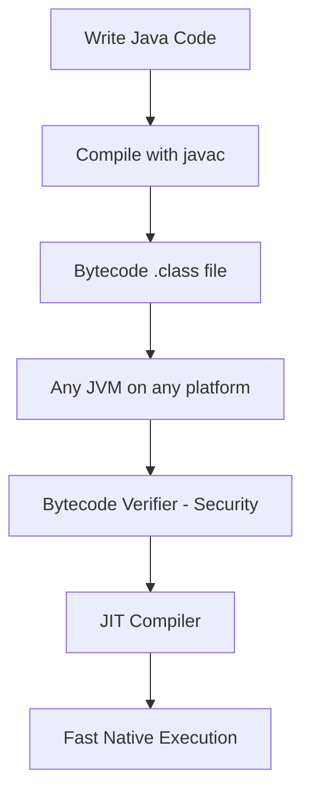

# Features of Java

## 1. Introduction

Java is a **high-level, object-oriented, platform-independent** programming language. It combines the power of C++ with simplicity and safety. These defining characteristics are what made Java the backbone of enterprise software for three decades.

---

## 2. Why This Topic Is Important

- Feature knowledge is the **foundation of every Java interview**.
- Understanding each feature explains *how* Java behaves and *why* code is written the way it is.
- It helps you reason about performance, safety, and design choices as you build real projects.
- "List Java features" is one of the most common first-round interview questions.

---

## 3. Real-World Analogy

Imagine Java as a **highly secure hotel**:

- Each room is private unless you give access (encapsulation).
- Any guest can enter through the main door (platform independence).
- The hotel has housekeepers who clean rooms automatically (garbage collector) so you never worry about leaks.
- You can clone your keycard to make copies (references) — but never duplicate the physical room itself.

---

## 4. Theory

Java has **12 major features**. Let's examine each:

### 1. Simple and Easy to Learn
Java removes complex C++ concepts like pointers, multiple inheritance, and manual memory management. The syntax is clean and readable, making it easy for beginners.

### 2. Object-Oriented
Everything in Java (except primitives) is an object. Java supports the four pillars of OOP: **Encapsulation, Inheritance, Polymorphism, and Abstraction**.

### 3. Platform Independent (WORA)
Java compiles to **bytecode**, not machine code. The JVM executes bytecode on any OS. This is the "Write Once, Run Anywhere" promise.

### 4. Secure
Java runs inside the JVM with a security manager. It has no explicit pointers, has automatic runtime checks (like array bounds checking), and strong access control via access modifiers.

### 5. Robust
Java's strong memory management (garbage collection), exception handling, and type checking make it crash-resistant. It catches problems early.

### 6. Multithreaded
Java supports concurrent execution with built-in thread support. Multiple tasks can run simultaneously, improving performance.

### 7. Architecture Neutral
Bytecode is not tied to any specific processor or architecture. The JVM translates it to native instructions at runtime.

### 8. Portable
"Platform independent" + "architecture neutral" = the same bytecode runs identically everywhere.

### 9. High Performance
The **Just-In-Time (JIT) compiler** in the JVM compiles frequently-used bytecode to native machine code at runtime, delivering near-native speed.

### 10. Dynamic
Java can adapt to an evolving environment. Classes are loaded at runtime (class loaders), enabling dynamic linking and reflection.

### 11. Distributed
Java has built-in networking support (URL, Socket, RMI). It is designed for distributed systems and the internet.

### 12. Interpreted and Compiled
Java is **compiled** to bytecode (`javac`) and then **interpreted/compiled** by the JVM — giving a blend of both worlds.

---

## 5. Syntax

There is no single "syntax" for features, but the following program demonstrates several features at once — object-oriented design, robustness, and platform independence:

```java
public class Demo {
    public static void main(String[] args) {
        System.out.println("Java is secure, robust, and portable!");
    }
}
```

---

## 6. Flow Explanation



Features are not isolated — they work together. Security verifies bytecode, portability lets it run anywhere, and the JIT makes it fast.

---

## 7. Memory Representation

Not directly applicable to "features", but the JVM memory model (heap, stack, method area) is a direct result of Java's robustness and security features. We study it in detail in [JVM-JRE-JDK.md](JVM-JRE-JDK.md) and [Java-Architecture.md](Java-Architecture.md).

---

## 8. Simple Example — Feature Demonstration

```java
public class FeatureDemo {
    public static void main(String[] args) {
        String os = System.getProperty("os.name");
        System.out.println("Hello from Java running on: " + os);
    }
}
```

Run the same program on Windows, macOS, and Linux. It prints a different OS name but runs identically — that is **platform independence** in action.

---

## 9. Intermediate Example — Multithreading

```java
public class ThreadDemo {
    public static void main(String[] args) {
        Runnable task = () -> {
            for (int i = 1; i <= 3; i++) {
                System.out.println(Thread.currentThread().getName() + " -> " + i);
            }
        };

        Thread t1 = new Thread(task, "Thread-A");
        Thread t2 = new Thread(task, "Thread-B");
        t1.start();
        t2.start();
    }
}
```

---

## 10. Advanced Example — Security & Robustness

```java
import java.util.Scanner;

public class RobustDemo {
    public static void main(String[] args) {
        Scanner sc = new Scanner(System.in);
        System.out.print("Enter a number: ");
        try {
            int n = Integer.parseInt(sc.nextLine());
            System.out.println("You entered: " + n);
        } catch (NumberFormatException e) {
            System.out.println("Invalid input! Java's exception handling caught the error.");
        } finally {
            sc.close();
            System.out.println("Resource closed (robust memory management).");
        }
    }
}
```

---

## 11. Output

For the **Intermediate Example**, output will look like (order may vary):

```
Thread-A -> 1
Thread-B -> 1
Thread-A -> 2
Thread-B -> 2
Thread-A -> 3
Thread-B -> 3
```

For the **Advanced Example** (if the user enters `abc`):

```
Enter a number: abc
Invalid input! Java's exception handling caught the error.
Resource closed (robust memory management).
```

---

## 12. Common Mistakes

| Mistake | Correction |
|---------|------------|
| Thinking Java is purely interpreted | It is **compiled to bytecode** then interpreted/JIT-compiled by the JVM |
| Believing Java has pointers | Java has references; no explicit pointer arithmetic |
| Thinking "platform independent" means JVM is platform independent | The **bytecode** is independent; the JVM itself is platform-specific |
| Confusing Java features with JavaScript features | Totally different languages |
| Believing Java is slow | JIT compilation makes modern Java very fast |

---

## 13. Best Practices

- Memorize the **12 features with one-line explanations** — they form interview gold.
- Connect features to examples: always pair "platform independent" with the JVM story.
- Use Java's built-in features (exception handling, GC, threads) rather than re-inventing them.
- When talking about performance, mention the JIT compiler, not "Java is slow".

---

## 14. Interview Questions

**Q1. Why is Java called platform independent?**
*Because Java compiles to bytecode which runs on any platform with a JVM. The bytecode is the same everywhere; only the JVM differs.*

**Q2. Is Java interpreted or compiled?**
*Both. `javac` compiles source to bytecode; the JVM interprets it and the JIT compiler converts hot bytecode to native machine code.*

**Q3. What is the difference between a pointer and a reference?**
*A pointer directly holds a memory address and supports arithmetic; a reference is a safe handle to an object managed by the JVM.*

**Q4. How does Java achieve high performance despite being platform independent?**
*Through the JIT compiler, which compiles frequently executed bytecode into native code at runtime.*

**Q5. What is the role of the Bytecode Verifier?**
*It checks bytecode for security violations (forged pointers, illegal access) before execution.*

---

## 15. Practice Exercises

1. List all 12 Java features in your own words, with a one-sentence example for each.
2. Compare Java's "simple" feature with C++ complexity in a table (3 rows).
3. Explain the connection between "robust" and "exception handling" in two sentences.
4. Write a short paragraph describing how "distributed" Java is used in web applications.

---

## 16. Coding Challenges

1. **Easy:** Write a program that prints your OS name, version, and architecture using `System.getProperty()`.
2. **Medium:** Using threads, create 3 threads that each print a different greeting. Ensure the main thread prints "Main done" only after all 3 finish (`join()`).
3. **Hard:** Write a program that demonstrates robustness by reading integers until the user types "stop". Handle every non-numeric input gracefully.

---

## 17. Summary

- Java's **12 features**: simple, object-oriented, platform independent, secure, robust, multithreaded, architecture neutral, portable, high performance, dynamic, distributed, interpreted + compiled.
- **WORA** (Write Once Run Anywhere) is the defining promise.
- Security comes from no-pointers, the bytecode verifier, and runtime checks.
- Performance comes from the **JIT compiler**.
- Features work together — one platform, one vision.

➡️ Continue to: [Java Versions](Java-Versions.md)