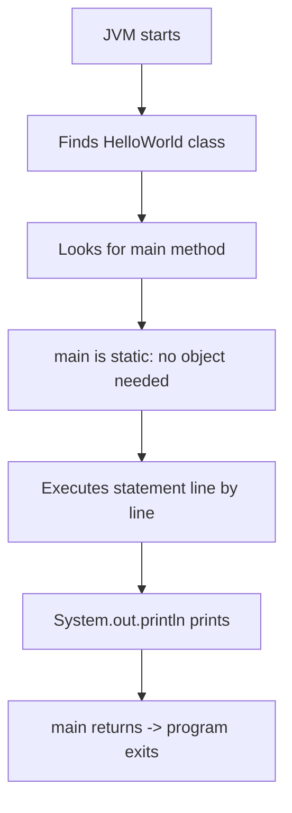

# First Java Program

## 1. Introduction

Every programmer's rite of passage is the **"Hello World"** program. It proves that your entire toolchain — JDK, path settings, and file structure — works correctly. This topic explains every word of it.

---

## 2. Why This Topic Is Important

- It is the **first program you will ever run**, and its success builds confidence.
- Understanding `main`, `public`, `static`, and `void` sets up everything that follows.
- It verifies your installation before you dive into complex topics.
- It teaches the golden rule: **filename must match the public class name**.

---

## 3. Real-World Analogy

Your first Java program is like **turning on a car for the first time**. The key (`main` method) must be in the ignition, the car (JVM) must be fueled and running, and the engine must be accessible to anyone who wants to drive. Once the engine turns over, you know everything is wired correctly.

---

## 4. Theory

### The Basic Skeleton

```java
public class HelloWorld {
    public static void main(String[] args) {
        System.out.println("Hello, World!");
    }
}
```

### Breaking Down Each Keyword

| Keyword | Meaning |
|---------|---------|
| `public` | The class/method is accessible from anywhere |
| `class` | Declares a class (the blueprint) |
| `HelloWorld` | The class name — **must match the filename** |
| `static` | The method belongs to the class, no object needed to call it |
| `void` | The method returns nothing |
| `main` | The entry point the JVM looks for |
| `String[] args` | An array of command-line arguments passed to the program |
| `System.out.println()` | Prints text to the console and moves to a new line |

### The `main` Method Contract
The JVM **requires** exactly this signature to start a program:
```java
public static void main(String[] args)
```
It can be declared with `String args[]` or `String... args`, but `String[] args` is standard.

---

## 5. Syntax

```java
public class ClassName {
    public static void main(String[] args) {
        // statements
    }
}
```

- File name: `ClassName.java`
- Opening brace `{` and closing brace `}` define the class/method body.
- Every statement ends with a semicolon `;`.

---

## 6. Flow Explanation



---

## 7. Memory Representation

When `main` runs, the JVM creates a **stack frame** for `main`, stores the `args` reference to the heap (the String array), and the `System.out` object already lives in the heap (created by the runtime). Simple mental model:

```
JVM Stack (main frame)         Heap
+-----------------------+      +----------------------+
| args -> String[] ref  |----->| ["arg1","arg2",...]  |
+-----------------------+      +----------------------+
```

---

## 8. Simple Example

```java
public class HelloWorld {
    public static void main(String[] args) {
        System.out.println("Hello, World!");
    }
}
```

---

## 9. Intermediate Example — Using Command-Line Arguments

```java
public class Greeting {
    public static void main(String[] args) {
        if (args.length > 0) {
            System.out.println("Hello, " + args[0] + "!");
        } else {
            System.out.println("Hello, World! (no name provided)");
        }
    }
}
```

Run it:

```powershell
java Greeting Alice
# Hello, Alice!
```

---

## 10. Advanced Example — Structured Program

```java
public class Welcome {
    static void printHeader() {
        System.out.println("=============================");
        System.out.println(" WELCOME TO MY JAVA PROGRAM");
        System.out.println("=============================");
    }

    static void printGreeting(String name) {
        System.out.println("Hello, " + name + "! Enjoy your Java journey.");
    }

    public static void main(String[] args) {
        printHeader();
        String user = (args.length > 0) ? args[0] : "Guest";
        printGreeting(user);
    }
}
```

---

## 11. Output

For the **Advanced Example** (run as `java Welcome Alice`):

```
=============================
 WELCOME TO MY JAVA PROGRAM
=============================
Hello, Alice! Enjoy your Java journey.
```

---

## 12. Common Mistakes

| Mistake | Correction |
|---------|------------|
| Class name ≠ filename | `HelloWorld.java` must contain `public class HelloWorld` |
| Forgetting `main`'s `static` | JVM calls `main` without creating an object |
| Writing `public static void main` as `public void static main` | Keyword order must be: `public static void main` |
| Typing `System.out.println` with wrong capitalization | Java is case-sensitive: `System` not `system` |
| Missing semicolons or braces | Every statement ends with `;`; every block has `{ }` |

---

## 13. Best Practices

- Start class names with an **uppercase letter** (PascalCase): `BankAccount`.
- Use `System.out.printf` or formatted strings when printing dynamic values.
- Keep `main` thin — delegate logic to helper methods.
- Always test with and without arguments to understand `args`.

---

## 14. Interview Questions

**Q1. Why is the main method `public static void`?**
*`public` so the JVM can access it from outside the class; `static` so no object is needed; `void` because it returns nothing to the OS.*

**Q2. Can you overload the main method?**
*Yes, but only `public static void main(String[] args)` is the entry point; overloads are ignored by the JVM.*

**Q3. What happens if the class is not public?**
*If the class isn't public, the filename doesn't have to match, but a public class must live in its own file matching its name.*

**Q4. Can we declare main without `public`?**
*The program won't start — the JVM requires `public static void main(String[])`.*

**Q5. What is `args`?**
*`args` is the array of command-line arguments; `args.length` gives the count and `args[0]` the first argument.*

---

## 15. Practice Exercises

1. Write HelloWorld, compile it, and run it.
2. Modify Greeting to print the full name: first + last from two arguments.
3. Print your name, age, and city from three command-line arguments.
4. Count how many arguments were passed and print the count.

---

## 16. Coding Challenges

1. **Easy:** Print "Hello, World!" 5 times using a loop (you'll learn loops later — try a `for` loop now).
2. **Medium:** Write a program that prints its own arguments in reverse order.
3. **Hard:** Write a program that sums all numeric arguments passed on the command line (ignore non-numbers).

---

## 17. Summary

- The entry point is always `public static void main(String[] args)`.
- Class name must match the filename for public classes.
- `System.out.println()` prints to the console.
- `args` carries command-line arguments.
- Compile with `javac`, run with `java`.

➡️ Continue to: [Interview Questions](Interview-Questions.md)