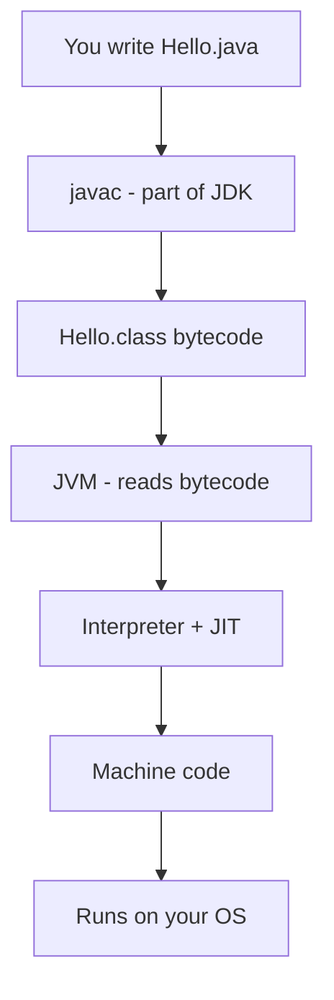
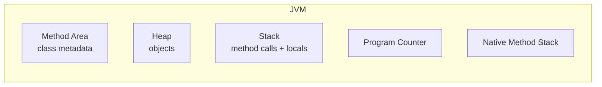

# JVM, JRE, and JDK

## 1. Introduction

The **JVM, JRE, and JDK** are the three layers that make Java run. Beginners confuse them constantly, but they are simple once understood as layers of a cake. This is one of the **most important topics** in all of Java.

---

## 2. Why This Topic Is Important

- The **JDK vs JRE vs JVM** question is asked in almost every Java interview.
- You need to know which one to install (JDK), which one runs your code (JVM), and which one is for users (JRE).
- Understanding these layers clarifies the entire Java execution model.
- It explains why Java is platform-independent.

---

## 3. Real-World Analogy

Imagine you own a **restaurant**:

- **JDK** = The whole restaurant (kitchen + ovens + waiters + menu). It has everything to *create* meals.
- **JRE** = The dining hall with waiters. It can *serve* meals but cannot cook new recipes.
- **JVM** = The waiter's brain. It knows exactly how to deliver each dish to the right table in the right order.

A developer uses the JDK to *create* programs. An end-user only needs the JRE to *run* them. And every time a program runs, it runs *inside* a JVM.

---

## 4. Theory

### JDK — Java Development Kit (for developers)
- The **complete kit** to write, compile, and run Java programs.
- Contains: JRE + `javac` (compiler) + `jar` (archiver) + `javadoc` (documentation tool) + debugger + other tools.

### JRE — Java Runtime Environment (for end users)
- The **runtime only**. Contains: JVM + core libraries (like `java.lang`, `java.util`, `java.io`).
- Cannot compile code (no `javac`). Can only *run* compiled `.class` files.

### JVM — Java Virtual Machine (the engine)
- The **heart** of Java. A virtual computer that executes bytecode.
- Responsibilities: loads bytecode, verifies it, manages memory (heap, stack), runs garbage collection, and compiles hot code via JIT.
- **Platform-specific** — there is a JVM for Windows, one for macOS, one for Linux, etc.

### The Relationship
```
JDK ⊃ JRE ⊃ JVM
```

| Layer | What it has | Who needs it | Can compile? | Can run? |
|-------|-------------|--------------|--------------|----------|
| JDK | JRE + dev tools (`javac`, `jar`) | Developers | Yes | Yes |
| JRE | JVM + core libraries | End users | No | Yes |
| JVM | Execution engine | Both (inside JRE) | No | Yes (bytecode) |

> **📌 Note:** Since Java 9, the JDK ships as a set of modules (JPMS). You can create a custom "minimal runtime" with `jlink` instead of a full JRE. Standalone JRE downloads were discontinued after Java 8 — installing the JDK gives you everything.

---

## 5. Syntax

No syntax — but here is how the JDK's tools look at the command line:

```powershell
javac Hello.java          # compile: JDK tool
java Hello                # run: JVM tool (inside JRE)
jar cvf app.jar *.class   # package: JDK tool
javadoc Hello.java        # docs: JDK tool
```

---

## 6. Flow Explanation



JDK **builds**, JRE **houses**, JVM **executes**.

---

## 7. Memory Representation

The JVM's internal memory layout (simplified) — this is what actually runs your program:



We cover these areas in detail in [Java-Architecture.md](Java-Architecture.md).

---

## 8. Simple Example

```java
public class CheckEnvironment {
    public static void main(String[] args) {
        System.out.println("JVM vendor : " + System.getProperty("java.vm.vendor"));
        System.out.println("JVM version: " + System.getProperty("java.vm.version"));
        System.out.println("Java home  : " + System.getProperty("java.home"));
    }
}
```

---

## 9. Intermediate Example

```java
public class LayerPrinter {
    public static void main(String[] args) {
        System.out.println("=== Java Runtime Layers ===");
        System.out.println("JDK : Development Kit (compile + run)");
        System.out.println("JRE : Runtime Environment (run only)");
        System.out.println("JVM : Virtual Machine (executes bytecode)");
        System.out.println();
        System.out.println("Installed runtime version: "
                + System.getProperty("java.version"));
        System.out.println("Bytecode compatibility: "
                + System.getProperty("java.specification.version"));
    }
}
```

---

## 10. Advanced Example

```java
import java.util.Map;

public class JvmInspector {
    public static void main(String[] args) {
        String[] props = {
            "java.version",      // language version
            "java.vm.name",      // JVM implementation
            "java.vm.version",   // JVM version
            "java.class.version" // bytecode version (major version)
        };

        for (String p : props) {
            System.out.printf("%-22s = %s%n", p, System.getProperty(p));
        }

        System.out.println("\nAll runtime properties (sample):");
        System.out.println("Max heap (-Xmx default): " + Runtime.getRuntime().maxMemory() / (1024 * 1024) + " MB");
        System.out.println("Available processors  : " + Runtime.getRuntime().availableProcessors());
    }
}
```

---

## 11. Output

For the **Advanced Example**, output will resemble:

```
java.version          = 21.0.2
java.vm.name          = OpenJDK 64-Bit Server VM
java.vm.version       = 21.0.2+13
java.class.version    = 65.0

All runtime properties (sample):
Max heap (-Xmx default): 4096 MB
Available processors  : 8
```

*(Your values will differ based on your machine.)*

---

## 12. Common Mistakes

| Mistake | Correction |
|---------|------------|
| Installing JRE "instead of JDK" | Modern Java: install the JDK; the standalone JRE is gone post-Java 8 |
| Thinking JVM is platform-independent | The **JVM is platform-specific**; the bytecode it runs is not |
| Believing `javac` is part of JRE | `javac` is a **JDK-only** tool |
| Confusing `java.home` with JDK/JRE | `java.home` points to the runtime root used by your program |
| Thinking JDK = JVM | JDK *contains* a JRE which *contains* a JVM |

---

## 13. Best Practices

- Install the **JDK**, never a standalone JRE.
- In interviews, describe the **layering**: JDK ⊃ JRE ⊃ JVM.
- Know the JVM responsibilities: load, verify, execute, manage memory, GC.
- Use `java -XshowSettings:vm -version` to inspect your JVM from the command line.

---

## 14. Interview Questions

**Q1. Difference between JDK, JRE, and JVM?**
*JDK = development kit (compiler + tools + JRE). JRE = runtime (JVM + libraries). JVM = the virtual machine that executes bytecode. JDK contains JRE which contains JVM.*

**Q2. Why is JVM called a "virtual" machine?**
*It is an abstract computer implemented in software — it doesn't exist as hardware, only as a process that simulates a CPU.*

**Q3. Can you run a Java program without the JDK?**
*Yes — if you only have the JRE and the compiled `.class` file. But you need the JDK to compile the source.*

**Q4. Why is JVM not platform independent?**
*Because it interacts with the underlying OS and hardware; each OS needs its own JVM implementation.*

**Q5. What does the JVM actually do at runtime?**
*It loads bytecode, verifies it, interprets/compiles it, manages memory, runs garbage collection, and handles threads.*

---

## 15. Practice Exercises

1. On your machine, find the JDK bin directory and list its tools (javac, java, jar, javadoc).
2. Run the `JvmInspector` program and note your heap size and processor count.
3. Draw the JDK ⊃ JRE ⊃ JVM nesting on paper with arrows.
4. Explain in your own words why end users never install the JDK.

---

## 16. Coding Challenges

1. **Easy:** Print `java.vm.name`, `java.version`, and `java.home`.
2. **Medium:** Write a program that prints the total heap memory and free memory in MB using `Runtime.getRuntime()`.
3. **Hard:** Use `java.class.version` to determine which Java major version compiled your classes (major 52 = Java 8, 61 = 17, 65 = 21).

---

## 17. Summary

- **JDK** = development kit for building programs.
- **JRE** = runtime for running programs (JDK contains it).
- **JVM** = the virtual machine that executes bytecode (JRE contains it).
- JDK ⊃ JRE ⊃ JVM.
- JVM is platform-specific; bytecode is platform-independent.
- The JVM manages memory, GC, threads, and JIT compilation.

➡️ Continue to: [Java Architecture](Java-Architecture.md)