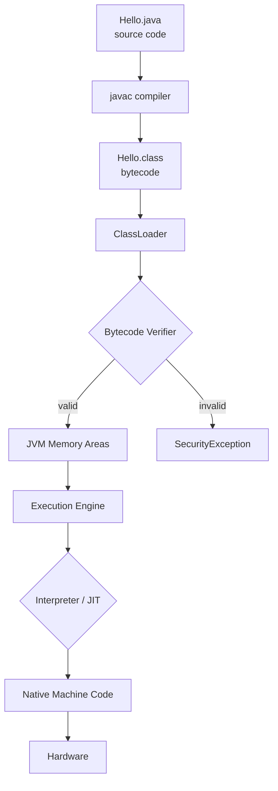
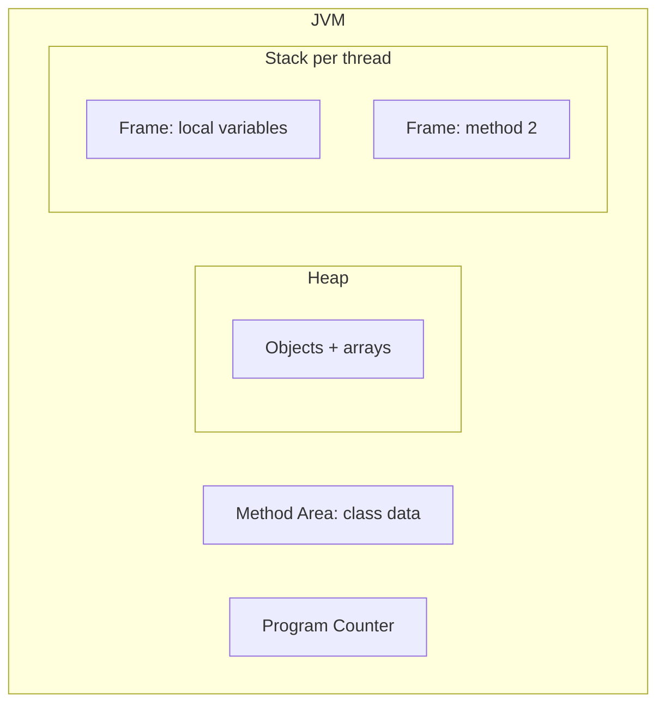

# Java Architecture

## 1. Introduction

Java's architecture is the set of design choices that deliver **"Write Once, Run Anywhere."** It describes how source code is transformed into bytecode and how the JVM turns that bytecode into something your computer can execute.

---

## 2. Why This Topic Is Important

- It is the **foundation topic** for understanding how Java works internally.
- Interviewers ask about JVM internals, class loading, and memory areas.
- It explains *why* Java code behaves identically across platforms.
- It sets up advanced topics: performance tuning, garbage collection, concurrency.

---

## 3. Real-World Analogy

Imagine you're mailing a package (your program):

- You write the content in a **universal language** (Java source) → package it as a standard box (bytecode).
- The **postal system** (JVM) figures out how to deliver it locally — train, truck, or drone.
- Each country has its own postal system (platform-specific JVM), but the package looks identical everywhere.

You never rewrite the package; only the delivery mechanism changes.

---

## 4. Theory

### The Three Pillars of Java Architecture

1. **Source Code (.java)** — human-readable Java.
2. **Bytecode (.class)** — platform-neutral intermediate code produced by `javac`.
3. **JVM (Java Virtual Machine)** — interprets/compiles bytecode into machine code.

### Class Loading
The JVM loads `.class` files using a **ClassLoader** hierarchy:

| ClassLoader | What it loads |
|-------------|---------------|
| Bootstrap ClassLoader | Core classes (`java.lang.*`) |
| Extension/Platform ClassLoader | Extensions (`javax.*` platform libs) |
| Application ClassLoader | Your own classes on the classpath |

### Runtime Data Areas (JVM Memory)
| Area | Stores | Lifecycle |
|------|--------|-----------|
| Method Area | Class metadata, static variables, constants | JVM lifetime |
| Heap | All objects and instance variables | Garbage collected |
| JVM Stack | Local variables, method calls (frames) | Per-thread |
| PC Register | Address of current instruction | Per-thread |
| Native Method Stack | Native (C/C++) method calls | Per-thread |

### Execution Engine
| Component | Job |
|-----------|-----|
| Interpreter | Reads bytecode and executes it line by line (slow start) |
| JIT Compiler | Compiles hot bytecode to native machine code (fast) |
| Garbage Collector | Reclaims memory from unused objects automatically |

---

## 5. Syntax

Architecture has no syntax, but the compilation entry point is always:

```powershell
javac Hello.java     # source -> bytecode
java Hello           # JVM loads & runs Hello.class
```

---

## 6. Flow Explanation



---

## 7. Memory Representation



- **Heap** grows as you `new` objects; GC cleans unreachable ones.
- **Stack** grows per method call, shrinks on return.

---

## 8. Simple Example

```java
public class ArchitectureDemo {
    public static void main(String[] args) {
        System.out.println("I am loaded, verified, and executed by the JVM.");
    }
}
```

---

## 9. Intermediate Example — Watching Class Loading

```java
public class WatchClassLoad {
    public static void main(String[] args) throws Exception {
        System.out.println("ClassLoader of this class: "
                + WatchClassLoad.class.getClassLoader());
        System.out.println("ClassLoader of String   : "
                + String.class.getClassLoader());   // null => bootstrap
        System.out.println("Runtime free memory (MB): "
                + Runtime.getRuntime().freeMemory() / (1024 * 1024));
    }
}
```

---

## 10. Advanced Example — Custom ClassLoader

```java
import java.io.IOException;
import java.nio.file.Files;
import java.nio.file.Path;

public class CustomClassLoader extends ClassLoader {

    public Class<?> findClass(String name) throws ClassNotFoundException {
        try {
            byte[] bytes = Files.readAllBytes(
                Path.of(name.replace('.', '/') + ".class"));
            return defineClass(name, bytes, 0, bytes.length);
        } catch (IOException e) {
            throw new ClassNotFoundException(name, e);
        }
    }

    public static void main(String[] args) throws Exception {
        CustomClassLoader loader = new CustomClassLoader();
        Class<?> c = loader.loadClass("ArchitectureDemo");
        System.out.println("Loaded class: " + c.getName());
        System.out.println("Loaded by  : " + c.getClassLoader());
    }
}
```

---

## 11. Output

For the **Intermediate Example**:

```
ClassLoader of this class: jdk.internal.loader.ClassLoaders$AppClassLoader@...
ClassLoader of String   : null
Runtime free memory (MB): 1024
```

---

## 12. Common Mistakes

| Mistake | Correction |
|---------|------------|
| Thinking bytecode is machine code | Bytecode is platform-neutral; JIT converts it to machine code at runtime |
| Believing all classes are loaded upfront | Classes are loaded **lazily** on first use |
| Confusing the stack and heap | Stack = method calls/locals per thread; Heap = objects shared across threads |
| Thinking the interpreter is always slow | The JIT warms up hot methods; long-running apps are fast |
| Believing the heap is unbounded | It is bounded by `-Xmx` and can throw `OutOfMemoryError` |

---

## 13. Best Practices

- Design code so objects are short-lived — the GC prefers this (minor collections).
- Avoid huge static collections — they pin memory in the method area/heap and block GC.
- Use `-Xmx` and `-Xms` flags to size the heap for production.
- Profile with `-Xlog:gc*` (Java 9+) to understand GC behavior.

---

## 14. Interview Questions

**Q1. What are the main components of JVM architecture?**
*ClassLoader, Runtime Data Areas (heap, stack, method area, PC, native stack), and the Execution Engine (interpreter + JIT + GC).*

**Q2. What is the difference between interpreter and JIT compiler?**
*The interpreter executes bytecode line by line; the JIT compiles hot bytecode to native code once, then executes it faster.*

**Q3. Why is heap called "shared memory"?**
*All threads share the same heap for object allocation; the stack is per-thread.*

**Q4. What is a ClassLoader and its types?**
*It loads .class files into memory. Types: Bootstrap, Platform/Extension, and Application.*

**Q5. What is the Parent Delegation Model?**
*Class loaders delegate loading to their parent first (bootstrap first), only loading themselves if the parent cannot find the class. Prevents duplicate/unsafe class definitions.*

---

## 15. Practice Exercises

1. Draw the full JVM architecture from memory with the 5 runtime areas.
2. Run the intermediate example and identify which classloader loads which class.
3. Explain the parent delegation model to a friend in 3 sentences.
4. Run a program with `java -Xmx128m Program` and observe heap behavior.

---

## 16. Coding Challenges

1. **Easy:** Print the class loader names for `String`, `ArrayList`, and your own class.
2. **Medium:** Write a program that creates 10,000 objects in a loop, then prints free memory before and after calling `System.gc()`.
3. **Hard:** Implement a custom class loader that loads a class from a different directory (absolute path).

---

## 17. Summary

- Java architecture = **source → bytecode → JVM**.
- JVM parts: **ClassLoader, Runtime Data Areas, Execution Engine**.
- Memory areas: method area, heap, stack, PC register, native stack.
- The **JIT compiler** delivers performance; the **interpreter** provides portability.
- The **GC** manages object memory automatically.
- Parent delegation ensures safe, predictable class loading.

➡️ Continue to: [Compilation Process](Compilation-Process.md)