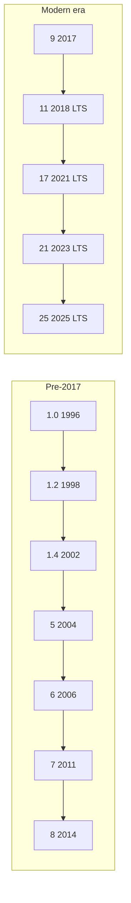

# Java Versions

## 1. Introduction

Java has evolved through **many versions** since 1996. Understanding the version landscape helps you choose the right Java for your project, read legacy code, and talk confidently in interviews.

---

## 2. Why This Topic Is Important

- **Job descriptions** specify Java versions (e.g., "Java 8/11/17"). You must know what they mean.
- Some syntax changes between versions — code written for Java 8 differs from Java 17.
- You must know what **LTS** means — it determines which Java is used in production.
- Version knowledge prevents you from using features that don't exist on your runtime.

---

## 3. Real-World Analogy

Java versions are like **phone operating system updates**. Every few months a new update arrives with new features. But most people use "long-term support" phones — they get security fixes for years. LTS Java versions are the same: new features every 6 months, but businesses standardize on the LTS versions that are supported long-term.

---

## 4. Theory

### The Naming Convention
- **Java 1.0 → 1.4**: Old names (Java 1.4).
- **Java 5 → 9**: Dropped the "1." prefix (Java 5, Java 8...).
- **Java 9 onward**: Plain version numbers (Java 17, Java 21).

### Release Cadence
| Era | Release Model |
|-----|---------------|
| Java 1.0 – 8 | Big feature releases every 2–3 years |
| Java 9 – 24 | Feature releases every **6 months** |
| LTS versions | Every **2 years** (supported for 8+ years) |

### What is LTS?
**LTS = Long-Term Support.** These versions receive security patches and bug fixes for many years. Enterprises standardize on them.

| LTS Version | Year | Support Until |
|-------------|------|---------------|
| Java 8 | 2014 | 2030 (extended) |
| Java 11 | 2018 | 2026+ |
| Java 17 | 2021 | 2029+ |
| Java 21 | 2023 | 2031+ |
| Java 25 | 2025 | 2033+ |

---

## 5. Syntax

There is no syntax for versions, but you can detect your Java version from code:

```java
public class JavaVersion {
    public static void main(String[] args) {
        System.out.println("Java version: " + System.getProperty("java.version"));
        System.out.println("Vendor: " + System.getProperty("java.vendor"));
    }
}
```

---

## 6. Flow Explanation



Modern Java = 6-month cadence with periodic LTS islands of stability.

---

## 7. Memory Representation

Not applicable. This is a conceptual timeline topic.

---

## 8. Simple Example

```java
public class FeatureList {
    public static void main(String[] args) {
        System.out.println("Java 5: Generics, Enums, Enhanced for-loop");
        System.out.println("Java 8: Lambdas, Streams, Optional");
        System.out.println("Java 9: Modules, JShell REPL");
        System.out.println("Java 17: Sealed classes, Pattern matching");
        System.out.println("Java 21: Virtual threads, Record patterns");
    }
}
```

---

## 9. Intermediate Example

```java
public class VersionInfo {
    public static void main(String[] args) {
        String version = System.getProperty("java.version");

        if (version.startsWith("1.8")) {
            System.out.println("You are on legacy Java 8");
        } else if (version.startsWith("11") || version.startsWith("17")
                   || version.startsWith("21")) {
            System.out.println("You are on an LTS version: " + version);
        } else {
            System.out.println("You are on a feature release: " + version);
        }
    }
}
```

---

## 10. Advanced Example

```java
public class SwitchWithJava {
    static String describe(String ver) {
        return switch (ver) {
            case "8"  -> "LTS 2014 - Still everywhere in legacy enterprise";
            case "11" -> "LTS 2018 - First Oracle LTS after the 6-month switch";
            case "17" -> "LTS 2021 - Current industry standard";
            case "21" -> "LTS 2023 - Virtual threads, records, pattern matching";
            default   -> "Feature release - use with caution in production";
        };
    }

    public static void main(String[] args) {
        System.out.println(describe("8"));
        System.out.println(describe("17"));
        System.out.println(describe("21"));
        System.out.println(describe("24"));
    }
}
```

---

## 11. Output

For the **Advanced Example**:

```
LTS 2014 - Still everywhere in legacy enterprise
LTS 2021 - Current industry standard
LTS 2023 - Virtual threads, records, patterns
Feature release - use with caution in production
```

---

## 12. Common Mistakes

| Mistake | Correction |
|---------|------------|
| Thinking Java 8 is the newest | It is LTS from 2014; Java 25 is the newest LTS |
| Using non-LTS in production | Non-LTS gets only ~6 months of updates |
| Confusing "Java 1.8" with "Java 18" | Java 1.8 = Java 8 (old naming) |
| Believing you must always use the latest version | Stability matters; LTS is the safe default |
| Ignoring vendor differences | Oracle, OpenJDK, Adoptium Temurin are different JDK distributions |

---

## 13. Best Practices

- **Learn on LTS** (17 or 21) so tutorials and tools align.
- Check the target version in project configs (`pom.xml`, `build.gradle`, `module-info.java`).
- Use `--release` flag when compiling to guarantee compatibility.
- Keep an eye on the Java 21+ features — virtual threads are a game changer for backend apps.

---

## 14. Interview Questions

**Q1. What is the difference between LTS and non-LTS Java versions?**
*LTS versions get long-term security and bug fixes (8+ years) and are production-safe. Non-LTS versions get ~6 months of updates.*

**Q2. Which Java versions are LTS?**
*8, 11, 17, 21, and 25 (as of 2025).*

**Q3. Why do companies still use Java 8?**
*Legacy codebases, older frameworks, and cost of migration.*

**Q4. What is the latest LTS version in 2026?**
*Java 25 (released Sept 2025), with Java 21 and 17 still widely supported.*

**Q5. What are virtual threads (Java 21)?**
*Lightweight threads managed by the JVM that allow millions of concurrent tasks with low overhead.*

---

## 15. Practice Exercises

1. Run `java -version` and identify whether your version is LTS or a feature release.
2. List the features introduced in Java 5, 8, 11, 17, and 21.
3. Write a table comparing Java 8 vs Java 21 (at least 4 rows).
4. Explain in your own words why a bank would prefer Java 21 over Java 24.

---

## 16. Coding Challenges

1. **Easy:** Print your current Java runtime version and vendor.
2. **Medium:** Write a program that stores the LTS versions and their release years in a map, then prints all pairs.
3. **Hard:** Write a program that reads a version number string (e.g., "17") from the user and tells them whether it is LTS and which features it introduced.

---

## 17. Summary

- Java releases every 6 months with **LTS every 2 years**.
- LTS versions: **8, 11, 17, 21, 25**.
- Java 8 is legacy; **Java 17/21 are the modern standard**.
- Version naming dropped the "1." prefix after Java 5.
- For production, prefer LTS. For learning, use 17 or 21.

➡️ Continue to: [Applications of Java](Applications-of-Java.md)