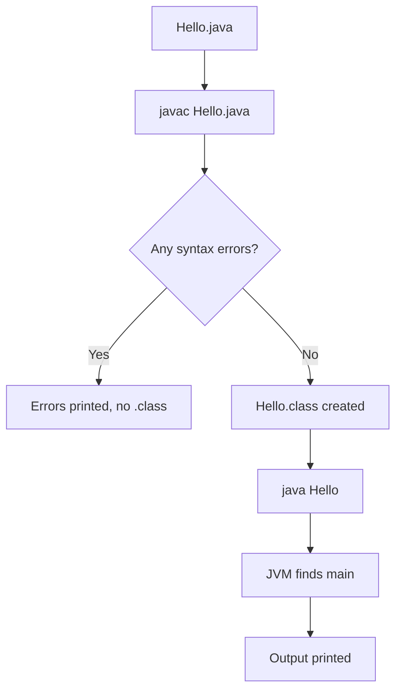

# Compile and Run

## 1. Introduction

This topic teaches the two commands that are the **heart of Java workflow**: `javac` (compile) and `java` (run). Understanding them deeply — including flags and classpath — will serve you for your whole career, even when using IDEs that hide them.

---

## 2. Why This Topic Is Important

- IDEs automate this, but **every backend deployment runs `java -jar`** in production.
- Interviewers probe your understanding of compilation and classpath.
- Debugging "class not found" errors requires knowing how `java` finds classes.
- It demystifies what the "Run" button actually does.

---

## 3. Real-World Analogy

Compiling is like **translating a book**: `javac` converts your manuscript (`.java`) into a standard printed format (`.class`). Running is like **reading the book aloud**: `java` tells the JVM to read the printed format and speak it on the platform's hardware.

---

## 4. Theory

### The Two Commands

| Command | Purpose | Input | Output |
|---------|---------|-------|--------|
| `javac File.java` | Compile | Source `.java` | Bytecode `.class` |
| `java ClassName` | Run | Class name | Program output |

### Key Rules
- `java` takes the **class name**, not the file name.
- Both commands must be run from the folder containing the files (or you set the **classpath**).
- Multiple source files can be compiled at once: `javac *.java`.
- Compile errors print with the file and line number.

### Useful Flags
| Flag | Meaning |
|------|---------|
| `javac -d <dir>` | Place `.class` files in a directory (keeps source clean) |
| `javac -version` | Show compiler version |
| `java -cp <path>` | Set the classpath |
| `java -jar app.jar` | Run a JAR archive |

---

## 5. Syntax

```powershell
# Basic workflow
javac Hello.java
java Hello

# With output directory
javac -d out Hello.java
java -cp out Hello
```

---

## 6. Flow Explanation



---

## 7. Memory Representation

Compiled classes are loaded into the **method area**; `main`'s frame goes on the **stack**; created objects go to the **heap**. (Review [Java-Architecture](../01-Introduction-to-Java/Java-Architecture.md) if this is fuzzy.)

---

## 8. Simple Example

File: `Hello.java`

```java
public class Hello {
    public static void main(String[] args) {
        System.out.println("Compile and run work!");
    }
}
```

Terminal:

```powershell
javac Hello.java
java Hello
```

---

## 9. Intermediate Example — Clean Output Directory

```powershell
# Put bytecode in a separate 'out' folder
mkdir out
javac -d out Hello.java
java -cp out Hello

# List what was created
dir out
```

Compile multiple files at once:

```powershell
javac -d out *.java
```

---

## 10. Advanced Example — Two Classes & Classpath

File: `Calculator.java`

```java
public class Calculator {
    public static int add(int a, int b) {
        return a + b;
    }
}
```

File: `Main.java`

```java
public class Main {
    public static void main(String[] args) {
        System.out.println("5 + 7 = " + Calculator.add(5, 7));
    }
}
```

Terminal:

```powershell
javac -d out Main.java Calculator.java
java -cp out Main
```

**Output:**
```
5 + 7 = 12
```

---

## 11. Output

For the **Simple Example**:

```
Compile and run work!
```

---

## 12. Common Mistakes

| Mistake | Correction |
|---------|------------|
| `java Hello.class` | Use `java Hello` — never include `.class` |
| `java Hello.java` | `java` runs compiled classes, not source (unless single-file mode) |
| Running from the wrong folder | The class must be on the classpath (current folder is default) |
| Forgetting to recompile after edits | `javac` must be re-run after every source change |
| Ignoring the `-d` flag | Without it, `.class` files clutter your source folder |

---

## 13. Best Practices

- Always compile into an `out`/`build` directory: `javac -d out *.java`.
- Recompile after **every** edit — stale `.class` files cause confusion.
- Keep package structure mirrored in the output directory (covered in Module 11).
- Use `-encoding UTF-8` if your source contains non-ASCII characters.

---

## 14. Interview Questions

**Q1. What is the difference between javac and java?**
*`javac` compiles source to bytecode; `java` launches the JVM to execute the bytecode.*

**Q2. Why do we pass the class name to java, not the file name?**
*Because the JVM loads a class by its binary name from the classpath; the file extension and path are abstractions.*

**Q3. What is the classpath?**
*The set of directories/archives where the JVM searches for `.class` files. Set with `-cp` or `CLASSPATH`.*

**Q4. What happens if the class has no main method?**
*`java` throws: "Main method not found in class X".*

**Q5. What is single-file source launcher?**
*Java 11+ lets you run `java Hello.java` directly — the JVM compiles in memory without producing a `.class` file. Handy for scripts.*

---

## 15. Practice Exercises

1. Write, compile, and run `Hello.java` from the terminal.
2. Compile into an `out` directory and run with `-cp`.
3. Create a two-class program and run it with the classpath set.
4. Try `java Hello.java` (single-file mode) and note the difference.

---

## 16. Coding Challenges

1. **Easy:** Print "Terminal Master" and run it from a folder with spaces in its name.
2. **Medium:** Create three classes that depend on each other and compile all with one `javac` command.
3. **Hard:** Package your classes into a JAR with `jar cfe app.jar Main *.class`, then run it with `java -jar app.jar`.

---

## 17. Summary

- `javac Hello.java` → bytecode; `java Hello` → execution.
- `java` uses **class names**; `javac` uses **file names**.
- Use `-d out` to keep output separate; use `-cp` for classpath.
- Recompile after every change.
- Java 11+ supports `java File.java` single-file mode for quick tests.

➡️ Next: [Exercises](Exercises.md)