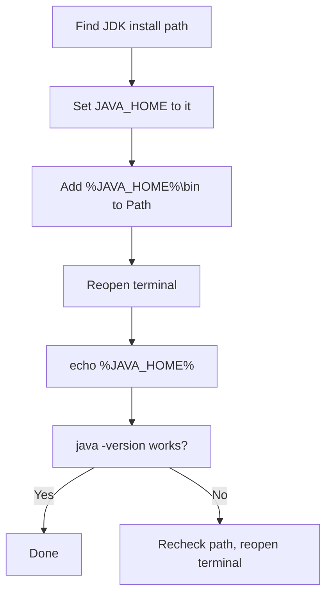

# Configure JAVA_HOME

## 1. Introduction

`JAVA_HOME` is an **environment variable** that tells tools (Maven, Gradle, Tomcat, IntelliJ) where your JDK is installed. Correctly setting it — along with adding the JDK's `bin` folder to `Path` — makes `java` and `javac` work from any terminal folder.

---

## 2. Why This Topic Is Important

- **Every build tool** (Maven, Gradle) needs `JAVA_HOME`. Modules 20–21 depend on it.
- If `JAVA_HOME` is wrong, tools fail with cryptic errors like *"Unable to locate a Java Runtime."*
- Adding `bin` to `Path` lets you type `java`, `javac`, `jar` from anywhere.
- It's a standard job task — you may have to set it on a fresh machine at work.

---

## 3. Real-World Analogy

Think of `JAVA_HOME` as the **home address of your translator service**. Tools ask: "Where does Java live?" The address tells them exactly where to find the compiler. `Path` is the taxi routes that let you call a translator from any street corner without typing the full address every time.

---

## 4. Theory

### What are Environment Variables?
Key-value pairs stored by the operating system and available to every program:

| Variable | Purpose |
|----------|---------|
| `JAVA_HOME` | Points to the JDK **root** folder |
| `Path` | Lists folders searched for executables (`java.exe`, `javac.exe`) |

### Why Both?
- `JAVA_HOME` = **for tools** (they read it programmatically).
- `Path` = **for your terminal** (it finds `java`, `javac` when you type them).

---

## 5. Syntax

```powershell
# Windows - view
echo %JAVA_HOME%

# macOS / Linux - view
echo $JAVA_HOME
```

---

## 6. Flow Explanation



---

## 7. Memory Representation

Not applicable.

---

## 8. Simple Example — Windows Setup (GUI)

1. Find your JDK path, e.g.:
   ```
   C:\Program Files\Eclipse Adoptium\jdk-21.0.2
   ```
2. Press `Win` and search **"Edit the system environment variables"**.
3. Click **Environment Variables…** (bottom right).
4. Under **System variables**, click **New**:
   - Variable name: `JAVA_HOME`
   - Variable value: `C:\Program Files\Eclipse Adoptium\jdk-21.0.2`
5. Select `Path` → **Edit** → **New** → add: `%JAVA_HOME%\bin`
6. Click **OK** on every dialog. Open a **new** terminal and run:
   ```powershell
   echo %JAVA_HOME%
   java -version
   ```

---

## 9. Intermediate Example — macOS / Linux Setup

```bash
# Add these lines to ~/.zshrc (macOS) or ~/.bashrc (Linux)
export JAVA_HOME=$(/usr/libexec/java_home -v 21)   # macOS only
# or simply: export JAVA_HOME=/opt/jdk-21           # Linux manual install

export PATH="$JAVA_HOME/bin:$PATH"

# Reload the config
source ~/.zshrc   # or source ~/.bashrc

# Verify
echo $JAVA_HOME
java -version
```

---

## 10. Advanced Example — Windows Setup (Terminal / PowerShell)

```powershell
# Run as Administrator
[Environment]::SetEnvironmentVariable(
    "JAVA_HOME",
    "C:\Program Files\Eclipse Adoptium\jdk-21.0.2",
    "Machine")

[Environment]::SetEnvironmentVariable(
    "Path",
    [Environment]::GetEnvironmentVariable("Path", "Machine") + ";%JAVA_HOME%\bin",
    "Machine")

# Reopen the terminal, then verify
echo %JAVA_HOME%
java -version
javac -version
```

---

## 11. Output

A working setup outputs:

```
C:\Program Files\Eclipse Adoptium\jdk-21.0.2
openjdk version "21.0.2" 2024-01-16 LTS
...
```

---

## 12. Common Mistakes

| Mistake | Correction |
|---------|------------|
| Pointing `JAVA_HOME` to the `bin` folder | It must point to the **JDK root** (parent of `bin`) |
| Not including `bin` in `Path` | `java` won't be found |
| Not opening a **new** terminal | Environment changes apply to new sessions only |
| Setting `Path` to `bin` but wrong JDK path | Use `%JAVA_HOME%\bin` so it stays in sync |
| Setting `JAVA_HOME` but not `Path` (or vice versa) | Set **both** |

---

## 13. Best Practices

- Set `JAVA_HOME` **once** at the System level, not per-user.
- Use `%JAVA_HOME%\bin` in `Path` — updating `JAVA_HOME` automatically updates `Path`.
- Verify after every change with `echo %JAVA_HOME%` and `java -version`.
- If you have multiple JDKs, point `JAVA_HOME` to the one you want by default.

---

## 14. Interview Questions

**Q1. What is JAVA_HOME and why is it needed?**
*An environment variable pointing to the JDK installation root. Build tools like Maven and Gradle read it to find the Java runtime.*

**Q2. What's the difference between JAVA_HOME and Path?**
*`JAVA_HOME` is read by tools programmatically; `Path` lets the OS/terminal find `java` and `javac` executables.*

**Q3. Why does the terminal not recognize `java` after install?**
*The `bin` folder isn't on `Path`, or the terminal wasn't reopened.*

---

## 15. Practice Exercises

1. Set `JAVA_HOME` and `Path` on your system.
2. Open a new terminal and run `echo %JAVA_HOME%` (or `echo $JAVA_HOME`).
3. Run `java -version` and `javac -version` from a random folder (e.g., `C:\Users`).
4. Use `where java` (Windows) or `which java` (Linux/mac) to locate the executables.

---

## 16. Coding Challenges

1. **Easy:** Print `JAVA_HOME` and `Path` from within a Java program using `System.getenv("JAVA_HOME")`.
2. **Medium:** Write a Java program that lists all environment variables whose names start with "JAVA".
3. **Hard:** Temporarily point `JAVA_HOME` to a wrong folder, run `mvn -version` (if installed), observe the error, then fix it.

---

## 17. Summary

- `JAVA_HOME` = JDK **root** folder path.
- `Path` must contain `%JAVA_HOME%\bin`.
- Tools (Maven, Gradle) read `JAVA_HOME`; the terminal uses `Path`.
- Always **reopen terminals** after changes.
- Verify with `echo %JAVA_HOME%`, `java -version`, `javac -version`.

➡️ Next: [Compile and Run](Compile-and-Run.md)