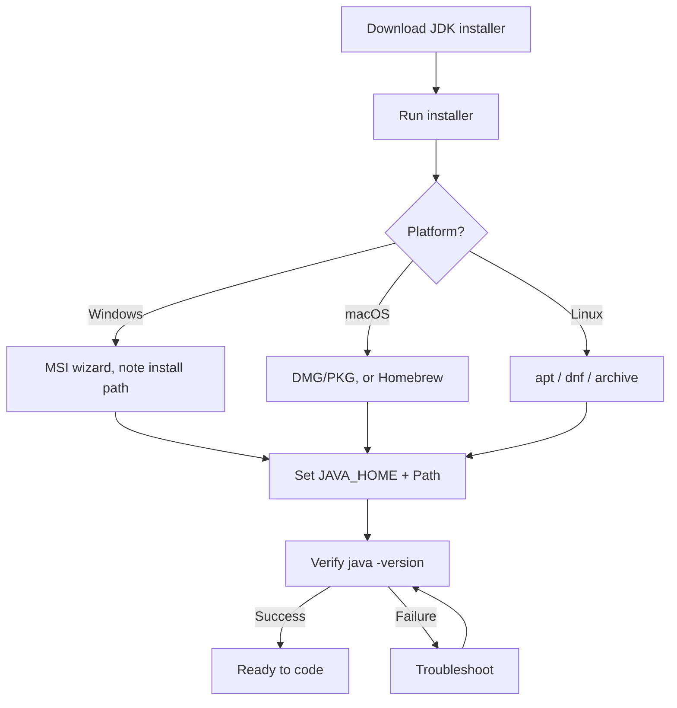

# Install JDK

## 1. Introduction

The **JDK (Java Development Kit)** is the compiler + runtime + tools needed to develop Java. This guide installs an **LTS version (17 or 21)** on Windows, macOS, and Linux.

---

## 2. Why This Topic Is Important

- Without a working JDK, **nothing else in this roadmap works**.
- A correct install saves you from confusing errors like *"'javac' is not recognized."*
- Choosing the right version (LTS) avoids version mismatch problems later.

---

## 3. Real-World Analogy

Installing the JDK is like **hiring a translator who speaks your programming language**. The translator (javac) converts your Java words into instructions the machine (JVM) understands. If the translator isn't installed, your machine simply says "I don't understand you."

---

## 4. Theory

### What You Actually Get With the JDK

| Tool | Purpose |
|------|---------|
| `javac` | Compiles `.java` source to `.class` bytecode |
| `java` | Runs compiled programs (launches the JVM) |
| `jar` | Packages classes into archives |
| `javadoc` | Generates HTML documentation from comments |
| `jlink` | Creates custom runtime images |
| `jshell` | Interactive REPL for testing code snippets |

### Which JDK Distribution?
- **Adoptium Temurin** — free, open-source, community-backed. Recommended.
- **Oracle JDK** — free for development, commercial license for production.
- **Amazon Corretto** — free, AWS-backed, drop-in replacement.
- **OpenJDK builds** — many vendors (Microsoft, Red Hat, Azul).

> **💡 Recommendation:** Use **Temurin 21** — the current LTS with the broadest tooling support in 2026.

---

## 5. Syntax

There is no Java syntax here — only terminal commands to verify the install:

```powershell
java -version
javac -version
echo %JAVA_HOME%   # Windows
echo $JAVA_HOME    # macOS / Linux
```

---

## 6. Flow Explanation



---

## 7. Memory Representation

Not applicable — this is an installation procedure.

---

## 8. Simple Example — Windows (MSI)

1. Go to https://adoptium.net/ → **Latest LTS** → Windows → download the `.msi`.
2. Run the installer; keep default options.
3. Note the install directory, e.g. `C:\Program Files\Eclipse Adoptium\jdk-21.0.x\`.
4. Open a **new** terminal:

```powershell
java -version
javac -version
```

---

## 9. Intermediate Example — macOS (Homebrew)

```bash
brew tap homebrew/cask-versions
brew install --cask temurin@21
java -version
javac -version
```

If you prefer the manual installer: download the `.pkg` and click through the wizard.

---

## 10. Advanced Example — Linux (Ubuntu)

```bash
# Install via apt
sudo apt update
sudo apt install openjdk-21-jdk

# Or use Adoptium's repo for the exact Temurin build
wget -qO - https://packages.adoptium.net/artifactory/api/gpg/key/public | sudo gpg --dearmor -o /etc/apt/trusted.gpg.d/adoptium.gpg
echo "deb https://packages.adoptium.net/artifactory/deb $(lsb_release -cs) main" | sudo tee /etc/apt/sources.list.d/adoptium.list
sudo apt update && sudo apt install temurin-21-jdk

java -version
```

For a manual tar install:

```bash
cd /opt
sudo tar -xzf ~/Downloads/jdk-21_linux-x64_bin.tar.gz
sudo ln -s /opt/jdk-21 /opt/java
```

---

## 11. Output

Successful verification looks like:

```
openjdk version "21.0.2" 2024-01-16 LTS
OpenJDK Runtime Environment Temurin-21.0.2+13 (build 21.0.2+13)
OpenJDK 64-Bit Server VM Temurin-21.0.2+13 (build 21.0.2+13, mixed mode, sharing)
```

---

## 12. Common Mistakes

| Mistake | Correction |
|---------|------------|
| Installing the **JRE** instead of the JDK | `javac` won't exist. Install a full JDK. |
| Downloading an old Java 8 when starting fresh | Choose 17 or 21 LTS |
| Not reopening the terminal after install | `Path` updates need a fresh terminal |
| Downloading Oracle JDK for commercial use | Check the license; Temurin is always safe |
| Confusing 32-bit vs 64-bit installs | Download the 64-bit installer for modern systems |

---

## 13. Best Practices

- **Always install an LTS** for learning and production.
- Write down your install path — you'll need it for `JAVA_HOME`.
- Verify with **both** `java -version` and `javac -version`.
- Use one JDK, not many, to avoid path confusion.

---

## 14. Interview Questions

**Q1. What is the difference between the JDK, JRE, and JVM?**
*JDK = development tools + JRE. JRE = JVM + libraries. JVM = the virtual machine that runs bytecode.*

**Q2. Which JDK should a beginner install in 2026?**
*A free LTS build such as Temurin 21.*

**Q3. What does `javac -version` verify?**
*That the compiler is on the PATH and installed correctly.*

**Q4. Is Oracle JDK free?**
*Free for development and testing; a paid license is required for commercial production use.*

---

## 15. Practice Exercises

1. Install the JDK and print both `java -version` and `javac -version`.
2. Locate the `bin` folder of your JDK and list the files in it.
3. Run `jshell` and type `System.out.println("hi")` to test the REPL.
4. Write down the exact version numbers you installed.

---

## 16. Coding Challenges

1. **Easy:** From the terminal, run `java --version` and `javac --version`, and note the difference in output format.
2. **Medium:** Use `jshell` to compute `17 * 21` and print the result.
3. **Hard:** Use `jlink` to create a minimal runtime image that can run a simple HelloWorld without the full JDK.

---

## 17. Summary

- The **JDK** includes `javac`, `java`, `jar`, and more.
- Use an **LTS** version — Temurin 21 is the 2026 recommendation.
- Verify installation with `java -version` and `javac -version`.
- Windows uses `.msi`, macOS uses Homebrew or `.pkg`, Linux uses `apt`/`dnf` or a tar archive.
- Reopen terminals after installation so `Path` updates take effect.

➡️ Next: [Configure JAVA_HOME](Configure-JAVA_HOME.md) or [Install VS Code](Install-VS-Code.md)