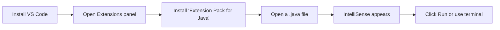

# Install VS Code

## 1. Introduction

**Visual Studio Code (VS Code)** is a free, lightweight code editor that supports Java through extensions. It's a fantastic choice for beginners because it is fast, simple, and teaches you to use the terminal without hiding it.

---

## 2. Why This Topic Is Important

- VS Code is **free** and works on all operating systems.
- Its terminal is ideal for learning `javac`/`java` commands directly.
- The "Extension Pack for Java" gives you IntelliSense (autocomplete), debugging, and run buttons.
- It's a great stepping stone before you move to a heavyweight IDE.

---

## 3. Real-World Analogy

VS Code is like a **modern notebook with smart ink** — it writes your code, guesses what you're about to type (IntelliSense), points out errors as you write (red squiggles), and lets you run your code with one click. But unlike a magic notebook, it works only after you attach the right pens (extensions).

---

## 4. Theory

### The Extension Pack for Java
One extension pack gives you everything:
- **Language Support for Java** (Red Hat) — parsing, IntelliSense.
- **Debugger for Java** — set breakpoints, step through code.
- **Test Runner for Java** — run JUnit tests later.
- **Maven for Java** — build support for later modules.
- **Project Manager for Java** — create new projects.

> **📌 Note:** You can use VS Code without the extension pack to write code, but IntelliSense, debugging, and run buttons require the extensions.

---

## 5. Syntax

No Java syntax — just the install commands. VS Code can also be installed via terminal:

```powershell
# Windows (winget)
winget install Microsoft.VisualStudioCode

# macOS (Homebrew)
brew install --cask visual-studio-code

# Linux (Ubuntu/Debian)
sudo snap install code --classic
```

---

## 6. Flow Explanation



---

## 7. Memory Representation

Not applicable.

---

## 8. Simple Example — Install Steps (GUI)

1. Download from https://code.visualstudio.com/
2. Run the installer (accept defaults).
3. Launch VS Code.
4. Press `Ctrl+Shift+X` to open the **Extensions** panel.
5. Search **"Extension Pack for Java"** (publisher: Microsoft).
6. Click **Install** and wait for it to finish.
7. Restart VS Code when prompted.

---

## 9. Intermediate Example — First Java File in VS Code

1. Create a folder, e.g., `C:\java-practice`.
2. In VS Code: **File → Open Folder** → select `java-practice`.
3. Create a new file `Hello.java`:
   ```java
   public class Hello {
       public static void main(String[] args) {
           System.out.println("Hello from VS Code!");
       }
   }
   ```
4. Click the **Run** triangle (top right) or press `Ctrl+F5`.
5. Output appears in the integrated terminal.

---

## 10. Advanced Example — Debugging in VS Code

1. Add a second line to `Hello.java`:
   ```java
   public class Hello {
       public static void main(String[] args) {
           int x = 10;
           int y = 20;
           System.out.println("Sum = " + (x + y));
       }
   }
   ```
2. Click the line number `8` (the print line) to set a **breakpoint** (red dot).
3. Press `F5` to start debugging.
4. Use `F10` to step, `F11` to step into, and watch the variables panel.
5. Press `Shift+F5` to stop.

---

## 11. Output

For the **Intermediate Example**:

```
Hello from VS Code!
```

---

## 12. Common Mistakes

| Mistake | Correction |
|---------|------------|
| Not installing the Java extension pack | IntelliSense and Run won't work |
| Opening a single file instead of a folder | Open the **folder** so VS Code understands the project context |
| Running code before Java is installed | Install the JDK first (see Install-JDK.md) |
| Ignoring the integrated terminal | Use it — it's the same as any terminal |
| Expecting automatic project templates | VS Code is a code editor, not a full project wizard |

---

## 13. Best Practices

- Always open a **folder**, not a lone file.
- Use `Ctrl+Shift+P` → "Java: Clean Java Language Server Workspace" if IntelliSense gets confused.
- Learn the keyboard shortcuts: `Ctrl+` (terminal toggle), `F5` (debug), `Ctrl+F5` (run).
- Keep your JDK version consistent with the Language Server settings.

---

## 14. Interview Questions

**Q1. What is VS Code and is it a good Java IDE?**
*It's a lightweight, free code editor. With the Java extension pack it supports IntelliSense, debugging, and running Java — excellent for beginners and quick tasks.*

**Q2. What is the Extension Pack for Java?**
*Microsoft's bundle of extensions including language support (Red Hat), debugger, test runner, and Maven support.*

**Q3. VS Code vs IntelliJ IDEA — which is better?**
*Both. IntelliJ is more powerful for large Spring projects; VS Code is lighter, faster, and great for learning and simple edits.*

---

## 15. Practice Exercises

1. Install VS Code and the Extension Pack for Java.
2. Create a folder and open it in VS Code.
3. Write and run a Hello program using the Run button.
4. Set a breakpoint and step through a 3-line program.

---

## 16. Coding Challenges

1. **Easy:** Print your name, city, and age using three separate `println` calls and run via the Run button.
2. **Medium:** Use the debugger to inspect the value of a variable before it changes.
3. **Hard:** Create two files in the same folder where `Main.java` calls a method from `Helper.java`, and run it — observe how VS Code handles multi-file projects.

---

## 17. Summary

- VS Code is **free, light, and cross-platform**.
- The **Extension Pack for Java** adds IntelliSense, debugging, and running.
- Open **folders**, not single files.
- Debug with `F5`, step with `F10/F11`.
- If things break, restart the Java language server.

➡️ Next: [Install IntelliJ](Install-IntelliJ.md) or skip to [Compile and Run](Compile-and-Run.md)