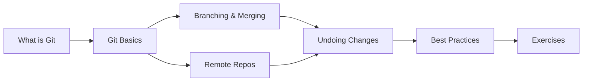

# 03 — Git & Version Control

> **Experience level: 🆕 Beginner (0 – 6 months)**

Version control is the tool that every developer uses every single day. Git tracks every change to your code, lets you experiment safely, collaborate with teams, and undo mistakes. This module makes you comfortable with Git before you write serious programs.

---

## 📂 Files in This Module

| File | What You'll Learn |
|------|-------------------|
| [What-is-Git.md](What-is-Git.md) | Version control concepts and the three states |
| [Git-Basics.md](Git-Basics.md) | Install, init, add, commit, status, log |
| [Branching-and-Merging.md](Branching-and-Merging.md) | Branching, merging, and resolving conflicts |
| [Remote-Repositories.md](Remote-Repositories.md) | GitHub, push, pull, clone |
| [Undoing-Changes.md](Undoing-Changes.md) | checkout, reset, revert, stash |
| [Git-Best-Practices.md](Git-Best-Practices.md) | Commit messages, .gitignore, workflows |
| [Exercises.md](Exercises.md) | Practice tasks for this module |

---

## 🎯 Learning Objectives

By the end of this module, you will be able to:

1. ✅ Explain what version control solves.
2. ✅ Create a repository and make commits.
3. ✅ Create and merge branches without fear.
4. ✅ Push code to GitHub and pull updates.
5. ✅ Undo mistakes safely with revert/reset/stash.

---

## 🧭 Module Map



---

## 📌 Quick Preview

```bash
git init                    # start a repository
git add .                   # stage all changes
git commit -m "My first commit"
git branch feature/login    # create a branch
git checkout feature/login  # switch to it
git push origin main        # upload to GitHub
```

---

## Next Module

➡️ [04 — Java Basics](../04-Java-Basics/README.md) — variables, types, and your first real programs.