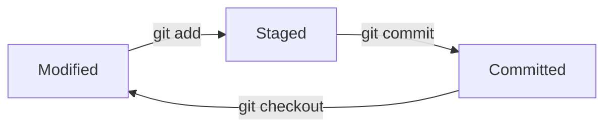

# What is Git?

## 1. Introduction

Git is a **distributed version control system** (DVCS) created by Linus Torvalds in 2005 to manage the Linux kernel source code. It records snapshots of your files over time so you can track changes, compare versions, and collaborate without ever losing work.

## 2. Why This Topic Is Important

- Every professional project — open source or corporate — uses Git or a Git-based platform (GitHub, GitLab, Bitbucket).
- Job interviews frequently assume you know Git fundamentals.
- It is your **safety net**: experiment freely, because you can always return to a working version.

## 3. Real-World Analogy

Think of Git like the **"undo history" in a word processor, shared by a whole team**. Every time you hit save (commit), the document is permanently recorded. If someone breaks a paragraph, you can jump back to the version before the break. Unlike a simple undo, everyone on the team can see the whole history.

## 4. Theory

### Key concepts

| Concept | Meaning |
|---------|---------|
| **Repository (repo)** | A folder tracked by Git, containing all history |
| **Commit** | A permanent snapshot of your files at a moment |
| **Working directory** | The files you are editing right now |
| **Staging area (index)** | The list of changes you have marked for the next commit |
| **Branch** | An independent line of development |
| **Remote** | A copy of the repo on another machine/server |

### The three states



- **Modified** — you changed a file but have not staged it.
- **Staged** — you marked the change for the next commit with `git add`.
- **Committed** — Git stored a permanent snapshot with `git commit`.

### Distributed vs centralized

In centralized systems (old SVN/CVS) there is one server with the history. In Git, **every clone contains the full history**, so you can work offline and your backup is any teammate's laptop.

## 5. Syntax

```bash
git init          # create a new repo
git status        # show current state
git add <file>    # stage a change
git commit -m "message"
git log           # show commit history
```

## 6. Flow Explanation

1. You edit a file → it becomes **modified**.
2. You run `git add` → the change is **staged**.
3. You run `git commit -m "..."` → the snapshot is **committed** to history.
4. Git stores commits as a chain — each commit knows its parent — giving you a complete timeline.

## 7. Memory Representation

Conceptually, Git stores commits as a graph:

```
commit1 <-- commit2 <-- commit3  (main branch)
```

Each commit points to its parent. The `.git` folder in your project stores this entire graph; your working files are just the latest "checked out" snapshot.

## 8. Simple Example

```bash
mkdir myproject
cd myproject
git init
echo "Hello" > hello.txt
git add hello.txt
git commit -m "Add hello file"
```

## 9. Intermediate Example

```bash
git status                     # see what changed
git diff                       # see the actual changes
git add hello.txt
git commit -m "Update greeting"
git log --oneline              # compact history
```

## 10. Advanced Example

```bash
git log --graph --all --decorate --oneline   # visualize branches
git show <commit-hash>                        # inspect a commit
git blame hello.txt                           # who changed each line
git tag v1.0.0                                # tag a release point
```

## 11. Output

After `git status` with no changes:

```
On branch main
nothing to commit, working tree clean
```

After a commit, Git prints a summary with the hash, author, and files changed.

## 12. Common Mistakes

| Mistake | Consequence | Fix |
|---------|-------------|-----|
| Committing secrets | Credentials in history | Use `.gitignore`; rotate secrets |
| Huge single commits | Hard to review/revert | Commit small and often |
| Not committing frequently | Lost work | Commit after each logical step |
| `git push` before checking | Forcing broken code to team | Run tests first |

## 13. Best Practices

- Write clear, imperative commit messages: `Add login form`, not `stuff`.
- Commit related changes together.
- Keep secrets and build output out of the repo (`.gitignore`).
- Pull/push regularly to avoid large divergences.
- Commit what you mean, mean what you commit.

## 14. Interview Questions

**Q: What is the difference between Git and GitHub?**
Git is the version control tool that runs locally; GitHub is an online hosting service for Git repositories.

**Q: What do the three Git states mean?**
Modified (changed, not staged), staged (marked for commit), committed (snapshot saved).

**Q: What is a merge conflict and when does it happen?**
It happens when two branches modify the same lines differently; Git cannot auto-merge and asks you to resolve manually.

## 15. Practice Exercises

1. Run `git init` in a practice folder and check `git status`.
2. Create a file, stage it, commit it, then check `git log`.
3. Modify the file and view the diff before committing again.

## 16. Coding Challenges

1. Reproduce the exact "three states" cycle five times in a row from memory.
2. Create 10 commits, then use `git log --oneline` to list them; identify a commit's hash and inspect it with `git show`.

## 17. Summary

- Git is a distributed version control system that snapshots your code.
- Files flow through three states: modified → staged → committed.
- Every clone holds full history, enabling offline work and safe collaboration.
- Commits form a graph; branches let you develop in parallel.
- Next, learn the everyday commands in **Git-Basics.md**.