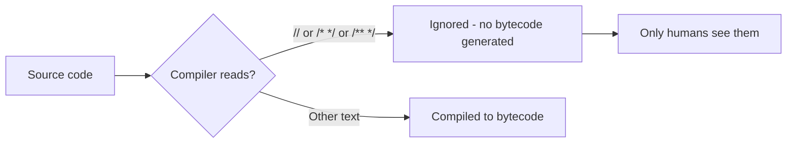

# Comments

## 1. Introduction

**Comments** are text in your code that the compiler **ignores** — they exist for humans. Java supports three styles: `//` single-line, `/* */` multi-line, and `/** */` Javadoc for generating documentation.

---

## 2. Why This Topic Is Important

- Comments turn confusing code into understandable code.
- **Javadoc** comments automatically generate professional API docs.
- Interviewers ask about comment types and best practices.
- Good commenting is a professional habit that signals quality.

---

## 3. Real-World Analogy

Comments are like **sticky notes on a recipe book**:

- `//` = a quick note on a single line ("preheat first").
- `/* */` = a longer explanation block.
- `/** */` = the detailed, formatted instructions at the top that get copied into the restaurant's menu binder (Javadoc docs).

---

## 4. Theory

### Three Types

| Style | Syntax | Purpose |
|-------|--------|---------|
| Single-line | `// text` | Brief notes |
| Multi-line | `/* text */` | Longer explanations |
| Javadoc | `/** text */` | Auto-generated documentation via `javadoc` tool |

### Where Comments Should Go
- **Class level**: describe what the class does.
- **Method level**: describe the method, parameters (`@param`), and return (`@return`).
- **Complex logic**: explain the *why*, not the *what*.

### The Cardinal Rule
> Comment the **"why"**, not the **"what"**. Code already shows *what* it does; comments should explain *why* it does it.

---

## 5. Syntax

```java
// Single-line comment
int x = 5; // trailing comment

/*
   Multi-line comment
   spanning several lines
*/

/**
 * This is a Javadoc comment.
 * @param name the user's name
 * @return a greeting string
 */
public String greet(String name) {
    return "Hi " + name;
}
```

---

## 6. Flow Explanation



Comments never reach the `.class` file.

---

## 7. Memory Representation

Comments consume **no runtime memory** — they are stripped during compilation.

---

## 8. Simple Example

```java
public class CommentsDemo {
    public static void main(String[] args) {
        // Print a welcome message
        System.out.println("Welcome to Java!");

        /* The line above prints
           a single message. */
    }
}
```

---

## 9. Intermediate Example — Meaningful Comments

```java
public class PriceCalculator {

    /**
     * Computes final price with tax.
     *
     * @param basePrice price before tax
     * @param taxRate   tax rate as decimal (e.g., 0.18)
     * @return total price including tax
     */
    public static double applyTax(double basePrice, double taxRate) {
        // Rounding to 2 decimals avoids floating-point display noise
        return Math.round(basePrice * (1 + taxRate) * 100) / 100.0;
    }

    public static void main(String[] args) {
        double total = applyTax(100, 0.18);
        System.out.println("Total with 18% tax: " + total);
    }
}
```

---

## 10. Advanced Example — Generating Javadoc

File: `MathUtil.java`

```java
/**
 * Math utility with common operations.
 * <p>
 * Safe for basic arithmetic use. Not for high-precision financial work.
 * </p>
 *
 * @author Your Name
 * @version 1.0
 */
public class MathUtil {

    /** Constant: ratio of circumference to diameter. */
    public static final double PI = 3.14159;

    /**
     * Returns the larger of two integers.
     *
     * @param a first integer
     * @param b second integer
     * @return the maximum of a and b
     */
    public static int max(int a, int b) {
        return a > b ? a : b;
    }
}
```

Generate documentation:

```powershell
javadoc -d docs MathUtil.java
```

This creates an `HTML` documentation site in the `docs` folder.

---

## 11. Output

For the **Intermediate Example**:

```
Total with 18% tax: 118.0
```

For `javadoc`: a folder of `.html` files opens in your browser with professional documentation.

---

## 12. Common Mistakes

| Mistake | Correction |
|---------|------------|
| Commenting the obvious (`// adds 1 to x`) | State *why*, not *what* |
| Writing long commented-out code blocks | Delete dead code — that's what Git history is for |
| Nesting `/* */` inside `/* */` | Not allowed — use `//` for inner notes |
| Forgetting Javadoc tags | Use `@param` and `@return` for documented methods |
| Using comments to hide bugs | Fix the bug, don't comment it out |

---

## 13. Best Practices

- Write comments that explain **"why"** and **"what problem"**.
- Use **Javadoc** for all public classes and methods.
- Keep comments short — a wall of comments is a maintenance smell.
- Update comments when code changes; stale comments lie.
- Remove commented-out code (use version control instead).

---

## 14. Interview Questions

**Q1. What are the three types of comments in Java?**
*`//` single-line, `/* */` multi-line, and `/** */` Javadoc.*

**Q2. Can comments be nested?**
*`//` and `/** */` cannot be nested inside `/* */`; Javadoc `/** */` cannot contain `/* */` either.*

**Q3. What is Javadoc?**
*A comment style `/** */` used by the `javadoc` tool to auto-generate HTML API documentation.*

**Q4. Do comments affect performance?**
*No — they're stripped by the compiler and never reach bytecode.*

**Q5. Should comments describe what the code does?**
*Preferably the "why". The code itself shows "what"; comments justify decisions, constraints, and tricky logic.*

---

## 15. Practice Exercises

1. Add single-line and multi-line comments to an existing program.
2. Write a Javadoc'd method with `@param` and `@return`.
3. Generate HTML docs with `javadoc` and open them.
4. Find a "what" comment in your code and rewrite it as a "why" comment.

---

## 16. Coding Challenges

1. **Easy:** Comment a 5-line program so a classmate could understand it.
2. **Medium:** Write a Javadoc'd `BankAccount` class with documented methods.
3. **Hard:** Create a small library with 3 classes, generate its full Javadoc, and navigate the generated HTML.

---

## 17. Summary

- Three comment styles: `//`, `/* */`, `/** */`.
- Comments are **stripped at compile time** — zero runtime cost.
- Explain **why**, not what.
- Use Javadoc for public APIs; generate docs with the `javadoc` tool.
- Keep comments in sync with code.

➡️ Continue to: [Keywords](Keywords.md)