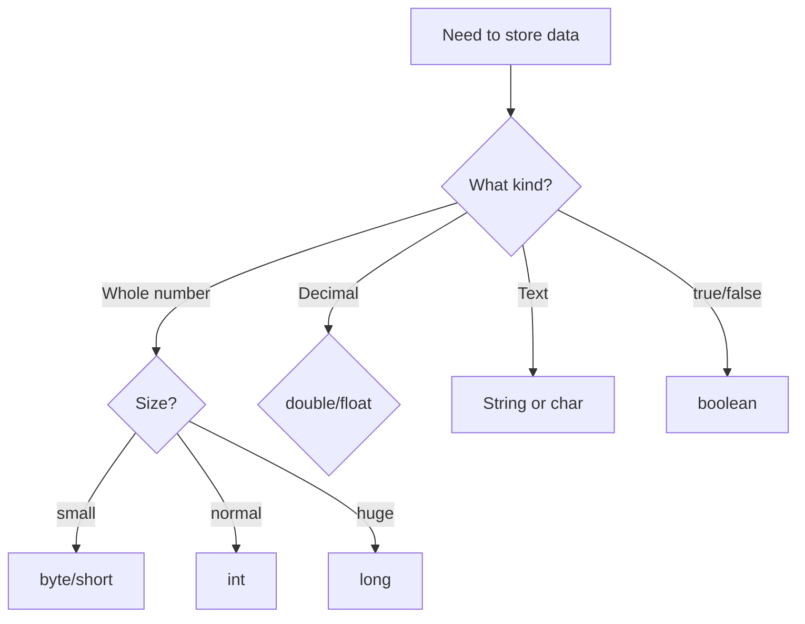
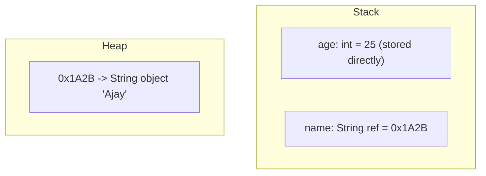

# Data Types

## 1. Introduction

Java has two categories of data types: **primitive types** (8 fixed types stored by value) and **reference types** (objects stored by address). Choosing the right type for your data is a core skill every Java developer must master.

---

## 2. Why This Topic Is Important

- Wrong type choices cause **overflow, precision loss, and memory waste**.
- Interviewers frequently test ranges, sizes, and defaults of primitives.
- The primitive vs reference distinction explains how Java stores everything.
- It's the foundation for casting, operators, and collections.

---

## 3. Real-World Analogy

Think of data types as **different containers** in a kitchen:

- `byte` = shot glass (tiny quantities)
- `int` = standard cup (everyday numbers)
- `double` = measuring jug (fractions & precision)
- `String` = recipe card (text)
- `boolean` = on/off light switch

You wouldn't measure soup in a shot glass or serve espresso in a bucket — pick the right container for the job.

---

## 4. Theory

### Primitive Types (8)

| Type | Size | Range / Values | Default |
|------|------|----------------|---------|
| `byte` | 1 byte | -128 to 127 | 0 |
| `short` | 2 bytes | -32,768 to 32,767 | 0 |
| `int` | 4 bytes | -2³¹ to 2³¹-1 (~ ±2.1 billion) | 0 |
| `long` | 8 bytes | -2⁶³ to 2⁶³-1 | 0L |
| `float` | 4 bytes | ~7 decimal digits | 0.0f |
| `double` | 8 bytes | ~15 decimal digits | 0.0d |
| `char` | 2 bytes | 0 to 65,535 (Unicode) | '\u0000' |
| `boolean` | 1 bit (JVM-dependent) | true / false | false |

### Reference Types
- **Classes** (e.g., `String`, your own classes)
- **Interfaces**
- **Arrays**

Reference variables store the **address** of an object in heap memory, not the value itself.

### Why the Range Matters
- `byte age = 200;` → **compile error**: "possible lossy conversion from int to byte" — the value 200 exceeds the byte range.

---

## 5. Syntax

```java
int count = 100;               // int literal
long population = 8_000_000_000L;  // note the L suffix
float pi = 3.14f;              // note the f suffix
double price = 199.99;         // default decimal type
char letter = 'A';             // single quotes
boolean isJavaFun = true;
String name = "Java";          // reference type, double quotes
```

---

## 6. Flow Explanation



---

## 7. Memory Representation



Primitives: value in stack. References: address in stack, object in heap.

---

## 8. Simple Example

```java
public class DataTypeDemo {
    public static void main(String[] args) {
        byte b = 100;
        short s = 30000;
        int i = 2_000_000_000;
        long l = 9_000_000_000L;
        float f = 3.14f;
        double d = 3.141592653589793;
        char c = 'J';
        boolean flag = true;

        System.out.println("byte   : " + b);
        System.out.println("short  : " + s);
        System.out.println("int    : " + i);
        System.out.println("long   : " + l);
        System.out.println("float  : " + f);
        System.out.println("double : " + d);
        System.out.println("char   : " + c);
        System.out.println("boolean: " + flag);
    }
}
```

---

## 9. Intermediate Example — Default Values

```java
public class DefaultValues {
    static byte b;
    static short s;
    static int i;
    static long l;
    static float f;
    static double d;
    static char c;
    static boolean bool;
    static String str;

    public static void main(String[] args) {
        System.out.println("byte=" + b + " short=" + s + " int=" + i + " long=" + l);
        System.out.println("float=" + f + " double=" + d);
        System.out.println("char='" + c + "' boolean=" + bool);
        System.out.println("String=" + str);
    }
}
```

---

## 10. Advanced Example — Practical Type Selection

```java
public class SmartTypes {
    public static void main(String[] args) {
        // Money: use double or BigDecimal for financial accuracy
        double salary = 75_000.50;

        // Counts: int is fine
        int students = 450;

        // Large totals: long
        long nationalDebt = 33_000_000_000_000L;

        // Single character
        char grade = 'A';

        // Flags
        boolean isPassed = grade != 'F';

        System.out.println("Salary: " + salary);
        System.out.println("Students: " + students);
        System.out.println("Debt: " + nationalDebt);
        System.out.println("Passed: " + isPassed);
    }
}
```

---

## 11. Output

For the **Simple Example**:

```
byte   : 100
short  : 30000
int    : 2000000000
long   : 9000000000
float  : 3.14
double : 3.141592653589793
char   : J
boolean: true
```

---

## 12. Common Mistakes

| Mistake | Correction |
|---------|------------|
| `float f = 3.14;` | Decimal literals are `double` — add `f` |
| `long l = 9999999999;` | Value exceeds int — add `L` |
| Using `double` for money | Use `BigDecimal` to avoid rounding errors |
| Forgetting char uses **single** quotes | `char c = "A";` is wrong; use `'A'` |
| Using `int` for huge numbers | Overflow silently wraps — use `long` |
| Confusing `char` and `String` | `char` = one character, `String` = text |

---

## 13. Best Practices

- Use `int` as the default whole-number type; `double` for decimals.
- Use `long` only when int's range is insufficient.
- Always suffix `L` for longs and `f` for floats.
- Use underscores for readability: `10_000_000`.
- For financial calculations use `BigDecimal`.

---

## 14. Interview Questions

**Q1. How many primitive types are in Java?**
*Eight: byte, short, int, long, float, double, char, boolean.*

**Q2. What is the size of an int?**
*4 bytes, range -2³¹ to 2³¹-1.*

**Q3. What is the difference between primitive and reference types?**
*Primitives store values directly and live on the stack; references store addresses to heap objects.*

**Q4. What is the default value of a primitive?**
*0 for numeric, '\u0000' for char, false for boolean. (Reference types default to null.)*

**Q5. Why is `String` not a primitive?**
*String is a class (reference type) with its own methods and immutability rules.*

---

## 15. Practice Exercises

1. Print the min/max values of int, double, and char using `Integer.MIN_VALUE`, etc.
2. Create a variable for each primitive type and print all 8.
3. Demonstrate an int overflow (add 1 to `Integer.MAX_VALUE`).
4. Show the difference between `char` and `String` with examples.

---

## 16. Coding Challenges

1. **Easy:** Print the range of `byte` and `short` using their wrapper constants.
2. **Medium:** Convert a `long` timestamp into years (assume 1 year = 31,536,000 seconds).
3. **Hard:** Write a program that calculates and prints the exact memory in bytes needed to store 1 million `int` values vs 1 million `long` values.

---

## 17. Summary

- 8 primitives: `byte short int long float double char boolean`.
- Primitives hold **values**; references hold **addresses**.
- Use `L` for long, `f` for float; `char` uses single quotes.
- Defaults: 0 / 0.0 / false / '\u0000' / null.
- Pick the smallest type that safely fits your data.

➡️ Continue to: [Literals](Literals.md)