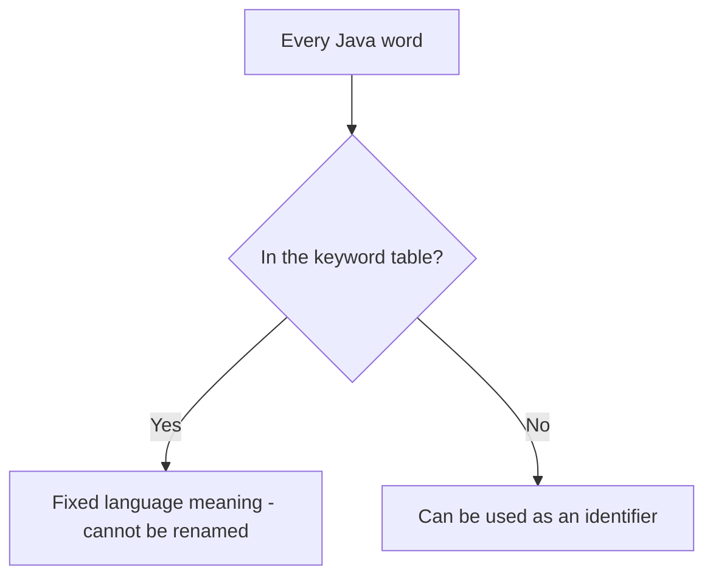

# Keywords

## 1. Introduction

**Keywords** (also called reserved words) are words with a **fixed meaning** in Java. You cannot use them as variable, class, or method names. There are 50+ keywords, plus a few *reserved literals* like `true`, `false`, and `null`.

---

## 2. Why This Topic Is Important

- Using a keyword as an identifier → **compile error**.
- Understanding each keyword's role helps you read and write Java faster.
- Interviewers quiz reserved words and their uses.
- It gives you a mental "map" of the language's core vocabulary.

---

## 3. Real-World Analogy

Keywords are like **traffic signs** — they have one fixed meaning and you can't repaint them for your own use. You can't put a "STOP" sign at your house entrance labeled "my driveway"; it means only one thing to every driver. Same with `if`, `class`, `return` — fixed meaning for every Java compiler.

---

## 4. Theory

### Keyword Categories

| Category | Keywords |
|----------|----------|
| **Data types** | `byte short int long float double char boolean` |
| **Class/object** | `class interface enum extends implements new` |
| **Access control** | `public private protected` |
| **Packages** | `package import` |
| **Flow control** | `if else switch case default` |
| **Loops** | `for while do` |
| **Jump** | `break continue return` |
| **OOP** | `this super instanceof` |
| **Methods** | `void static final abstract native synchronized` |
| **Exceptions** | `try catch finally throw throws` |
| **Memory** | `new` |
| **Concurrency** | `synchronized volatile` |
| **Others** | `var` (Java 10+), `record` (14+), `sealed` (17+), `yield` (14+), `_` (reserved) |

### Reserved Literals (not keywords but unusable)
- `true`, `false` — boolean values.
- `null` — no object reference.

### `var` (Java 10+)
`var` is a **reserved type name**, not a keyword. It infers the type from the initializer:

```java
var x = 10;        // x is int
var name = "Java"; // name is String
```

---

## 5. Syntax

```java
public class KeywordDemo {            // public, class
    public static void main(String[] args) {   // static, void
        int count = 0;                // int
        if (count == 0) {             // if
            count = 1;                // assignment
        } else {                      // else
            count = -1;
        }
        System.out.println(count);    // System (class), out (field)
    }
}
```

---

## 6. Flow Explanation



---

## 7. Memory Representation

Keywords themselves have no memory. But the constructs they declare (classes, variables, loops) create the runtime structures we've studied.

---

## 8. Simple Example — Many Keywords in One Program

```java
public class KeywordTour {
    public static void main(String[] args) {
        int x = 5;                // int
        double d = 2.5;           // double
        boolean flag = true;      // boolean, true
        String s = null;          // null
        System.out.println(x + " " + d + " " + flag + " " + s);
    }
}
```

---

## 9. Intermediate Example — Flow Keywords

```java
public class FlowKeywords {
    public static void main(String[] args) {
        for (int i = 1; i <= 5; i++) {
            if (i == 3) {
                continue;         // skip 3
            }
            if (i == 5) {
                break;            // stop at 5
            }
            System.out.println("i = " + i);
        }
    }
}
```

---

## 10. Advanced Example — `var` and `instanceof`

```java
public class ModernKeywords {
    public static void main(String[] args) {
        var number = 42;                 // var infers int
        var text = "Hello";              // var infers String

        Object obj = text;
        if (obj instanceof String str) { // pattern matching (Java 16+)
            System.out.println("obj is a String of length " + str.length());
        }

        System.out.println("number=" + number + " text=" + text);
    }
}
```

---

## 11. Output

For the **Intermediate Example**:

```
i = 1
i = 2
i = 4
```

For the **Advanced Example**:

```
obj is a String of length 5
number=42 text=Hello
```

---

## 12. Common Mistakes

| Mistake | Correction |
|---------|------------|
| `int class = 5;` | `class` is reserved — use `className` |
| `String public = "x";` | `public` is reserved — use a different name |
| Using `_` as an identifier | `_` is reserved since Java 9 |
| Using `true`/`false`/`null` as names | They are reserved literals |
| Thinking `var` is a full keyword | It's a reserved type name — only usable for local variables with an initializer |

---

## 13. Best Practices

- Never try to "work around" keywords — just pick better names.
- Know that keywords are **case-sensitive** (`class` ≠ `Class`).
- Use `var` only when it improves readability (avoid `var x = someWeirdLongMethodName();`).
- Follow naming conventions so keywords never tempt you (`nameClass` not `class`).

---

## 14. Interview Questions

**Q1. What is a keyword in Java?**
*A reserved word with a predefined meaning that cannot be used as an identifier.*

**Q2. Is `true` a keyword?**
*Technically it's a boolean literal / reserved word; it cannot be used as an identifier.*

**Q3. What is `var`?**
*A reserved type name (Java 10+) that infers the type of a local variable from its initializer.*

**Q4. How many keywords does Java have?**
*About 50+, plus reserved literals `true`, `false`, `null` (and `_` since Java 9).*

**Q5. Can you use a keyword as a method name?**
*No — the compiler will reject it.*

---

## 15. Practice Exercises

1. Try to compile `int if = 10;` and record the error message.
2. List 10 keywords from memory and their purposes.
3. Categorize keywords into: types, flow, OOP, exception, and concurrency.
4. Use `var` for three local variables and confirm the inferred types.

---

## 16. Coding Challenges

1. **Easy:** Write a valid program using at least 12 different keywords.
2. **Medium:** Write a program that demonstrates `this`, `super`, and `instanceof`.
3. **Hard:** Build a mini dictionary program that stores 15 keywords with their meanings in a Map and prints them.

---

## 17. Summary

- Keywords have **fixed meanings** and can't be identifiers.
- Categories: types, flow, OOP, exceptions, concurrency, and more.
- `true`, `false`, `null` are reserved literals.
- `var` (Java 10+) infers local variable types.
- Knowing keywords = reading Java faster.

➡️ Continue to: [Exercises](Exercises.md)