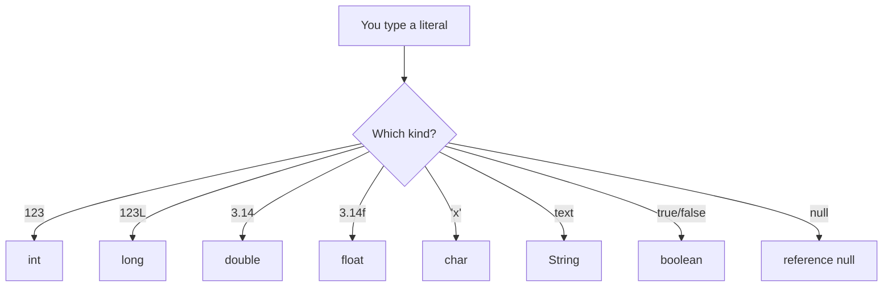

# Literals

## 1. Introduction

A **literal** is a value written directly in source code — like `42`, `3.14`, `'A'`, or `"hello"`. Literals are the raw ingredients your variables store. Understanding how to write them correctly (suffixes, bases, escapes) prevents subtle bugs.

---

## 2. Why This Topic Is Important

- Wrong literal suffixes (`3.14` vs `3.14f`) cause compile errors.
- String literals need escape characters for quotes, newlines, and tabs.
- Understanding number bases (hex, binary) is used in low-level coding.
- Interviewers test literals with tricky "what's the type?" questions.

---

## 3. Real-World Analogy

Literals are like **recipe measurements written in the recipe itself**: "add **3** eggs", "use **1.5** cups", "a pinch of salt". The values (3, 1.5, pinch) are fixed in the recipe — they're the literals. Variables are the mixing bowls where you put the measured ingredients.

---

## 4. Theory

### Types of Literals

| Category | Examples | Notes |
|----------|----------|-------|
| Integer | `42`, `0xFF`, `0b1010`, `1_000_000` | Decimal, hex (0x), binary (0b), octal (0), underscores |
| Floating-point | `3.14`, `3.14f`, `1e6` (scientific) | Default is `double`; `f`/`F` = float |
| Character | `'A'`, `'\n'`, `'\u0041'` | Single quotes; escapes and Unicode |
| String | `"Java"`, `"line1\nline2"` | Double quotes; supports escapes |
| Boolean | `true`, `false` | Only two possible values |
| Null | `null` | Reference types can be `null` |

### Escape Sequences
| Escape | Meaning |
|--------|---------|
| `\n` | New line |
| `\t` | Tab |
| `\'` | Single quote |
| `\"` | Double quote |
| `\\` | Backslash |
| `\uXXXX` | Unicode character |

### Integer Bases
| Prefix | Base | Example | Decimal value |
|--------|------|---------|---------------|
| (none) | Decimal | `255` | 255 |
| `0x`/`0X` | Hexadecimal | `0xFF` | 255 |
| `0b`/`0B` | Binary | `0b11111111` | 255 |
| `0` | Octal | `0377` | 255 |

---

## 5. Syntax

```java
int decimal = 100;              // decimal
int hex     = 0x64;             // hexadecimal = 100
int binary  = 0b1100100;        // binary = 100
long big    = 100L;             // long literal
float pi    = 3.14f;            // float literal
double bigP = 3.14e2;           // 314.0 scientific
char c1     = 'A';              // char literal
char c2     = '\u0041';         // same char via Unicode = 'A'
String s    = "Tab\there\n";    // escape sequences
boolean ok  = true;
String n    = null;
```

---

## 6. Flow Explanation



---

## 7. Memory Representation

- Integer/float literals fit in registers or stack slots.
- String literals live in the **String Constant Pool** in the heap (see Module 08).
- `char` literals are 2-byte Unicode values.

---

## 8. Simple Example

```java
public class LiteralDemo {
    public static void main(String[] args) {
        System.out.println("Decimal : " + 100);
        System.out.println("Hex     : " + 0x64);
        System.out.println("Binary  : " + 0b1100100);
        System.out.println("Char    : " + 'A');
        System.out.println("Boolean : " + true);
    }
}
```

---

## 9. Intermediate Example — Escape Characters

```java
public class Escapes {
    public static void main(String[] args) {
        System.out.println("Line1\nLine2");          // newline
        System.out.println("Col1\tCol2\tCol3");      // tabs
        System.out.println("Quote: \"Java rocks\""); // double quotes
        System.out.println("Backslash: \\");          // backslash
        System.out.println("Unicode: \u2665");        // heart symbol
    }
}
```

---

## 10. Advanced Example — Literal Type Detection

```java
public class LiteralTypes {
    public static void main(String[] args) {
        // 100 is int; 100L is long
        long a = 100;        // int widened to long (implicit)
        float b = 100;       // int widened to float
        double c = 100;      // int widened to double
        float d = 3.14f;     // float literal (required)
        // float e = 3.14;   // ERROR: double cannot be narrowed implicitly

        System.out.println("long a = " + a);
        System.out.println("float b = " + b);
        System.out.println("double c = " + c);
        System.out.println("float d = " + d);
        System.out.println("Scientific 1e3 = " + 1e3);
        System.out.println("Underscored 1_000_000 = " + 1_000_000);
    }
}
```

---

## 11. Output

For the **Intermediate Example**:

```
Line1
Line2
Col1	Col2	Col3
Quote: "Java rocks"
Backslash: \
Unicode: ♥
```

---

## 12. Common Mistakes

| Mistake | Correction |
|---------|------------|
| `float f = 3.14;` | Add `f`: `float f = 3.14f;` |
| `long x = 9999999999;` | Add `L` — value exceeds int range |
| Using double quotes for a char | `char c = "A";` → error; use `'A'` |
| Forgetting `\` in escapes | `System.out.println("a\b");` interprets `\b` as backspace |
| Leading zeros treated as octal | `int x = 010;` = 8, not 10 (avoid leading zeros) |
| Thinking `null` is a primitive | `null` only applies to reference types |

---

## 13. Best Practices

- Use **underscores** for large numbers: `1_000_000_000`.
- Always suffix `L` for long, `f` for float literals.
- Prefer decimal over octal (octal is rarely needed).
- Use `\uXXXX` sparingly — it's less readable than the actual character.
- Write scientific notation for huge/small values: `6.02e23`.

---

## 14. Interview Questions

**Q1. What is the type of the literal `3.14`?**
*It is a `double` because decimal literals default to double.*

**Q2. How do you write a binary literal?**
*With the `0b` prefix, e.g., `0b1010` = 10.*

**Q3. What does `0xFF` equal?**
*255 in decimal — it's a hex literal.*

**Q4. What is the default type of integer literals?**
*`int`. To create a `long`, append `L`.*

**Q5. What are escape sequences?**
*Special backslash codes in literals to represent non-printable characters like `\n`, `\t`, `\"`.*

---

## 15. Practice Exercises

1. Write the same decimal value 255 in decimal, hex, binary, and octal.
2. Print a table using `\t` separators for 5 columns.
3. Print a heart character using a Unicode escape.
4. Demonstrate the `float` suffix requirement with a compile error.

---

## 16. Coding Challenges

1. **Easy:** Print 10 in 4 different bases (decimal, hex, binary, octal).
2. **Medium:** Write a program that prints a small box using escape sequences and Unicode block characters.
3. **Hard:** Determine the exact type of each of these literals and print your reasoning: `0b11`, `0x1F`, `1_2_3`, `1e2`, `'\n'`, `true`.

---

## 17. Summary

- Literals are **raw values in code**: integers, floats, chars, strings, booleans, null.
- Suffixes: `L` for long, `f` for float.
- Bases: `0x` hex, `0b` binary, `0` octal.
- Escape sequences: `\n`, `\t`, `\"`, `\\`, `\uXXXX`.
- Decimal literals default to `double`; integer literals default to `int`.

➡️ Continue to: [Type Casting](Type-Casting.md)