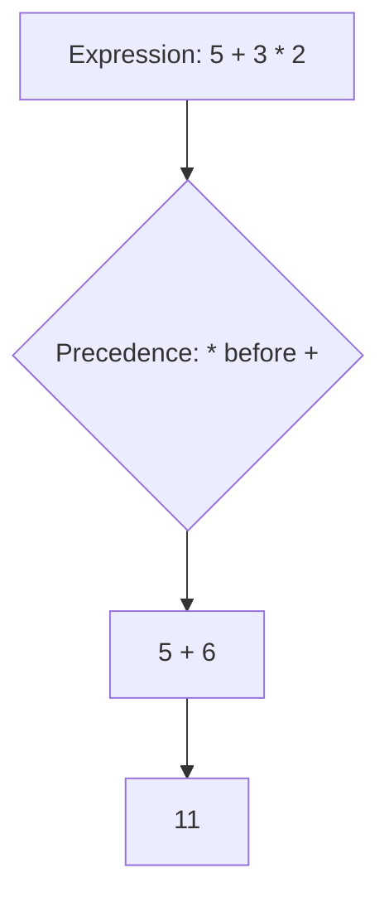

# Operators

## 1. Introduction

**Operators** are symbols that perform operations on values: arithmetic (`+`, `-`, `*`, `/`), comparison (`==`, `<`), logical (`&&`, `||`), and more. They are the verbs of a programming language — they make data *do things*.

---

## 2. Why This Topic Is Important

- Operators appear in **every line of real code**.
- Interviewers test tricky precedence and type-promotion questions.
- Misusing `=` vs `==`, or `&&` vs `&`, causes classic bugs.
- Mastering operators = mastering expression evaluation.

---

## 3. Real-World Analogy

Operators are like **kitchen instructions in a recipe**:

- `+` = "add"
- `-` = "subtract"
- `*` = "multiply portions"
- `==` = "is this the same?"
- `&&` = "both conditions must hold" (e.g., "heat AND mix")

The recipe reader (JVM) follows these instructions in a strict order — that order is **operator precedence**.

---

## 4. Theory

### Categories of Operators

#### 1. Arithmetic
`+  -  *  /  %` (modulus/remainder)

#### 2. Relational (Comparison)
`==  !=  >  <  >=  <=` — return `boolean`

#### 3. Logical
`&&` (AND), `||` (OR), `!` (NOT)

#### 4. Assignment
`=  +=  -=  *=  /=  %=`

#### 5. Increment / Decrement
`++` and `--` (prefix vs postfix)

#### 6. Ternary
`condition ? valueIfTrue : valueIfFalse`

#### 7. Bitwise
`&  |  ^  ~  <<  >>  >>>`

### Operator Precedence (high → low)
| Level | Operators |
|-------|-----------|
| 1 | `()` `[]` |
| 2 | `++ -- !` (unary) |
| 3 | `* / %` |
| 4 | `+ -` |
| 5 | `<< >> >>>` |
| 6 | `< <= > >=` |
| 7 | `== !=` |
| 8 | `&` |
| 9 | `^` |
| 10 | `\|` |
| 11 | `&&` |
| 12 | `\|\|` |
| 13 | `?:` |
| 14 | `= += -= ...` |

### Integer Division Gotcha
`7 / 2` = **3** (both int → integer division). Use `7 / 2.0` = 3.5.

### Modulus
`10 % 3` = 1 (remainder after dividing).

### Short-Circuit Behavior
- `&&` and `||` **short-circuit**: if the result is decided by the left operand, the right side isn't evaluated. This avoids errors like `list != null && list.size() > 0`.

---

## 5. Syntax

```java
int sum = 10 + 5;                 // arithmetic
boolean eq = (10 == 5);           // relational
boolean both = (true && false);   // logical
int x = 5; x += 3;                // assignment + arithmetic
int y = x++;                      // postfix increment (y=8, x=9)
int z = ++x;                      // prefix increment (x=10, z=10)
String msg = (x > 8) ? "big" : "small";  // ternary
```

---

## 6. Flow Explanation



The JVM evaluates using precedence, then left-to-right for equal-level operators.

---

## 7. Memory Representation

Operators execute on values held in stack frames. Intermediate results are computed on the JVM's **operand stack**. For example, `a = b + c` loads `b`, loads `c`, adds, stores to `a`.

---

## 8. Simple Example

```java
public class OperatorsDemo {
    public static void main(String[] args) {
        int a = 10, b = 3;
        System.out.println("a + b = " + (a + b));
        System.out.println("a - b = " + (a - b));
        System.out.println("a * b = " + (a * b));
        System.out.println("a / b = " + (a / b) + "  (int division)");
        System.out.println("a % b = " + (a % b));
    }
}
```

---

## 9. Intermediate Example — Logic & Ternary

```java
public class LogicDemo {
    public static void main(String[] args) {
        int age = 20;
        boolean hasID = true;

        boolean canEnter = (age >= 18) && hasID;
        String result = canEnter ? "Welcome in" : "Access denied";
        System.out.println(result);

        String username = "";
        String display = username.isEmpty() ? "Guest" : username;
        System.out.println("Displaying as: " + display);
    }
}
```

---

## 10. Advanced Example — Short-Circuit & Bitwise

```java
public class AdvancedOps {
    public static void main(String[] args) {
        // Short-circuit prevents NPE
        String name = null;
        if (name != null && name.length() > 3) {
            System.out.println("Long name");
        } else {
            System.out.println("Short-circuit saved us from NPE");
        }

        // Bitwise operations
        int flags = 0b1100;
        int mask   = 0b1010;
        System.out.println("flags & mask = " + Integer.toBinaryString(flags & mask));
        System.out.println("flags | mask = " + Integer.toBinaryString(flags | mask));
        System.out.println("flags ^ mask = " + Integer.toBinaryString(flags ^ mask));
        System.out.println("flags << 1   = " + Integer.toBinaryString(flags << 1));
    }
}
```

---

## 11. Output

For the **Simple Example**:

```
a + b = 13
a - b = 7
a * b = 30
a / b = 3  (int division)
a % b = 1
```

For the **Advanced Example**:

```
Short-circuit saved us from NPE
flags & mask = 1000
flags | mask = 1110
flags ^ mask = 0110
flags << 1   = 11000
```

---

## 12. Common Mistakes

| Mistake | Correction |
|---------|------------|
| `if (x = 5)` instead of `if (x == 5)` | `=` assigns; `==` compares |
| Expecting `7 / 2` = 3.5 | Integer division truncates; use `7 / 2.0` |
| Forgetting precedence | Parenthesize complex expressions |
| Confusing `&` and `&&` | `&&` short-circuits; `&` always evaluates both |
| Mixing `++` prefix and postfix | Prefix increments first; postfix returns old value |
| Writing `a < b < c` | Java has no chained comparison; use `a < b && b < c` |

---

## 13. Best Practices

- Parenthesize for **readability**, even when precedence is correct.
- Prefer `&&`/`||` over `&`/`|` for boolean logic.
- Use `+=` style compound assignments for clarity.
- Avoid side effects inside conditions (e.g., `if (x++ > 5)`).
- Use `Integer.divideUnsigned` when unsigned division matters.

---

## 14. Interview Questions

**Q1. What is the result of `7 / 2` in Java?**
*3 — both operands are int, so integer division applies.*

**Q2. What is the difference between `&` and `&&`?**
*`&&` is short-circuit logical AND; `&` is bitwise AND (and non-short-circuit logical).*

**Q3. What is the difference between `++i` and `i++`?**
*`++i` increments first, returns new value; `i++` returns old value, then increments.*

**Q4. What is the ternary operator?**
*`condition ? a : b` — a compact if/else expression.*

**Q5. What is operator precedence?**
*The order in which operators are evaluated; `*`/`/` before `+`/`-`, and so on.*

---

## 15. Practice Exercises

1. Compute and print results for all arithmetic operators with `a=15, b=4`.
2. Evaluate a short-circuit example that would throw NPE without short-circuiting.
3. Use the ternary operator to assign a pass/fail string.
4. Print bitwise results for `12 & 10` in decimal and binary.

---

## 16. Coding Challenges

1. **Easy:** Check if a number is even using `%`.
2. **Medium:** Write a program that swaps two numbers using XOR (`^`), no temp variable.
3. **Hard:** Implement a simple calculator using all arithmetic operators, handling division by zero with a check.

---

## 17. Summary

- Categories: arithmetic, relational, logical, assignment, increment, ternary, bitwise.
- `7 / 2` = 3 (int division); use `2.0` for decimals.
- `&&`/`||` short-circuit; `&`/`|` don't.
- `++i` vs `i++`: prefix vs postfix semantics.
- Use parentheses to control and clarify precedence.

➡️ Continue to: [User Input](User-Input.md)