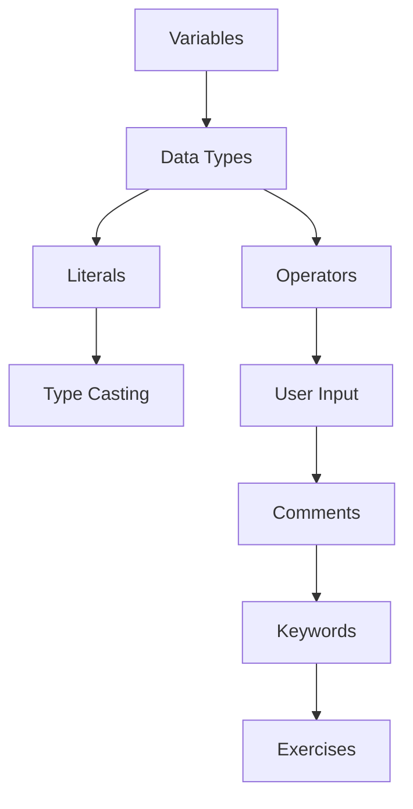

# 04 — Java Basics

> This module is where the real programming begins. You'll learn how to **store data** (variables and data types), **operate on data** (operators), **receive input** from the user, and write clean code with **comments**. These are the building blocks used in every program you will ever write.

---

## 📂 Files in This Module

| File | What You'll Learn |
|------|-------------------|
| [Variables.md](Variables.md) | Declaring variables, naming rules, and storage |
| [Data-Types.md](Data-Types.md) | Primitive vs reference types, ranges, sizes |
| [Literals.md](Literals.md) | Writing values in code: numbers, chars, strings, booleans |
| [Type-Casting.md](Type-Casting.md) | Implicit & explicit conversion between types |
| [Operators.md](Operators.md) | Arithmetic, relational, logical, assignment, and more |
| [User-Input.md](User-Input.md) | Reading keyboard input with the `Scanner` class |
| [Comments.md](Comments.md) | Single-line, multi-line, and Javadoc comments |
| [Keywords.md](Keywords.md) | Reserved words in Java and their roles |
| [Exercises.md](Exercises.md) | Practice tasks for this module |

---

## 🎯 Learning Objectives

By the end of this module, you will be able to:

1. ✅ Declare and use variables of every primitive data type.
2. ✅ Convert between types safely with casting.
3. ✅ Perform calculations and comparisons with operators.
4. ✅ Read and process user input.
5. ✅ Write self-documenting code with comments.
6. ✅ Avoid reserved keywords as identifiers.

---

## 🧭 Module Map



Read in this order — each topic builds on the previous.

---

## 🚀 What You'll Be Able to Build

By the end of this module you can write programs like a **temperature converter**, a **simple calculator**, and an **age checker** — real, interactive programs.

---

## 📌 Quick Preview

```java
import java.util.Scanner;

public class BasicsPreview {
    public static void main(String[] args) {
        Scanner sc = new Scanner(System.in);
        System.out.print("Enter your age: ");
        int age = sc.nextInt();
        boolean adult = age >= 18;
        System.out.println("You are an adult: " + adult);
        sc.close();
    }
}
```

You'll understand every line of this by the end of the module.

---

## Next Module

➡️ [05 — Control Statements](../05-Control-Statements/README.md) — make programs *decide* and *repeat* with if/else and loops.