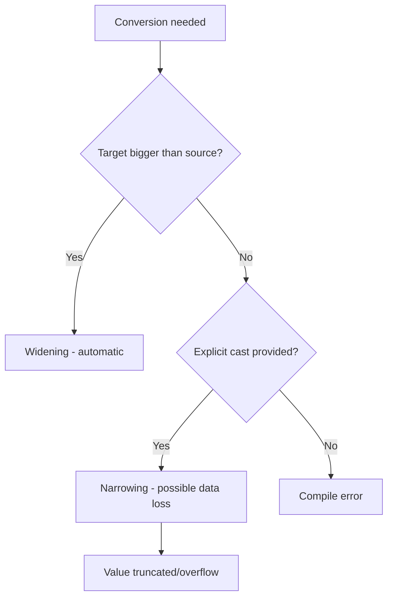

# Type Casting

## 1. Introduction

**Type casting** is converting a value from one data type to another. Java supports **implicit casting** (widening, automatic) and **explicit casting** (narrowing, manual). Mastering casting prevents precision loss and the dreaded "incompatible types" compile errors.

---

## 2. Why This Topic Is Important

- You'll constantly mix types in real code: `double result = int / double;`
- Interviewers ask about widening vs narrowing and their risks.
- Wrong casting silently corrupts data (e.g., `(byte) 300` = 44).
- Casting is essential for parsing strings, math, and file processing.

---

## 3. Real-World Analogy

Casting is like **pouring water between containers**:

- **Widening** (int → long): pour into a *bigger* jug — safe, nothing spills.
- **Narrowing** (long → int): pour into a *smaller* glass — dangerous, water overflows.
- **Casting** (double → int): deliberately dropping the liquid droplets below the measurement line (truncation) — you choose to lose the decimal part.

---

## 4. Theory

### Widening (Implicit / Automatic)
Smaller type → larger type. **Always safe**, Java does it automatically:

```
byte → short → int → long → float → double
              ↑
             char
```

- `int` → `long`, `long` → `float`, etc.
- No data loss because the target holds a wider range.

### Narrowing (Explicit / Manual)
Larger type → smaller type. **Risky** — requires a cast operator:

```java
double d = 9.7;
int i = (int) d;        // 9 (truncates the fraction)
```

- Data may be **truncated** (fraction lost) or **overflow** (value wraps around).
- The compiler demands an explicit cast because it can't guarantee safety.

### Special Cases
- `char` to `int` and back preserves Unicode codes.
- `int` to `float` is widening but can lose precision (float has ~7 digits).
- String ↔ numbers is **not** casting — use `Integer.parseInt()`.

---

## 5. Syntax

```java
// Widening: automatic
int i = 100;
long l = i;

// Narrowing: explicit cast
double d = 100.99;
int x = (int) d;         // x = 100

// char to int
int code = 'A';          // 65
char ch = (char) 66;     // 'B'
```

---

## 6. Flow Explanation



---

## 7. Memory Representation

- **Widening**: the value is written into a larger slot (e.g., int 4 bytes → long 8 bytes), with sign extension.
- **Narrowing**: the value is cut to fit the smaller slot — high bits dropped, causing overflow.
- **double → int**: the fraction is discarded; the integer part remains.

---

## 8. Simple Example

```java
public class CastingDemo {
    public static void main(String[] args) {
        int i = 500;
        long l = i;                  // widening: automatic
        System.out.println("long from int: " + l);

        double d = 99.99;
        int truncated = (int) d;     // narrowing: explicit
        System.out.println("int from double: " + truncated);
    }
}
```

---

## 9. Intermediate Example — Overflow Behavior

```java
public class CastingRisks {
    public static void main(String[] args) {
        int big = 300;
        byte small = (byte) big;     // overflow!
        System.out.println("(byte) 300 = " + small);

        double d = 3.9;
        int t = (int) d;
        System.out.println("(int) 3.9 = " + t + "  (fraction dropped)");

        char letter = 'A';
        int code = letter;           // widening char -> int
        System.out.println("char 'A' as int = " + code);
    }
}
```

---

## 10. Advanced Example — Practical Mixed-Type Math

```java
public class MixedMath {
    public static void main(String[] args) {
        int total = 7;
        int count = 2;

        double avg = (double) total / count;   // cast before division!
        System.out.println("Average (double): " + avg);

        int avgInt = total / count;            // integer division
        System.out.println("Average (int)   : " + avgInt);

        // Mixing types promotes to the widest
        long result = 10 + 20L;                // long
        double result2 = 10 + 2.5;             // double
        System.out.println("Mixed long  : " + result);
        System.out.println("Mixed double: " + result2);
    }
}
```

---

## 11. Output

For the **Intermediate Example**:

```
(byte) 300 = 44
(int) 3.9 = 3  (fraction dropped)
char 'A' as int = 65
```

For the **Advanced Example**:

```
Average (double): 3.5
Average (int)   : 3
Mixed long  : 30
Mixed double: 12.5
```

---

## 12. Common Mistakes

| Mistake | Correction |
|---------|------------|
| `int x = 10.5;` | Decimal defaults to double; add cast: `(int) 10.5` |
| `(byte) 300` expecting 300 | Byte max is 127 — overflow produces 44 |
| `int / int` when you need a decimal | Cast one operand: `(double) a / b` |
| Casting a String with `(int)` | Strings need `Integer.parseInt()`, not casting |
| Narrowing without a cast | Compiler error: "incompatible types / lossy conversion" |
| Thinking truncation rounds | `(int) 3.9` = 3, not 4 — it **truncates** |

---

## 13. Best Practices

- Prefer `double` for division results; cast **before** the operator.
- Use `Math.round()` when you need rounding, not truncation.
- Avoid narrowing casts in financial code — use `BigDecimal`.
- Check overflow before narrowing in critical logic.

---

## 14. Interview Questions

**Q1. What is widening vs narrowing casting?**
*Widening converts to a larger type automatically (int→long); narrowing converts to a smaller type manually with a cast ((byte) x) and risks data loss.*

**Q2. Does `(int) 3.9` produce 3 or 4?**
*3 — casting truncates toward zero; it does not round.*

**Q3. What is the type promotion rule in expressions?**
*The result type is the widest type among operands; byte/short/char promote to int in arithmetic.*

**Q4. Can you cast a String to int?**
*No — casting works on numeric/boolean types. Use `Integer.parseInt(String)`.*

**Q5. What happens if you cast a value outside the target range?**
*Overflow: the value wraps (e.g., `(byte) 300` = 44).*

---

## 15. Practice Exercises

1. Convert `int` to `double` implicitly and print both.
2. Convert `double 7.99` to `int` and note the result.
3. Show overflow: cast `Integer.MAX_VALUE` to `short`.
4. Write a division that produces 2.5 instead of 2.

---

## 16. Coding Challenges

1. **Easy:** Convert a `char` 'Z' to int and back, printing both.
2. **Medium:** Write a program that converts seconds (long) into hours, minutes, seconds.
3. **Hard:** Implement a temperature converter (Celsius↔Fahrenheit) using proper casts, then round results with `Math.round`.

---

## 17. Summary

- **Widening** = automatic, safe (int→long→float→double).
- **Narrowing** = manual cast `(type)`, risky (truncation/overflow).
- Cast **before division** to avoid integer division.
- Strings convert with parse methods, not casts.
- `(int) 3.9` truncates to 3; use `Math.round()` to round.

➡️ Continue to: [Operators](Operators.md)