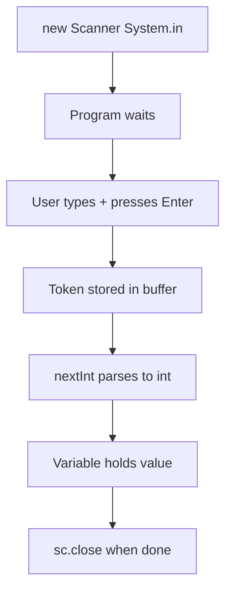

# User Input

## 1. Introduction

Programs become useful when they can **react to user input**. In Java, the classic tool for console input is the **`Scanner`** class (from `java.util`). With it, your programs become interactive instead of static.

---

## 2. Why This Topic Is Important

- **Interactive programs** are the foundation of all real applications.
- Every CLI tool reads input: calculators, menu apps, games.
- Interviewers test `Scanner` edge cases (nextInt vs nextLine, closing).
- Understanding input flows into file reading (Module 13) and network input.

---

## 3. Real-World Analogy

`Scanner` is like a **receptionist at a hotel**. The receptionist (Scanner) stands at the door (System.in) and, one by one, asks you for pieces of information: name (nextLine), age (nextInt), salary (nextDouble). When you've given everything, you can check out (close the scanner).

---

## 4. Theory

### Creating a Scanner
```java
Scanner sc = new Scanner(System.in);
```
- `System.in` = the keyboard (standard input stream).
- `Scanner` parses that stream into tokens.

### Key Methods
| Method | Returns | Reads |
|--------|---------|-------|
| `next()` | String | One word |
| `nextLine()` | String | Whole line |
| `nextInt()` | int | Integer |
| `nextDouble()` | double | Decimal |
| `nextBoolean()` | boolean | true/false |
| `hasNext()` / `hasNextInt()` | boolean | Checks what's available |

### The `nextInt()` + `nextLine()` Trap
`nextInt()` reads the number but **leaves the Enter key** (`\n`) in the buffer. The next `nextLine()` immediately consumes that leftover empty line. **Fix:** call `sc.nextLine()` once after `nextInt()` to consume the newline.

---

## 5. Syntax

```java
import java.util.Scanner;

Scanner sc = new Scanner(System.in);
String name = sc.nextLine();
int age = sc.nextInt();
double height = sc.nextDouble();
sc.close();
```

---

## 6. Flow Explanation



---

## 7. Memory Representation

`System.in` is an InputStream. `Scanner` wraps it and reads from a buffer. Strings read from input are new objects in the heap.

---

## 8. Simple Example

```java
import java.util.Scanner;

public class InputDemo {
    public static void main(String[] args) {
        Scanner sc = new Scanner(System.in);
        System.out.print("Enter your name: ");
        String name = sc.nextLine();
        System.out.println("Hello, " + name + "!");
        sc.close();
    }
}
```

---

## 9. Intermediate Example — Multiple Types

```java
import java.util.Scanner;

public class CollectData {
    public static void main(String[] args) {
        Scanner sc = new Scanner(System.in);

        System.out.print("Name: ");
        String name = sc.nextLine();

        System.out.print("Age: ");
        int age = sc.nextInt();

        System.out.print("Monthly salary: ");
        double salary = sc.nextDouble();

        System.out.println("--- Profile ---");
        System.out.println("Name   : " + name);
        System.out.println("Age    : " + age);
        System.out.println("Salary : $" + salary);
        sc.close();
    }
}
```

---

## 10. Advanced Example — Handling the newline trap

```java
import java.util.Scanner;

public class InputFix {
    public static void main(String[] args) {
        Scanner sc = new Scanner(System.in);

        System.out.print("Enter roll number: ");
        int roll = sc.nextInt();
        sc.nextLine();                 // consume leftover newline!

        System.out.print("Enter full name: ");
        String name = sc.nextLine();

        System.out.println("Roll: " + roll + " | Name: " + name);
        sc.close();
    }
}
```

### Bonus — safe integer reading with validation:

```java
import java.util.Scanner;

public class SafeInput {
    public static void main(String[] args) {
        Scanner sc = new Scanner(System.in);
        System.out.print("Enter an integer: ");
        while (!sc.hasNextInt()) {
            System.out.print("That's not an integer. Try again: ");
            sc.next();
        }
        int n = sc.nextInt();
        System.out.println("You entered: " + n);
        sc.close();
    }
}
```

---

## 11. Output

For the **Advanced Example** (user types `101` then `Ajay Kumar`):

```
Enter roll number: 101
Enter full name: Ajay Kumar
Roll: 101 | Name: Ajay Kumar
```

For the **SafeInput** example (user types `abc`, then `42`):

```
Enter an integer: abc
That's not an integer. Try again: 42
You entered: 42
```

---

## 12. Common Mistakes

| Mistake | Correction |
|---------|------------|
| Forgetting `import java.util.Scanner;` | Compile error: "cannot find symbol" |
| `nextInt()` then `nextLine()` skipping | Consume the newline with an extra `nextLine()` |
| Not closing the Scanner | Call `sc.close()` to release the stream |
| Reading `next()` when you want a full name | `next()` stops at spaces — use `nextLine()` |
| No input validation | Use `hasNextInt()` before `nextInt()` |

---

## 13. Best Practices

- Always **close** the Scanner (`sc.close()`) or use try-with-resources (Module 10).
- Prefer `nextLine()` for text, `nextInt()` for numbers.
- Validate input with `hasNext...` loops.
- Print prompts with `System.out.print` (no newline) for a natural feel.

---

## 14. Interview Questions

**Q1. What is the Scanner class?**
*A class in `java.util` that reads primitive types and strings from input streams, typically `System.in`.*

**Q2. Why does `nextLine()` sometimes skip input after `nextInt()`?**
*Because `nextInt()` leaves the trailing newline in the buffer, and `nextLine()` consumes that leftover empty line.*

**Q3. What is the difference between `next()` and `nextLine()`?**
*`next()` reads one whitespace-delimited token; `nextLine()` reads the entire line including spaces.*

**Q4. What happens if you enter text when `nextInt()` is called?**
*An `InputMismatchException` is thrown.*

**Q5. Why should you close the Scanner?**
*To release the underlying stream resource and avoid resource leaks.*

---

## 15. Practice Exercises

1. Read your name and age, then print a sentence.
2. Read three numbers and print their sum and average.
3. Reproduce the `nextInt()`+`nextLine()` trap, then fix it.
4. Build a safe-input loop that rejects non-integers.

---

## 16. Coding Challenges

1. **Easy:** Ask the user for two numbers and print sum, product, and difference.
2. **Medium:** Ask for full name and age; print initials and age in months.
3. **Hard:** Build a mini ATM: ask for amount, deposit/withdraw, and maintain a running balance until the user types "exit".

---

## 17. Summary

- `Scanner sc = new Scanner(System.in);` reads console input.
- `nextLine()` = full line; `nextInt()`/`nextDouble()` = typed values.
- Watch the **newline trap** after numeric reads.
- Validate with `hasNextInt()` loops.
- Close the Scanner when done.

➡️ Continue to: [Comments](Comments.md)