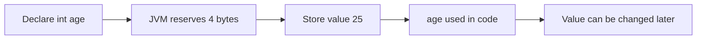
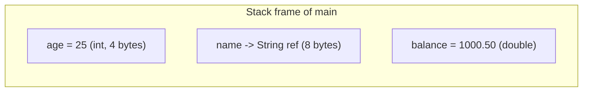

# Variables

## 1. Introduction

A **variable** is a named storage location in memory that holds a value which can change during program execution. Think of it as a labeled box: you choose the label (name), the box type (data type), and what goes inside (value).

---

## 2. Why This Topic Is Important

- **Every program uses variables** — without them you cannot process data.
- Understanding variables is the prerequisite for all of Java.
- Interviewers test naming rules, defaults, and scope.
- Correct variable design prevents bugs and makes code readable.

---

## 3. Real-World Analogy

A variable is like a **labelled storage box**:

- The **label** is the variable name (`age`).
- The **box type** is the data type (`int` = box for whole numbers).
- The **item inside** is the value (`25`).

You can replace the item anytime (reassign), but the box type stays the same.

---

## 4. Theory

### Variable Declaration & Initialization

```java
int age;          // declaration: creates a box named 'age' of type int
age = 25;         // assignment: puts 25 into the box
int score = 90;   // declaration + initialization in one line
int a, b, c;      // declare multiple variables at once
```

### Rules for Variable Names (Identifiers)
- Must start with a letter, `_`, or `$` (not a digit).
- After the first character, letters, digits, `_`, and `$` are allowed.
- **Case-sensitive**: `age` ≠ `Age`.
- Cannot be a **reserved keyword** (like `class`, `int`, `if`).
- Should follow **camelCase** convention: `totalMarks`, `bankBalance`.

### Local vs Instance vs Static Variables
| Type | Where Declared | Default Value | Lifetime |
|------|----------------|---------------|----------|
| Local | Inside a method | No default — must initialize | Until method ends |
| Instance | Inside class, no `static` | Type default (0, null) | While object lives |
| Static | Inside class, with `static` | Type default | While class is loaded |

### Scope
A variable is visible only inside the block `{ }` where it is declared.

---

## 5. Syntax

```java
type variableName = value;   // declaration + init
variableName = newValue;     // reassignment
```

---

## 6. Flow Explanation



---

## 7. Memory Representation



- Primitive values live directly in the stack/local area.
- Reference variables store an **address** pointing to an object in the heap.

---

## 8. Simple Example

```java
public class VariableDemo {
    public static void main(String[] args) {
        int age = 25;
        double price = 99.5;
        char grade = 'A';
        String name = "Ajay";
        System.out.println("Name: " + name);
        System.out.println("Age : " + age);
        System.out.println("Price: " + price);
        System.out.println("Grade: " + grade);
    }
}
```

---

## 9. Intermediate Example — Updating and Swapping

```java
public class VariableUpdate {
    public static void main(String[] args) {
        int counter = 0;
        counter = counter + 1;   // 1
        counter += 5;            // 6  (compound assignment)
        counter++;               // 7

        int a = 10, b = 20;
        System.out.println("Before swap: a=" + a + " b=" + b);
        int temp = a;
        a = b;
        b = temp;
        System.out.println("After swap : a=" + a + " b=" + b);
    }
}
```

---

## 10. Advanced Example — Static Variable Counter

```java
public class Counter {
    static int totalObjects = 0;   // shared across all objects

    Counter() {
        totalObjects++;
    }

    public static void main(String[] args) {
        Counter c1 = new Counter();
        Counter c2 = new Counter();
        Counter c3 = new Counter();
        System.out.println("Total objects created: " + totalObjects);
    }
}
```

---

## 11. Output

For the **Intermediate Example**:

```
Before swap: a=10 b=20
After swap : a=20 b=10
```

For the **Advanced Example**:

```
Total objects created: 3
```

---

## 12. Common Mistakes

| Mistake | Correction |
|---------|------------|
| Using an uninitialized local variable | `int x; System.out.println(x);` → compile error. Initialize it |
| Using a reserved word as a name | `int class = 5;` → error. Use `className` |
| Wrong scope access | Variable inside `{ }` can't be used outside |
| Naming with a digit at the start | `int 1number` → error. Use `number1` |
| Confusing `=` (assignment) with `==` (comparison) | `=` stores a value; `==` checks equality |

---

## 13. Best Practices

- Use **descriptive names**: `totalMarks` not `tm`.
- Initialize variables **where you declare them** when possible.
- Declare variables **close to first use**.
- Follow camelCase: `studentName`, `isActive`.
- Prefer `final` for constants (Module 06 covers `final` in depth).

---

## 14. Interview Questions

**Q1. What are the types of variables in Java?**
*Local (inside methods), instance (belong to object), and static/class (belong to class).*

**Q2. What is the default value of a local variable?**
*None — local variables have no default and must be initialized before use.*

**Q3. What is the difference between instance and static variables?**
*Instance variables belong to each object (own copy); static variables are shared by all objects of the class.*

**Q4. What are the naming rules for identifiers?**
*Start with letter, `_`, or `$`; then letters/digits/`_`/`$`; case-sensitive; not a keyword.*

**Q5. Can a variable be used before assignment in Java?**
*No — the compiler rejects reading a local variable before it is assigned.*

---

## 15. Practice Exercises

1. Declare variables for your name, age, height, and marks, then print them.
2. Swap two numbers without a third variable (using + and -).
3. Create a static counter and count how many objects of your class are created.
4. Demonstrate a variable going out of scope (compile error when accessed outside its block).

---

## 16. Coding Challenges

1. **Easy:** Print the value of a variable, change it, print again.
2. **Medium:** Take two integers, swap them, and verify the swap with a print.
3. **Hard:** Create a `Person` counter class; create 5 objects; print the count using a static variable.

---

## 17. Summary

- Variables are **named memory boxes** with a type, name, and value.
- Local variables need explicit initialization; instance/static get defaults.
- Name identifiers with camelCase; never use keywords.
- Scope = the block where the variable lives.
- `static` variables are shared across all objects.

➡️ Continue to: [Data Types](Data-Types.md)