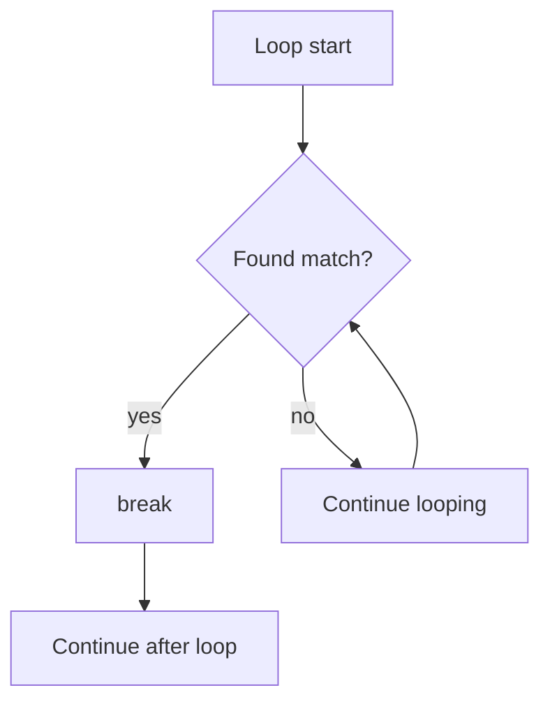

# break Statement

## 1. Introduction

The **`break`** statement immediately **exits a loop or switch** when it's encountered. It transfers control to the first statement *after* the loop/switch, skipping everything remaining.

---

## 2. Why This Topic Is Important

- `break` is essential for **early exit** — stopping the moment you find what you need.
- Used in `switch` (prevent fall-through) and loops (search/quit conditions).
- Interviewers test **labeled break** in nested loops.
- Efficient code stops work once the goal is reached.

---

## 3. Real-World Analogy

Imagine **searching a shelf of books for one titled "Java"**. The moment you find it, you stop searching — you don't check the remaining books. That's `break`: as soon as the goal is achieved, exit the search loop.

---

## 4. Theory

### Usage in a Loop
```java
for (int i = 1; i <= 10; i++) {
    if (i == 5) {
        break;          // exit the loop entirely
    }
    System.out.println(i);
}
// prints 1 2 3 4, then exits
```

### Usage in switch
```java
switch (day) {
    case 1: System.out.println("Mon"); break;  // stops here
    case 2: System.out.println("Tue"); break;
}
```

### Labeled Break (nested loops)
```java
outer:
for (int i = 0; i < 3; i++) {
    for (int j = 0; j < 3; j++) {
        if (j == 1) {
            break outer;   // breaks out of BOTH loops
        }
        System.out.print(i + "" + j + " ");
    }
}
```

---

## 5. Syntax

```java
break;                 // exits current loop/switch
break labelName;       // exits the labeled outer block
```

---

## 6. Flow Explanation



---

## 7. Memory Representation

`break` is a simple jump instruction (goto) in bytecode — it moves the program counter to after the loop. No memory impact.

---

## 8. Simple Example

```java
public class BreakDemo {
    public static void main(String[] args) {
        for (int i = 1; i <= 10; i++) {
            if (i == 4) {
                break;
            }
            System.out.print(i + " ");
        }
        System.out.println("\nLoop exited at i = 4");
    }
}
```

---

## 9. Intermediate Example — Early Exit Search

```java
public class Search {
    public static void main(String[] args) {
        int[] numbers = {3, 8, 12, 7, 5};
        int target = 12;
        boolean found = false;

        for (int i = 0; i < numbers.length; i++) {
            if (numbers[i] == target) {
                System.out.println("Found " + target + " at index " + i);
                found = true;
                break;                       // stop searching early
            }
        }
        if (!found) {
            System.out.println(target + " not found");
        }
    }
}
```

---

## 10. Advanced Example — Labeled Break

```java
public class LabeledBreak {
    public static void main(String[] args) {
        outer:
        for (int i = 1; i <= 3; i++) {
            for (int j = 1; j <= 3; j++) {
                if (i * j == 4) {
                    System.out.println("Found at i=" + i + ", j=" + j);
                    break outer;   // exits both loops
                }
                System.out.println("Checking i=" + i + ", j=" + j);
            }
        }
        System.out.println("Done with all loops.");
    }
}
```

---

## 11. Output

For the **Simple Example**:

```
1 2 3
Loop exited at i = 4
```

For the **Advanced Example**:

```
Checking i=1, j=1
Checking i=1, j=2
Checking i=1, j=3
Checking i=2, j=1
Found at i=2, j=2
Done with all loops.
```

---

## 12. Common Mistakes

| Mistake | Correction |
|---------|------------|
| Using plain `break` in a nested loop | It only exits the innermost loop — use a label |
| Putting `break` outside a loop/switch | Compile error |
| Confusing `break` with `continue` | `break` exits; `continue` skips one iteration |
| Overusing breaks that make flow unclear | Prefer structured conditions when possible |
| Breaking inside an `if` inside a `while(true)` without reaching the end | Ensure a clear exit path for all cases |

---

## 13. Best Practices

- Use `break` for **early exit** when the goal is found — it's more efficient.
- Prefer labels only when breaking multiple nested loops.
- Avoid deeply nested loops with many breaks — extract logic into methods.
- In switch, always `break` (or use the arrow form) to prevent fall-through.

---

## 14. Interview Questions

**Q1. What does break do in a loop?**
*It immediately terminates the loop and continues after it.*

**Q2. Difference between break and continue?**
*`break` exits the whole loop; `continue` skips the rest of the current iteration and moves to the next.*

**Q3. What is a labeled break?**
*A break that exits a named (labeled) outer block, used with nested loops.*

**Q4. Can break be used outside loops?**
*Yes — inside `switch` to prevent fall-through.*

**Q5. Does break in an inner loop exit the outer loop too?**
*No — plain break exits only the innermost loop; use a labeled break for outer loops.*

---

## 15. Practice Exercises

1. Print numbers 1 to 10 but stop at 7 using break.
2. Search an array for a value and break when found.
3. Use labeled break to exit a 2D loop at a specific cell.
4. Demonstrate break inside switch to prevent fall-through.

---

## 16. Coding Challenges

1. **Easy:** Find and print the first even number in a list, then break.
2. **Medium:** In a 2D grid, find the position of the first cell with value 0 and stop.
3. **Hard:** Implement a number-guessing loop where break exits immediately when the user types -1.

---

## 17. Summary

- `break` exits a loop/switch immediately.
- `break labelName` exits a labeled outer loop.
- Use it for early exit (searches, quit conditions).
- Plain break only exits the innermost loop.
- Always break in classic switch to avoid fall-through.

➡️ Continue to: [continue](Continue.md)