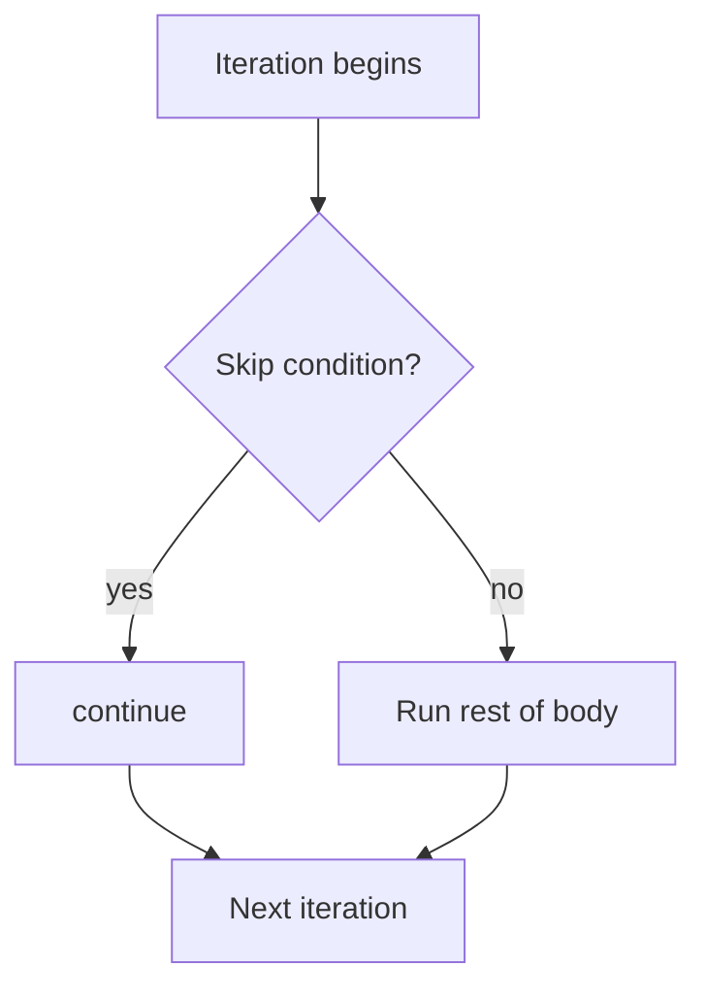

# continue Statement

## 1. Introduction

The **`continue`** statement skips the **rest of the current iteration** and jumps to the loop's next iteration. Unlike `break` (which exits the loop), `continue` just moves on — the loop keeps running.

---

## 2. Why This Topic Is Important

- `continue` filters values: "skip everything that isn't X" is a one-liner.
- It simplifies conditions by avoiding deep nesting of `if (!bad) { ... }`.
- Interviewers contrast `break` vs `continue` constantly.
- It's the foundation of filter-like logic in loops.

---

## 3. Real-World Analogy

Imagine **checking a delivery list for fragile items**. For each package: if it's *not* fragile, you move to the next one (continue) — you don't stop delivering. You only pay attention to fragile packages. `continue` = "nothing to see here, move on."

---

## 4. Theory

### Basic Behavior
```java
for (int i = 1; i <= 5; i++) {
    if (i == 3) {
        continue;          // skip printing 3, go to i=4
    }
    System.out.println(i);
}
// prints 1 2 4 5
```

### In while/do-while — Warning!
In `while`/`do-while`, `continue` jumps back to the **condition check**. If the update statement is after the `continue`, the loop may spin forever:

```java
int i = 0;
while (i < 5) {
    i++;               // update BEFORE continue avoids the trap
    if (i % 2 == 0) {
        continue;
    }
    System.out.println(i);
}
```

### Labeled continue
```java
outer:
for (int i = 1; i <= 3; i++) {
    for (int j = 1; j <= 3; j++) {
        if (j == 2) {
            continue outer;    // skip to next i
        }
        System.out.print(i + "" + j + " ");
    }
}
// prints 11 21 31
```

---

## 5. Syntax

```java
continue;           // next iteration of current loop
continue label;     // next iteration of labeled outer loop
```

---

## 6. Flow Explanation



---

## 7. Memory Representation

`continue` is a jump instruction that returns control to the loop's increment/condition check. No memory impact.

---

## 8. Simple Example

```java
public class ContinueDemo {
    public static void main(String[] args) {
        for (int i = 1; i <= 5; i++) {
            if (i % 2 == 0) {
                continue;          // skip even numbers
            }
            System.out.print(i + " ");
        }
        System.out.println();
    }
}
```

---

## 9. Intermediate Example — Filtering

```java
public class Filter {
    public static void main(String[] args) {
        int[] scores = {45, 80, 12, 90, 67, 30};

        System.out.print("Passing scores: ");
        for (int score : scores) {
            if (score < 40) {
                continue;         // skip failures
            }
            System.out.print(score + " ");
        }
        System.out.println();
    }
}
```

---

## 10. Advanced Example — Labeled continue

```java
public class LabeledContinue {
    public static void main(String[] args) {
        outer:
        for (int i = 1; i <= 3; i++) {
            for (int j = 1; j <= 3; j++) {
                if (j == 2) {
                    continue outer;   // next row (i) immediately
                }
                System.out.print(i + "" + j + " ");
            }
        }
        System.out.println();
    }
}
```

---

## 11. Output

For the **Simple Example**:

```
1 3 5
```

For the **Advanced Example**:

```
11 21 31
```

---

## 12. Common Mistakes

| Mistake | Correction |
|---------|------------|
| Infinite loop in `while` with `continue` after the update | Place the update **before** `continue` |
| Confusing continue with break | Continue skips one iteration; break exits |
| Using `continue` in switch cases | `continue` doesn't belong in switch (use `break`) |
| Labeled continue targeting the wrong loop | Name the loop you actually want to advance |
| Skipping needed cleanup code | Code after `continue` in the same iteration won't run |

---

## 13. Best Practices

- Use `continue` to keep conditions **flat** instead of deeply nesting.
- In `while`/`do-while`, increment counters **before** any `continue`.
- Prefer enhanced-for + continue for clean filtering.
- Use labeled continue sparingly — it can confuse readers.

---

## 14. Interview Questions

**Q1. What does continue do?**
*It skips the remaining body of the current iteration and moves to the next iteration.*

**Q2. Difference between break and continue?**
*`break` exits the loop entirely; `continue` only skips the current iteration.*

**Q3. Why can continue cause an infinite while loop?**
*If the counter update is placed after the continue, the update is skipped forever.*

**Q4. What is labeled continue?**
*It advances the iteration of a labeled outer loop instead of the inner one.*

**Q5. When should you prefer continue over if-else?**
*When you want to skip invalid values without wrapping the rest of the body in a condition.*

---

## 15. Practice Exercises

1. Print all numbers from 1 to 20 except multiples of 3.
2. Skip the letter "x" while printing a string's characters.
3. Print only consonants of a word using continue.
4. Use labeled continue to print a 3x3 grid skipping the second column.

---

## 16. Coding Challenges

1. **Easy:** Print all odd numbers 1-30 using continue.
2. **Medium:** Given scores, print only those ≥ 40 using continue.
3. **Hard:** In a 3x3 multiplication grid, use labeled continue to print only the diagonal.

---

## 17. Summary

- `continue` skips the **rest of the current iteration**.
- `break` exits; `continue` moves on.
- Watch the update-before-continue rule in while/do-while.
- Labeled continue advances outer loops.
- Great for filters and flat conditions.

➡️ Continue to: [Pattern Problems](Pattern-Problems.md)