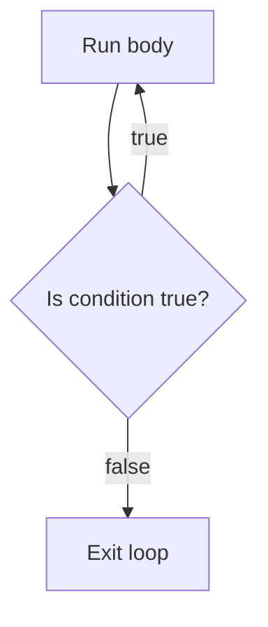

# do-while Loop

## 1. Introduction

The **`do-while` loop** is the sibling of `while` — with one crucial difference: it checks the condition **after** running the body, so it executes **at least once** before any check.

---

## 2. Why This Topic Is Important

- Perfect for **"ask at least once, then repeat until valid"** patterns (menus, retries).
- Interviewers love the question: *"What's the difference between while and do-while?"*
- Guaranteeing one execution is sometimes exactly what logic requires.
- It prevents duplicated code when prompting users.

---

## 3. Real-World Analogy

Think of **entering a PIN at an ATM**: You're always asked at least once. If it's wrong, you're asked again — but the first attempt always happens. That's a `do-while`: do (ask for PIN) while (it's wrong).

---

## 4. Theory

### Syntax
```java
do {
    // body — always runs at least once
} while (condition);
```

### How It Works
1. Run the body.
2. Check the condition.
3. If true → run the body again.
4. If false → exit.

### Comparison Table
| Aspect | `while` | `do-while` |
|--------|---------|------------|
| Condition checked | Before body | After body |
| Minimum runs | 0 | 1 |
| Best for | Unknown count | Guarantee at-least-once |
| Semicolon after `)` | No | **Yes** |

---

## 5. Syntax

```java
int i = 1;
do {
    System.out.println(i);
    i++;
} while (i <= 5);
```

> **⚠️ Note the trailing semicolon** after `while (i <= 5);` — forgetting it is a compile error.

---

## 6. Flow Explanation



The body always runs first.

---

## 7. Memory Representation

Same as other loops — the condition and counters live on the stack. No heap allocation.

---

## 8. Simple Example

```java
public class DoWhileDemo {
    public static void main(String[] args) {
        int i = 1;
        do {
            System.out.print(i + " ");
            i++;
        } while (i <= 5);
        System.out.println();
    }
}
```

---

## 9. Intermediate Example — Runs Even When False

```java
public class AtLeastOnce {
    public static void main(String[] args) {
        int x = 100;

        while (x < 10) {                    // zero runs
            System.out.println("while ran");
        }

        do {                                // one run
            System.out.println("do-while ran once");
        } while (x < 10);
    }
}
```

---

## 10. Advanced Example — Input Validation

```java
import java.util.Scanner;

public class PinCheck {
    public static void main(String[] args) {
        Scanner sc = new Scanner(System.in);
        int pin;

        do {
            System.out.print("Enter your 4-digit PIN: ");
            pin = sc.nextInt();
            if (pin != 1234) {
                System.out.println("Wrong PIN, try again.");
            }
        } while (pin != 1234);

        System.out.println("Access granted!");
        sc.close();
    }
}
```

---

## 11. Output

For the **Intermediate Example**:

```
do-while ran once
```

For the **PinCheck** (user enters 0000, then 1234):

```
Enter your 4-digit PIN: 0000
Wrong PIN, try again.
Enter your 4-digit PIN: 1234
Access granted!
```

---

## 12. Common Mistakes

| Mistake | Correction |
|---------|------------|
| Forgetting the semicolon after `while(...)` | Compile error — always end `do-while` with `;` |
| Thinking do-while runs 0 times | It always runs at least once |
| Using do-while for pre-checks | If the body must not run initially, use `while` |
| Reusing `while`'s syntax from memory | Note the inverted order: body first, condition last |

---

## 13. Best Practices

- Use `do-while` for **validate-then-ask-again** flows.
- Keep the body small — move validation logic into methods.
- Pair with a clear exit message when the condition finally passes.
- For menus shown at least once, do-while beats `while(true)` + break.

---

## 14. Interview Questions

**Q1. Difference between while and do-while?**
*`while` checks the condition before the body (0+ runs); `do-while` checks after (at least 1 run).*

**Q2. When would you choose do-while?**
*When the body must execute at least once — e.g., displaying a menu or prompting for input.*

**Q3. What happens if the condition is false initially in do-while?**
*The body still executes exactly once.*

**Q4. Do you need a semicolon after do-while?**
*Yes — after the `while (condition);` line.*

**Q5. Can do-while loop infinitely?**
*Yes, if the condition never becomes false.*

---

## 15. Practice Exercises

1. Print numbers 1 to 5 using do-while.
2. Show the "at least once" behavior with a false condition.
3. Validate a positive number: keep asking until `n > 0`.
4. Print a menu at least once and loop until "exit" is chosen.

---

## 16. Coding Challenges

1. **Easy:** Sum numbers until the user enters a negative number.
2. **Medium:** Keep asking for a number between 1 and 10 until valid.
3. **Hard:** Build a simple quiz that repeats the same question until the correct answer is given.

---

## 17. Summary

- `do { body } while (condition);` runs the body **at least once**.
- Condition is checked after the body.
- Trailing semicolon required.
- Ideal for menus and input validation.
- Choose `while` when zero runs are acceptable; `do-while` when at least one is required.

➡️ Continue to: [break](Break.md)