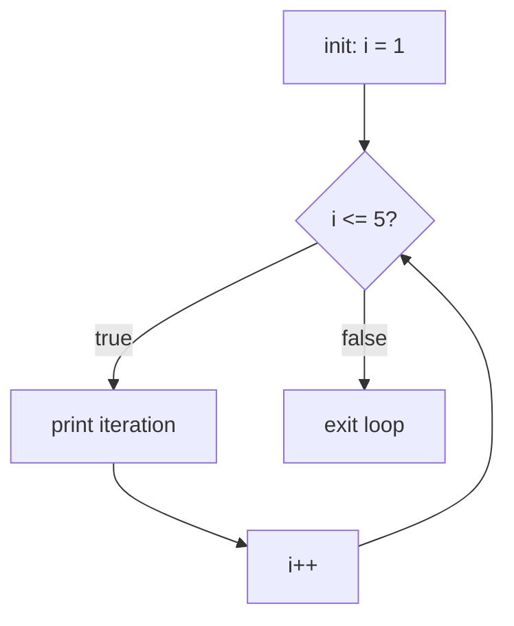

# for Loop

## 1. Introduction

The **`for` loop** repeats a block of code a known number of times. It bundles three things in one line: **initialization**, **condition**, and **increment**. It's the workhorse for iterating over ranges, arrays, and sequences.

---

## 2. Why This Topic Is Important

- Most repetitive work in Java uses `for` loops.
- They are the basis of **iteration over arrays and collections** (Modules 07, 12).
- Interviewers test loop boundaries (off-by-one errors) heavily.
- Almost every algorithm you'll ever write contains a `for` loop.

---

## 3. Real-World Analogy

A `for` loop is like a **factory production line with a fixed quota**: "Start the machine (initialization). While we haven't hit the quota of 100 boxes (condition), produce one box (body) and count it (increment)." You know exactly how many times the action repeats.

---

## 4. Theory

### The Three Parts
```java
for (initialization; condition; update) {
    // body
}
```
| Part | Runs | Purpose |
|------|------|---------|
| initialization | Once, before the loop | Set counter (e.g., `int i = 1`) |
| condition | Before each iteration | Continue only if true |
| update | After each iteration | Change counter (e.g., `i++`) |

### Execution Order
1. initialization (once)
2. check condition → if false, exit
3. run body
4. update
5. back to step 2

### Variations
- `for (;;)` → infinite loop
- `for (int i = n; i >= 0; i--)` → count down
- `for (int i = 0, j = 10; i < j; i++, j--)` → multiple counters
- Enhanced for (arrays/collections): `for (Type x : collection)` — Module 07

---

## 5. Syntax

```java
for (int i = 1; i <= 5; i++) {
    System.out.println("Iteration " + i);
}
```

---

## 6. Flow Explanation



---

## 7. Memory Representation

The loop variable `i` is a local variable in the stack frame. Each iteration reuses the same slot. No heap allocation happens for a simple counter loop.

---

## 8. Simple Example — Print 1 to 5

```java
public class ForDemo {
    public static void main(String[] args) {
        for (int i = 1; i <= 5; i++) {
            System.out.print(i + " ");
        }
        System.out.println();
    }
}
```

---

## 9. Intermediate Example — Sum and Factorial

```java
public class SumFactorial {
    public static void main(String[] args) {
        int n = 10;
        int sum = 0;
        for (int i = 1; i <= n; i++) {
            sum += i;
        }
        System.out.println("Sum 1..10 = " + sum);

        int fact = 1;
        for (int i = 2; i <= 5; i++) {
            fact *= i;
        }
        System.out.println("5! = " + fact);
    }
}
```

---

## 10. Advanced Example — Nested Loops & Prime Check

```java
public class AdvancedLoops {
    static boolean isPrime(int num) {
        if (num < 2) return false;
        for (int i = 2; i * i <= num; i++) {
            if (num % i == 0) return false;
        }
        return true;
    }

    public static void main(String[] args) {
        System.out.print("Primes up to 30: ");
        for (int n = 2; n <= 30; n++) {
            if (isPrime(n)) System.out.print(n + " ");
        }
        System.out.println();

        // Nested loops: multiplication table grid
        for (int i = 1; i <= 3; i++) {
            for (int j = 1; j <= 3; j++) {
                System.out.print((i * j) + " ");
            }
            System.out.println();
        }
    }
}
```

---

## 11. Output

For the **Simple Example**:

```
1 2 3 4 5
```

For the **Advanced Example**:

```
Primes up to 30: 2 3 5 7 11 13 17 19 23 29
1 2 3
2 4 6
3 6 9
```

---

## 12. Common Mistakes

| Mistake | Correction |
|---------|------------|
| Off-by-one: `i <= n` vs `i < n` | Decide inclusive/exclusive explicitly |
| Forgetting the update → infinite loop | Always update the counter |
| Semicolon after `for(...)` | `for(...);` creates an empty body |
| Using `i` after the loop | Loop variables are scoped to the loop |
| Integer overflow in the condition | Use `i <= 10` not `i < Integer.MAX_VALUE` with `i++` |

---

## 13. Best Practices

- Prefer the **enhanced for** for arrays/collections.
- Keep loop bodies small; extract work into methods.
- Use `i < n` (exclusive upper bound) consistently to avoid off-by-one.
- Declare the loop variable inside the `for` when you don't need it after.
- For fixed iterations, `for` is clearer than `while`.

---

## 14. Interview Questions

**Q1. What are the three parts of a for loop?**
*Initialization, condition, and update (increment/decrement).*

**Q2. What is an infinite for loop?**
*`for (;;)` — no initialization, condition (always true), or update.*

**Q3. What is the enhanced for loop?**
*`for (Type var : arrayOrCollection)` — iterates each element without an index.*

**Q4. Can the initialization or update have multiple statements?**
*Yes, separated by commas: `for (int i=0, j=10; i<j; i++, j--)`.*

**Q5. When is a for loop preferred over a while loop?**
*When the number of iterations is known ahead of time (counting).*

---

## 15. Practice Exercises

1. Print numbers 10 down to 1 using a decreasing loop.
2. Sum the first 50 natural numbers.
3. Print the even numbers between 1 and 20.
4. Print the multiplication table of 7.

---

## 16. Coding Challenges

1. **Easy:** Print "Java" 10 times with the iteration number.
2. **Medium:** Find and print all factors of a given number using a for loop.
3. **Hard:** Print the Fibonacci series up to n terms using a for loop.

---

## 17. Summary

- `for (init; condition; update)` repeats a known number of times.
- Order: init → condition → body → update → condition → ...
- Watch for off-by-one errors and infinite loops.
- Use enhanced for for arrays/collections.
- Nested for loops build grids, tables, and patterns.

➡️ Continue to: [While Loop](While-Loop.md)