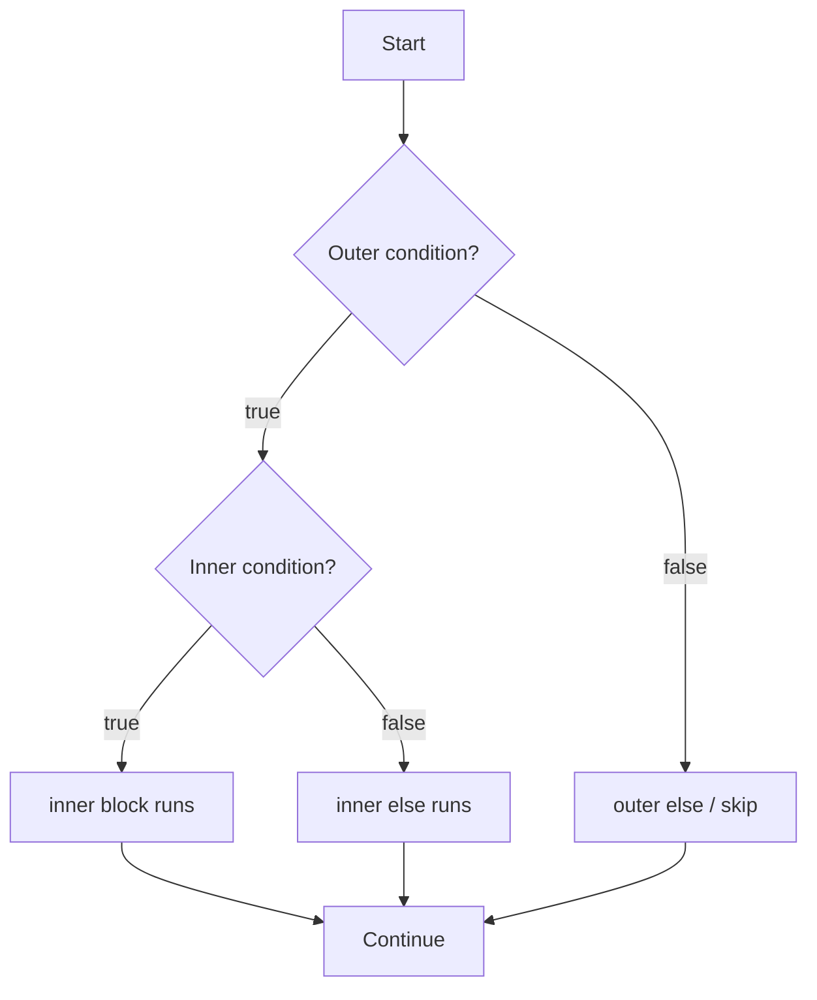

# Nested if Statements

## 1. Introduction

A **nested `if`** is an `if` statement placed *inside another* `if` block. It's used when a second decision depends on the result of the first. Nested conditions model real-world logic like "IF you're logged in, THEN check IF you're an admin."

---

## 2. Why This Topic Is Important

- Complex business rules (permissions, validation, multi-stage checks) are nested logic.
- Interviewers ask to "flatten" nested ifs with logical operators — a common optimization question.
- Deeply nested code is a **code smell**; learning to manage it is a professional skill.
- It's essential for building menu-driven and multi-step applications.

---

## 3. Real-World Analogy

Think of an **airport security line**:

1. First check: "Do you have a boarding pass?" (outer if)
2. If yes, second check: "Is your ID valid?" (inner if)
3. If yes, third check: "Is your luggage under weight?" (innermost if)

Each step only matters if the previous one passed — exactly how nested ifs work.

---

## 4. Theory

### Structure
```java
if (outerCondition) {
    // runs when outer is true
    if (innerCondition) {
        // runs when both outer AND inner are true
    }
}
```

### Nesting Depth
- Java allows arbitrary nesting depth, but **keep it ≤ 3 levels** for readability.
- Nested ifs and logical operators are often interchangeable:

```java
// Nested
if (age >= 18) {
    if (hasVoterId) {
        System.out.println("Can vote");
    }
}

// Equivalent with &&
if (age >= 18 && hasVoterId) {
    System.out.println("Can vote");
}
```

### The `else` Binding Rule
An `else` always binds to the **nearest** unmatched `if`. Braces eliminate ambiguity.

---

## 5. Syntax

```java
if (outer) {
    if (inner) {
        // both true
    } else {
        // outer true, inner false
    }
} else {
    // outer false
}
```

---

## 6. Flow Explanation



---

## 7. Memory Representation

Nested ifs compile to sequential branch instructions — the JVM's PC register jumps between the outer and inner checks. No extra memory is used.

---

## 8. Simple Example

```java
public class NestedIfDemo {
    public static void main(String[] args) {
        int age = 25;
        boolean hasId = true;

        if (age >= 18) {
            if (hasId) {
                System.out.println("You can enter the club.");
            } else {
                System.out.println("You are old enough but need an ID.");
            }
        } else {
            System.out.println("You are too young.");
        }
    }
}
```

---

## 9. Intermediate Example — Multi-Level Validation

```java
public class LoanEligibility {
    public static void main(String[] args) {
        double salary = 60000;
        int creditScore = 750;
        boolean employed = true;

        if (employed) {
            if (salary >= 50000) {
                if (creditScore >= 700) {
                    System.out.println("Loan approved!");
                } else {
                    System.out.println("Loan denied: credit score too low.");
                }
            } else {
                System.out.println("Loan denied: salary too low.");
            }
        } else {
            System.out.println("Loan denied: not employed.");
        }
    }
}
```

---

## 10. Advanced Example — Flattening with Logical Operators

```java
public class Flattened {
    public static void main(String[] args) {
        int age = 30;
        boolean hasLicense = true;
        boolean hasInsurance = false;

        // Deeply nested version (avoid)
        if (age >= 18) {
            if (hasLicense) {
                if (hasInsurance) {
                    System.out.println("Can drive.");
                } else {
                    System.out.println("Insurance required.");
                }
            } else {
                System.out.println("License required.");
            }
        } else {
            System.out.println("Too young.");
        }

        // Flattened with guard clauses (preferred)
        if (age < 18) {
            System.out.println("Too young.");
            return;
        }
        if (!hasLicense) {
            System.out.println("License required.");
            return;
        }
        if (!hasInsurance) {
            System.out.println("Insurance required.");
            return;
        }
        System.out.println("Can drive.");
    }
}
```

---

## 11. Output

For the **Intermediate Example**:

```
Loan approved!
```

For the **Advanced Example** (both versions):

```
Insurance required.
Insurance required.
```

---

## 12. Common Mistakes

| Mistake | Correction |
|---------|------------|
| Forgetting braces → wrong else binding | Always brace nested ifs |
| Nesting too deep (4+ levels) | Flatten with `&&` or guard clauses |
| Duplicating conditions | Reuse the result; don't re-check the same condition |
| Mixing independent and nested logic | If conditions are independent, use separate `if`s |
| Missing the "else" cases | Cover what happens when inner/outer is false |

---

## 13. Best Practices

- **Limit depth to 3 levels.** Beyond that, refactor.
- Prefer **guard clauses** (early returns) over deep nesting.
- Combine simple conditions with `&&` / `||` instead of nesting.
- Extract inner logic into a **method** when it becomes complex.
- Always use braces to control else-binding.

---

## 14. Interview Questions

**Q1. What is a nested if?**
*An `if` statement inside another `if` block, used when a second condition depends on the first.*

**Q2. To which `if` does an `else` bind?**
*To the nearest unmatched `if`. Braces make this explicit.*

**Q3. How do you avoid deeply nested ifs?**
*Use logical operators (`&&`, `||`), guard clauses, or extract methods.*

**Q4. Is there a limit to nesting depth?**
*No language limit, but readability demands ≤ 3 levels.*

**Q5. Nested ifs vs logical operators — which is better?**
*Logical operators are more concise and readable for simple conditions; nesting may be clearer when each level needs its own else/error message.*

---

## 15. Practice Exercises

1. Check if a person is eligible to donate blood (age ≥ 18, weight ≥ 50, healthy).
2. Build a 2-level login: check username first, then password.
3. Write a number classifier: positive/negative, then even/odd inside.
4. Refactor a 4-level nested if into flattened guard clauses.

---

## 16. Coding Challenges

1. **Easy:** Print "Adult male" / "Adult female" / "Minor" using nested checks (gender + age).
2. **Medium:** Ticket booking: choose movie (outer), then class (inner), compute price.
3. **Hard:** Implement a bank ATM: validate PIN, then balance check, then withdraw amount — each with error messages.

---

## 17. Summary

- Nested ifs model **dependent conditions** (check B only if A passed).
- `else` binds to the nearest unmatched `if`.
- Keep depth ≤ 3; prefer **guard clauses** and `&&`.
- Cover all true/false paths.
- Deep nesting is a code smell — refactor it.

➡️ Continue to: [Switch](Switch.md)