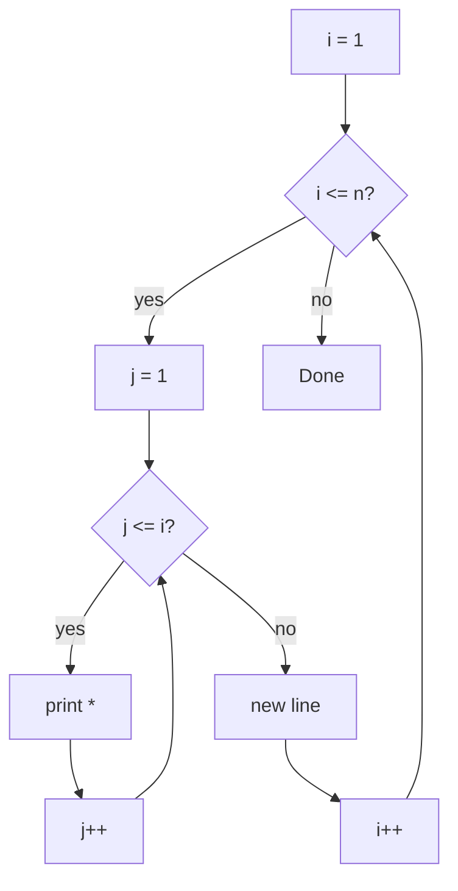

# Pattern Problems

## 1. Introduction

**Pattern problems** are classic exercises that use **nested loops** to print shapes — stars, numbers, and alphabets. They are the single best way to master loop logic and are a favourite in interviews and exams.

---

## 2. Why This Topic Is Important

- They train your **loop reasoning** (rows, columns, spaces).
- Interviewers use them to test logical thinking under pressure.
- The same thinking powers grid-based algorithms (matrices, images).
- Solving 10–15 patterns makes loops *second nature*.

---

## 3. Real-World Analogy

Printing a pattern is like **laying bricks row by row**. The outer loop decides how many rows; the inner loop decides how many bricks in each row. Spaces in patterns are like the gaps you leave for windows — calculated position by position.

---

## 4. Theory

### The Golden Structure
Every pattern = **nested loops**:

| Loop | Controls | Rule of thumb |
|------|----------|---------------|
| Outer loop | Number of **rows** | `i` runs from 1 to n |
| Inner loop | Number of **columns** in that row | `j` runs based on `i` and `n` |
| Printing | `System.out.print(...)` then `System.out.println()` per row | No newline inside the inner loop |

### Key Relationships
- **Increasing triangle**: inner runs `j <= i`
- **Decreasing triangle**: inner runs `j <= n - i + 1`
- **Pyramid**: spaces first (`n - i`), then stars (`2*i - 1`)
- **Number patterns**: print `i` or `j` instead of `*`

---

## 5. Syntax

```java
for (int i = 1; i <= n; i++) {        // rows
    for (int j = 1; j <= i; j++) {    // columns
        System.out.print("* ");
    }
    System.out.println();             // new line per row
}
```

---

## 6. Flow Explanation



---

## 7. Memory Representation

Patterns only use loop counters (stack locals). No objects are created, so memory is constant — O(1) extra space.

---

## 8. Simple Example — Right Triangle

```java
public class Pattern1 {
    public static void main(String[] args) {
        int n = 5;
        for (int i = 1; i <= n; i++) {
            for (int j = 1; j <= i; j++) {
                System.out.print("* ");
            }
            System.out.println();
        }
    }
}
```

**Output:**
```
*
* *
* * *
* * * *
* * * * *
```

---

## 9. Intermediate Example — Numbers & Inverted Triangle

```java
public class Pattern2 {
    public static void main(String[] args) {
        int n = 5;

        // Increasing number triangle
        for (int i = 1; i <= n; i++) {
            for (int j = 1; j <= i; j++) {
                System.out.print(j + " ");
            }
            System.out.println();
        }

        System.out.println();

        // Inverted star triangle
        for (int i = n; i >= 1; i--) {
            for (int j = 1; j <= i; j++) {
                System.out.print("* ");
            }
            System.out.println();
        }
    }
}
```

---

## 10. Advanced Example — Pyramid & Diamond

```java
public class Pattern3 {
    public static void main(String[] args) {
        int n = 5;

        // Pyramid
        for (int i = 1; i <= n; i++) {
            for (int space = 1; space <= n - i; space++) {
                System.out.print("  ");          // leading spaces
            }
            for (int star = 1; star <= 2 * i - 1; star++) {
                System.out.print("* ");
            }
            System.out.println();
        }

        // Diamond (upper + lower)
        for (int i = n - 1; i >= 1; i--) {
            for (int space = 1; space <= n - i; space++) {
                System.out.print("  ");
            }
            for (int star = 1; star <= 2 * i - 1; star++) {
                System.out.print("* ");
            }
            System.out.println();
        }
    }
}
```

---

## 11. Output

For the **Intermediate Example**:

```
1
1 2
1 2 3
1 2 3 4
1 2 3 4 5

* * * * *
* * * *
* * *
* *
*
```

For the **Advanced Example**, a full 5-row pyramid plus an inverted pyramid producing a diamond.

---

## 12. Common Mistakes

| Mistake | Correction |
|---------|------------|
| Printing a newline inside the inner loop | Move `println()` to the outer loop |
| Wrong inner-loop bound | For triangles use `j <= i`, not `j <= n` |
| Forgetting leading spaces in pyramids | Spaces make the shape centered |
| Using `j <= n - i` off-by-one | For 0-indexed vs 1-indexed loops, test with small n |
| Mixing `i` and `j` when printing numbers | Decide whether to print row number, column number, or both |

---

## 13. Best Practices

- **Trace by hand** the first 2–3 rows before coding.
- Start with `i = 1` and `j = 1` (1-indexed) for beginners.
- Separate **space loops** and **star loops** in pyramids.
- Write a reusable `printPattern(int n)` method — you'll build a small library.
- Test with `n = 1` and `n = 2` to catch edge cases.

---

## 14. Interview Questions

**Q1. How do you print a right-angle triangle?**
*Outer loop for rows, inner loop running `j <= i` printing `*`, newline after each row.*

**Q2. What does the outer loop control vs the inner loop?**
*Outer = rows; inner = elements in each row.*

**Q3. How do you print a centered pyramid?**
*Print `n - i` spaces, then `2*i - 1` stars, then a newline.*

**Q4. How would you print alphabets in a pattern?**
*Cast the loop index to a char: `(char) ('A' + j - 1)`.*

**Q5. What is the time complexity of pattern printing?**
*O(n²) for 2D patterns — nested loops with both running ~n times.*

---

## 15. Practice Exercises

1. Right triangle, inverted triangle.
2. Number triangle (1, 12, 123, ...).
3. Alphabet triangle (A, AB, ABC, ...).
4. Square of stars (n x n).

---

## 16. Coding Challenges

1. **Easy:** Print a hollow square (border stars only).
2. **Medium:** Print Floyd's triangle (consecutive numbers).
3. **Hard:** Print Pascal's triangle, then a full diamond.
4. **Bonus:** Print a "X" pattern using spaces and stars for odd n.

---

## 17. Summary

- Patterns = **nested loops**: outer = rows, inner = columns.
- `j <= i` → increasing triangle; `j <= n - i + 1` → decreasing.
- Pyramids need **space loops** before star loops.
- Print per-row with `println()` in the outer loop.
- Hand-trace before coding to get bounds right.

➡️ This completes **Module 05**. Continue to [Module 06 — Methods](../06-Methods/README.md).