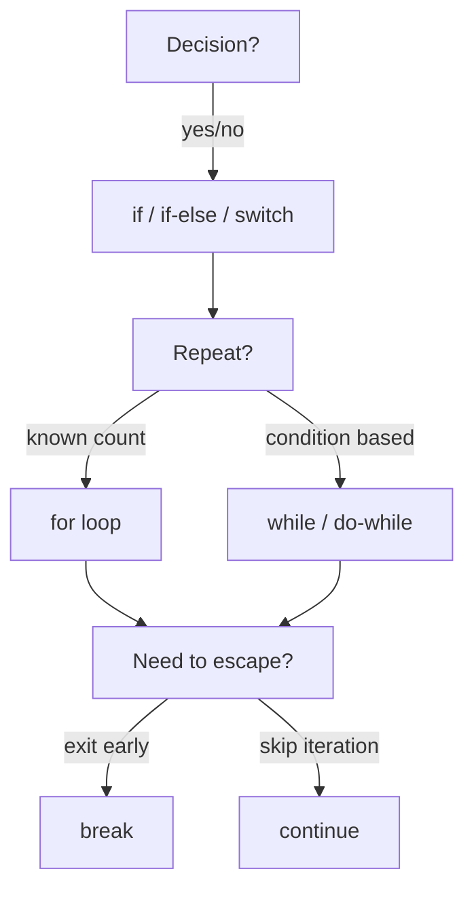

# 05 — Control Statements

> **Experience level: 🟡 Basic+ (6 months – 1 year)**

So far your programs run top-to-bottom. **Control statements** let your program *make decisions* (if/else, switch) and *repeat work* (loops). This is where programs become truly useful — they can react to input and process large amounts of data.

---

## 📂 Files in This Module

| File | What You'll Learn |
|------|-------------------|
| [if.md](if.md) | The simplest decision: execute code when a condition is true |
| [if-else.md](if-else.md) | Choose between two paths |
| [Nested-if.md](Nested-if.md) | Multiple conditions inside conditions |
| [Switch.md](Switch.md) | Clean multi-way branching |
| [For-Loop.md](For-Loop.md) | Repeat a known number of times |
| [While-Loop.md](While-Loop.md) | Repeat while a condition holds |
| [Do-While.md](Do-While.md) | Repeat at least once |
| [Break.md](Break.md) | Exit a loop early |
| [Continue.md](Continue.md) | Skip one iteration |
| [Pattern-Problems.md](Pattern-Problems.md) | Classic star/number patterns using nested loops |

---

## 🎯 Learning Objectives

By the end of this module, you will be able to:

1. ✅ Make decisions with `if`, `if-else`, nested `if`, and `switch`.
2. ✅ Repeat code with `for`, `while`, and `do-while` loops.
3. ✅ Control loops with `break` and `continue`.
4. ✅ Choose the right control structure for the situation.
5. ✅ Print complex star/number patterns using nested loops.

---

## 🧭 Control Structure Map



---

## 🚀 What You'll Build

By the end of this module you can write a **guessing game**, a **menu-driven program**, a **multiplication table generator**, and beautiful **pattern programs** — all classics that interviewers love.

---

## 📌 Quick Preview

```java
import java.util.Scanner;

public class Preview {
    public static void main(String[] args) {
        Scanner sc = new Scanner(System.in);
        System.out.print("Enter a number: ");
        int n = sc.nextInt();

        if (n % 2 == 0) {
            System.out.println(n + " is even.");
        } else {
            System.out.println(n + " is odd.");
        }

        for (int i = 1; i <= 10; i++) {
            System.out.println(n + " x " + i + " = " + (n * i));
        }
        sc.close();
    }
}
```

You'll understand every line of this by the end of the module.

---

## Next Module

➡️ [06 — Methods](../06-Methods/README.md) — package reusable logic into methods.