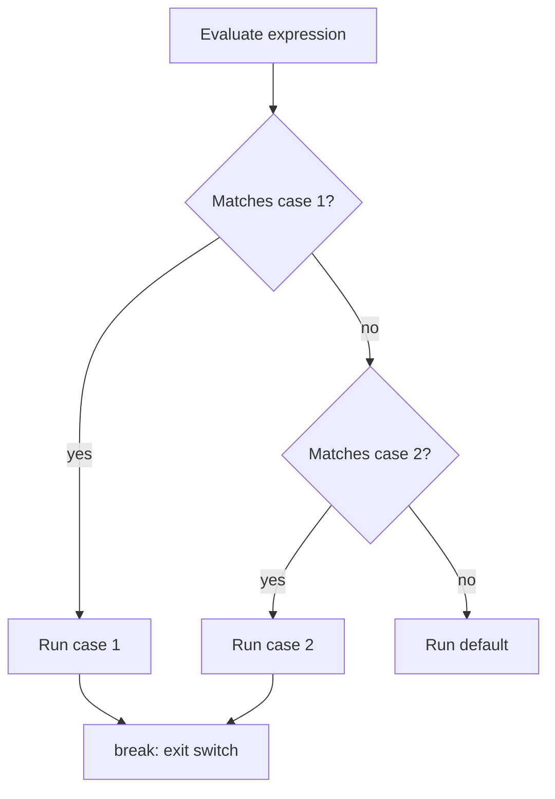

# switch Statement

## 1. Introduction

The **`switch`** statement selects one of many code blocks based on the value of a single expression. It's a cleaner alternative to long `else-if` chains when comparing **exact values** (like a day of the week, a menu option, or a state name).

---

## 2. Why This Topic Is Important

- It produces **cleaner, faster, and more readable** multi-way branching than else-if.
- Java 12+ introduced **switch expressions** with arrow syntax — modern interviews test this.
- Used heavily in menu systems, parsers, state machines, and HTTP routing.
- Knowing both classic and modern switch makes your code current.

---

## 3. Real-World Analogy

A switch is like a **vending machine with labeled buttons**. Instead of asking "is it cola? is it water? is it juice?" one after another, you press button 3 and get exactly what button 3 offers. The machine directly jumps to your selection.

---

## 4. Theory

### Classic Switch (Java 7+)
```java
switch (expression) {
    case value1:
        // code
        break;
    case value2:
        // code
        break;
    default:
        // code
}
```

### Rules
| Rule | Detail |
|------|--------|
| Supported types | `int`, `char`, `byte`, `short`, `String` (Java 7+), enums |
| `break` | Exits the switch; without it, execution **falls through** |
| `default` | Runs when no case matches (optional, usually last) |
| Duplicate cases | Not allowed |

### Fall-Through
If you omit `break`, execution continues into the next case. Sometimes intentional (share code), usually a bug.

### Switch Expression (Java 14+, modern)
```java
String result = switch (day) {
    case "MON", "TUE" -> "Weekday";
    case "SAT", "SUN" -> "Weekend";
    default -> "Unknown";
};
```
No `break` needed; each arrow produces a value; `yield` returns values in block form.

---

## 5. Syntax

```java
switch (expression) {
    case constant -> result;
    case constant -> { yield value; }
    default -> result;
}
```

---

## 6. Flow Explanation



---

## 7. Memory Representation

The compiler may generate a **jump table** (hash-based) for efficient case lookup — that's why switch is faster than a long else-if chain for many constants.

---

## 8. Simple Example — Classic Switch

```java
public class SwitchDemo {
    public static void main(String[] args) {
        int day = 3;
        String name;

        switch (day) {
            case 1: name = "Monday"; break;
            case 2: name = "Tuesday"; break;
            case 3: name = "Wednesday"; break;
            case 4: name = "Thursday"; break;
            case 5: name = "Friday"; break;
            case 6: name = "Saturday"; break;
            case 7: name = "Sunday"; break;
            default: name = "Invalid day";
        }
        System.out.println("Day " + day + " is " + name);
    }
}
```

---

## 9. Intermediate Example — Switch on String

```java
public class SwitchString {
    public static void main(String[] args) {
        String month = "FEB";

        switch (month.toLowerCase()) {
            case "jan": System.out.println("31 days"); break;
            case "feb": System.out.println("28/29 days"); break;
            case "mar": System.out.println("31 days"); break;
            default:    System.out.println("Check your month spelling.");
        }
    }
}
```

---

## 10. Advanced Example — Switch Expression with yield

```java
public class SwitchExpression {
    static int daysInMonth(String month) {
        return switch (month) {
            case "JAN", "MAR", "MAY", "JUL", "AUG", "OCT", "DEC" -> 31;
            case "FEB" -> 28;
            case "APR", "JUN", "SEP", "NOV" -> 30;
            default -> {
                System.out.println("Unknown month: " + month);
                yield -1;              // yield for block bodies
            }
        };
    }

    public static void main(String[] args) {
        System.out.println("FEB -> " + daysInMonth("FEB"));
        System.out.println("DEC -> " + daysInMonth("DEC"));
        System.out.println("XYZ -> " + daysInMonth("XYZ"));
    }
}
```

---

## 11. Output

For the **Advanced Example**:

```
FEB -> 28
DEC -> 31
Unknown month: XYZ
XYZ -> -1
```

---

## 12. Common Mistakes

| Mistake | Correction |
|---------|------------|
| Forgetting `break` (unintentional fall-through) | Add `break`, or use the arrow form |
| Missing `default` | Unmatched values silently do nothing |
| Comparing strings with `==` in case | Cases use `==`-like equality internally, but you switch on the String *value* — ensure consistent case (`toLowerCase()`) |
| Duplicate case values | Compile error |
| Using `switch` on `double`/`long` | Not supported for these types |

---

## 13. Best Practices

- Use **switch expressions** (arrow `->`) for modern, concise code.
- Always include `default` for safety.
- Group related cases with commas: `case "A", "B" -> ...`
- Prefer switch over else-if chains when branching on exact values.
- Use enums with switch for type-safe state machines.

---

## 14. Interview Questions

**Q1. What types can a switch use?**
*int, char, byte, short, String (Java 7+), and enums. Not long, float, or double.*

**Q2. What is fall-through?**
*When a case has no `break`, execution continues into the next case block.*

**Q3. Difference between classic switch and switch expression?**
*Switch expressions use `->`, produce a value, have no fall-through, and require exhaustiveness (all cases covered or default).*

**Q4. Is switch faster than else-if?**
*For many constants, the compiler can use a jump table, making switch faster than a linear else-if scan.*

**Q5. What does `yield` do in a switch expression?**
*`yield` returns a value from a block-bodied arrow case.*

---

## 15. Practice Exercises

1. Convert a day number (1-7) to its name using classic switch.
2. Convert a month name to its season using String switch.
3. Rewrite the day example as a switch expression.
4. Add a `default` case that prints "Invalid" for out-of-range input.

---

## 16. Coding Challenges

1. **Easy:** Print the number of days in a month using switch.
2. **Medium:** Build a calculator menu (add/sub/mul/div) with switch on the operator symbol.
3. **Hard:** Implement a simple HTTP status-code explainer: 200, 404, 500, and default — returning descriptive strings via switch expression.

---

## 17. Summary

- `switch` branches on **exact values** — cleaner than else-if chains.
- Classic form needs `break`; expression form (`->`) doesn't.
- Supported: int-family, char, String, enums.
- Always include `default`.
- Use `yield` inside block-bodied switch expressions.

➡️ Continue to: [For Loop](For-Loop.md)