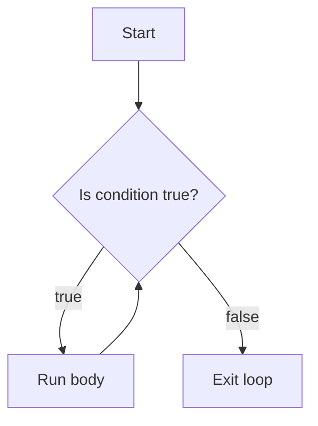

# while Loop

## 1. Introduction

The **`while` loop** repeats a block of code **as long as** a condition remains true. Unlike `for`, the number of iterations may be unknown in advance — you keep going until something changes.

---

## 2. Why This Topic Is Important

- `while` is ideal for **unknown-count repetition**: reading input until "quit", waiting until a process finishes, polling a sensor.
- Interviewers test infinite-loop safety and condition placement.
- Combined with `Scanner`, it powers interactive programs.
- It's the basis of menu systems, game loops, and event handlers.

---

## 3. Real-World Analogy

A `while` loop is like **waiting for water to boil**: "While the water is not boiling (condition), keep heating (body)." You don't know exactly how long it'll take — you just keep checking the condition.

---

## 4. Theory

### Syntax
```java
while (condition) {
    // body
}
```

### How It Works
1. Check the condition.
2. If **true**, run the body.
3. Go back to step 1.
4. If **false**, exit the loop.

### Key Facts
- The condition is checked **before** the body → the body may run **zero times**.
- If the condition never becomes false → **infinite loop**.
- You must update something inside the body that eventually makes the condition false.

---

## 5. Syntax

```java
int i = 1;
while (i <= 5) {
    System.out.println(i);
    i++;
}
```

---

## 6. Flow Explanation



---

## 7. Memory Representation

The loop condition lives on the stack; each iteration reuses the same local slots. No heap allocation.

---

## 8. Simple Example

```java
public class WhileDemo {
    public static void main(String[] args) {
        int count = 1;
        while (count <= 5) {
            System.out.print(count + " ");
            count++;
        }
        System.out.println();
    }
}
```

---

## 9. Intermediate Example — Countdown

```java
public class Countdown {
    public static void main(String[] args) {
        int seconds = 10;
        while (seconds > 0) {
            System.out.println("T-minus " + seconds);
            seconds--;
        }
        System.out.println("Liftoff!");
    }
}
```

---

## 10. Advanced Example — Menu Loop with Scanner

```java
import java.util.Scanner;

public class MenuLoop {
    public static void main(String[] args) {
        Scanner sc = new Scanner(System.in);
        int choice;

        while (true) {
            System.out.println("\n--- Calculator Menu ---");
            System.out.println("1. Add");
            System.out.println("2. Subtract");
            System.out.println("3. Exit");
            System.out.print("Choose: ");
            choice = sc.nextInt();

            if (choice == 3) {
                System.out.println("Goodbye!");
                break;
            }
            if (choice == 1) {
                System.out.println("Result: " + (10 + 5));
            } else if (choice == 2) {
                System.out.println("Result: " + (10 - 5));
            } else {
                System.out.println("Invalid choice.");
            }
        }
        sc.close();
    }
}
```

---

## 11. Output

For the **Countdown**:

```
T-minus 10
T-minus 9
...
T-minus 1
Liftoff!
```

For the **MenuLoop**, the menu keeps reappearing until the user selects 3.

---

## 12. Common Mistakes

| Mistake | Correction |
|---------|------------|
| Forgetting to update the counter → infinite loop | Always modify the condition variable in the body |
| `while (true)` without a `break` | Guarantees an infinite loop — ensure an exit path |
| Checking the condition on a variable never changed | Same as above |
| Using `=` instead of `==` in the condition | Infinite loop or logic error |
| Expecting the body to run at least once | `while` checks first — use `do-while` for at-least-once |

---

## 13. Best Practices

- Use `while` when the iteration **count is unknown**.
- Use a **sentinel value** ("quit", -1) to end loops cleanly.
- Update the condition variable as the **last** statement for clarity.
- Prefer a bounded loop (`while (count < MAX)`) over `while (true)`.
- When you must use `while (true)`, guarantee a `break` path.

---

## 14. Interview Questions

**Q1. What is the difference between while and for loops?**
*`for` is best when the count is known; `while` when it depends on a condition evaluated at runtime.*

**Q2. How many times does a while loop run if the condition is initially false?**
*Zero times — the condition is checked before the body.*

**Q3. What causes an infinite while loop?**
*A condition that never becomes false, usually because the condition variable isn't updated.*

**Q4. What is a sentinel value?**
*A special input value (like -1 or "quit") that signals the loop to stop.*

**Q5. Can a while loop replace a for loop?**
*Yes — all loops are interchangeable in capability; choice is about readability.*

---

## 15. Practice Exercises

1. Print numbers from 1 to 20 using while.
2. Count digits in a number using while (divide by 10).
3. Keep asking the user for a password until they type "java123".
4. Reverse a number using a while loop.

---

## 16. Coding Challenges

1. **Easy:** Print the sum of all numbers from 1 to 100 with while.
2. **Medium:** Read integers until the user enters 0, then print the sum.
3. **Hard:** Build a guess-the-number game: random target, loop until the user guesses it, give "higher/lower" hints.

---

## 17. Summary

- `while (condition) { body }` repeats while the condition is true.
- Condition checked **before** the body (0+ runs).
- Update the condition variable to avoid infinite loops.
- Great for menus, input loops, and unknown counts.
- Use `break` to exit a `while (true)` loop.

➡️ Continue to: [Do-While](Do-While.md)