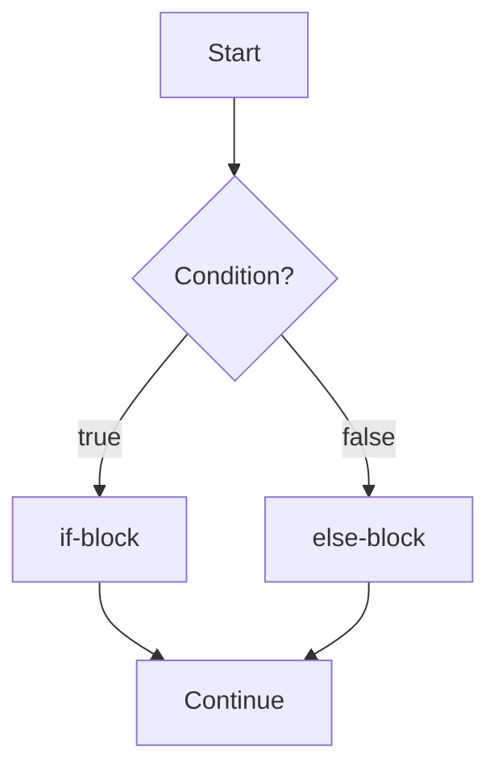

# if-else Statement

## 1. Introduction

The **`if-else`** statement chooses between **two alternatives**: run one block if the condition is true, or run another block if it is false. It's Java's way of saying "do A, otherwise do B."

---

## 2. Why This Topic Is Important

- **Every binary decision** (pass/fail, true/false, on/off) uses if-else.
- The `else-if` chain is how you handle *many* options cleanly.
- Interviewers test the **dangling else** problem and ordering of conditions.
- It appears in ~90% of real-world Java methods.

---

## 3. Real-World Analogy

An if-else is like a **traffic light**: if the light is green, you go; otherwise (red/yellow) you stop. Two outcomes, one check. An **else-if chain** is like choosing a meal size: if it's a small order → small box, else if medium → medium box, else → large box.

---

## 4. Theory

### Basic if-else
```java
if (condition) {
    // runs when condition is true
} else {
    // runs when condition is false
}
```
Exactly **one** of the two blocks always runs.

### else-if Chain
```java
if (marks >= 90) {
    grade = 'A';
} else if (marks >= 75) {
    grade = 'B';
} else if (marks >= 60) {
    grade = 'C';
} else {
    grade = 'F';
}
```
- Conditions are checked **top to bottom**.
- The **first true** condition wins; the rest are skipped.
- The final `else` is optional (catches "everything else").

---

## 5. Syntax

```java
if (condition) {
    // true path
} else {
    // false path
}
```

---

## 6. Flow Explanation



For else-if chains, each condition is tested in sequence until one is true.

---

## 7. Memory Representation

Both branches are compiled; the JVM jumps to the correct one. No additional heap memory is used — decisions live in the stack frame's instruction pointer.

---

## 8. Simple Example

```java
public class IfElseDemo {
    public static void main(String[] args) {
        int age = 16;

        if (age >= 18) {
            System.out.println("Adult: eligible to vote.");
        } else {
            System.out.println("Minor: not eligible to vote.");
        }
    }
}
```

---

## 9. Intermediate Example — else-if Grade Calculator

```java
public class GradeCalc {
    public static void main(String[] args) {
        int marks = 82;
        char grade;

        if (marks >= 90) {
            grade = 'A';
        } else if (marks >= 75) {
            grade = 'B';
        } else if (marks >= 60) {
            grade = 'C';
        } else if (marks >= 40) {
            grade = 'D';
        } else {
            grade = 'F';
        }
        System.out.println("Marks: " + marks + " -> Grade: " + grade);
    }
}
```

---

## 10. Advanced Example — Business Logic with else-if

```java
public class ShippingCost {
    public static void main(String[] args) {
        double weight = 7.5;   // in kg
        double cost;

        if (weight <= 1) {
            cost = 50;
        } else if (weight <= 5) {
            cost = 100;
        } else if (weight <= 10) {
            cost = 200;
        } else {
            cost = 500;
        }
        System.out.println("Shipping cost for " + weight + " kg = Rs " + cost);
    }
}
```

---

## 11. Output

For the **Grade Calculator**:

```
Marks: 82 -> Grade: B
```

For the **Shipping example**:

```
Shipping cost for 7.5 kg = Rs 200
```

---

## 12. Common Mistakes

| Mistake | Correction |
|---------|------------|
| Using many `if`s instead of `else if` | Independent `if`s run ALL true branches; `else if` runs only the first |
| Reversing condition order | Put the most specific/important condition first |
| Semicolon after `if` | `if (x > 0);` → empty statement; the block always runs |
| Forgetting the final `else` | Without it, unmatched values silently do nothing |
| Comparing strings with `==` | Strings need `.equals()` (Module 08) |

---

## 13. Best Practices

- Use `else if` for **mutually exclusive** outcomes; `if`s for independent checks.
- Order conditions from **most restrictive** to least.
- Always terminate an else-if chain with a final `else` (even if empty) for safety.
- Consider `switch` or a `Map` when the chain grows beyond ~4 branches.

---

## 14. Interview Questions

**Q1. What is the difference between `if` and `if-else`?**
*`if` runs only the true branch; `if-else` guarantees exactly one branch runs.*

**Q2. What is the "dangling else" problem?**
*When `else` binds to the nearest unmatched `if`. Using braces removes all ambiguity.*

**Q3. Can an else-if chain run more than one block?**
*No — execution stops at the first true condition.*

**Q4. Is the final else required?**
*No, but it's recommended as a catch-all for unexpected values.*

**Q5. When should you use else-if instead of switch?**
*When conditions involve ranges/comparisons (e.g., `marks >= 75`), not exact equality.*

---

## 15. Practice Exercises

1. Check if a number is positive, negative, or zero (else-if).
2. Print whether a year is leap or not (hint: divisible by 4 and not 100, or by 400).
3. Classify an age as Child (<13), Teen (13-19), Adult (20-59), Senior (60+).
4. Use else-if to convert a score to a Pass/Fail with a grade.

---

## 16. Coding Challenges

1. **Easy:** Read a number and print whether it is even or odd using if-else.
2. **Medium:** Find the largest of three numbers using else-if.
3. **Hard:** Write an electricity bill calculator with slab rates using else-if.

---

## 17. Summary

- `if-else` runs exactly one of two blocks.
- `else-if` chains handle many options, first-true wins.
- Order conditions most-specific first.
- Use braces; add a final `else` as a catch-all.
- Choose `switch` for many exact-value cases.

➡️ Continue to: [Nested if](Nested-if.md)