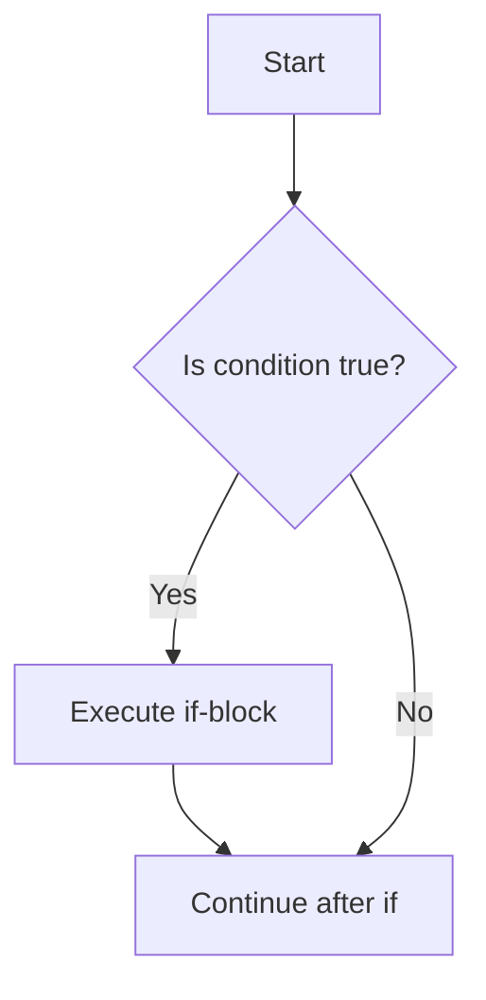

# if Statement

## 1. Introduction

The **`if` statement** is Java's simplest decision maker. It executes a block of code **only if** a condition is `true`. This single concept is the foundation of all logic in programming.

---

## 2. Why This Topic Is Important

- `if` is the most used statement in all of programming.
- Every decision your program makes (validation, permission checks, filters) uses it.
- Interviewers test edge cases: empty conditions, dangling else, operator misuse.
- Mastering `if` unlocks everything from games to business rules.

---

## 3. Real-World Analogy

The `if` statement is like a **door with a keycard lock**. If you have a valid keycard (condition is true), the door opens (block runs). If not, you just walk away (block is skipped) — no error, nothing happens.

---

## 4. Theory

### Syntax
```java
if (condition) {
    // statements run only when condition is true
}
```

### Rules
- The `condition` must produce a **boolean** (`true`/`false`).
- Braces `{ }` are optional for a **single** statement, but always use them.
- If the condition is false, the block is skipped entirely.
- Conditions often use relational (`>`, `<`, `==`) and logical (`&&`, `||`) operators.

---

## 5. Syntax

```java
if (age >= 18) {
    System.out.println("You are an adult.");
}
```

---

## 6. Flow Explanation



---

## 7. Memory Representation

The condition is evaluated and stored as a boolean on the JVM stack; the branch either jumps into the block or skips it. No extra memory allocation.

---

## 8. Simple Example

```java
public class IfDemo {
    public static void main(String[] args) {
        int score = 75;

        if (score >= 60) {
            System.out.println("You passed!");
        }
        System.out.println("Score: " + score);
    }
}
```

---

## 9. Intermediate Example — Multiple Independent `if`s

```java
public class MultipleIfs {
    public static void main(String[] args) {
        int marks = 85;
        int attendance = 90;

        if (marks >= 80) {
            System.out.println("Excellent marks!");
        }
        if (attendance >= 75) {
            System.out.println("Good attendance!");
        }
        if (marks >= 80 && attendance >= 75) {
            System.out.println("You are a top student!");
        }
    }
}
```

---

## 10. Advanced Example — Guard Clause Pattern

```java
public class GuardClause {
    static void processPayment(double amount) {
        if (amount <= 0) {
            System.out.println("Invalid amount. Transaction rejected.");
            return;               // guard: exit early
        }
        if (amount > 10000) {
            System.out.println("Amount exceeds limit. Needs manager approval.");
            return;
        }
        System.out.println("Payment of $" + amount + " processed.");
    }

    public static void main(String[] args) {
        processPayment(-50);
        processPayment(15000);
        processPayment(500);
    }
}
```

---

## 11. Output

For the **Advanced Example**:

```
Invalid amount. Transaction rejected.
Amount exceeds limit. Needs manager approval.
Payment of $500.0 processed.
```

---

## 12. Common Mistakes

| Mistake | Correction |
|---------|------------|
| `if (x = 5)` instead of `if (x == 5)` | `=` assigns; `==` compares. `if (x = 5)` won't even compile |
| Missing braces around multiple statements | Only the first statement belongs to the `if` |
| Using `if` instead of `else if` for exclusive paths | All true conditions run; use else-if chains |
| Writing `if (x > 5 && x < 10)` as `if (5 < x < 10)` | Java has no chained comparisons |
| Forgetting the condition must be boolean | `if (5)` → compile error in Java (unlike C) |

---

## 13. Best Practices

- **Always use braces** even for one-liners — prevents future bugs.
- Use **guard clauses** (`if (bad) return;`) to keep methods readable.
- Put the most likely condition first for performance and readability.
- Write clear boolean conditions; avoid double negatives like `if (!(x < 5))`.

---

## 14. Interview Questions

**Q1. What happens if the condition in an `if` is false?**
*The block is skipped and execution continues after the closing brace.*

**Q2. Can the condition be a non-boolean value like an int?**
*No — Java requires a boolean expression in `if`. `if (1)` doesn't compile.*

**Q3. Are braces required for a single statement?**
*No, but best practice is to always use them.*

**Q4. What is a guard clause?**
*A quick `if` that returns early to reject invalid cases, keeping the main logic flat and readable.*

**Q5. Why does `if (x = 5)` fail to compile?**
*Because `x = 5` is an assignment (returns int), not a boolean comparison.*

---

## 15. Practice Exercises

1. Print "Even" if a number is divisible by 2.
2. Print "Eligible" if a person's age is at least 18.
3. Print "Positive" if a number is greater than zero.
4. Use three independent `if`s to check marks, attendance, and discipline.

---

## 16. Coding Challenges

1. **Easy:** Read a number and print "Big" if it's greater than 100.
2. **Medium:** Read three numbers and count how many are positive.
3. **Hard:** Implement a login check: accept if username equals "admin" AND password equals "pass123".

---

## 17. Summary

- `if (condition) { ... }` runs a block only when the condition is true.
- Condition must be boolean.
- Use braces always; use guard clauses for early exit.
- `==` compares, `=` assigns.

➡️ Continue to: [if-else](if-else.md)