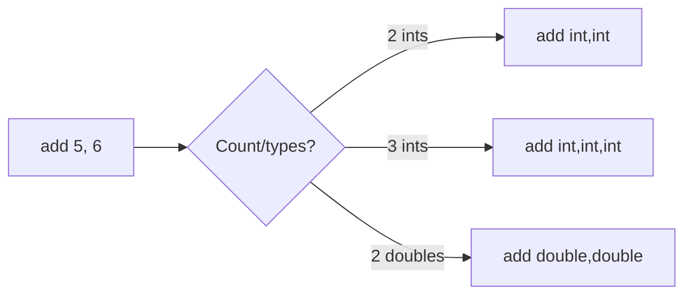

# Method Overloading

## 1. Introduction

**Method overloading** lets you define **multiple methods with the same name** but **different parameter lists** in the same class. The compiler picks the right one based on the arguments you pass — a form of compile-time polymorphism.

---

## 2. Why This Topic Is Important

- Overloading creates **clean, intuitive APIs** (`println` itself is overloaded ~10 times).
- It's a core **polymorphism** concept tested in every OOP interview.
- Constructors are overloaded in real-world classes all the time.
- Understanding it clarifies "which method runs?" resolution.

---

## 3. Real-World Analogy

Think of a **single word with multiple meanings depending on context** — like "order": "order a coffee" (noun), "order the files" (verb), "order by size" (with an attribute). Same word, different structure, clear meaning each time. Java picks the right method by what you pass it.

---

## 4. Theory

### Rules
| Requirement | Detail |
|-------------|--------|
| Same method name | Yes |
| Different parameter list | Count, types, or order must differ |
| Return type irrelevant | Can't overload on return type alone |
| Same class (or subclass) | Overloading happens in one class scope |

### Valid vs Invalid
```java
static void show(int a) { }          // OK
static void show(int a, int b) { }   // OK - different count
static void show(double a) { }       // OK - different type
static void show(String s) { }       // OK - different type
static int show(int a) { }           // ERROR - same params, diff return only
```

### Resolution
Java chooses the **most specific** applicable method:
```java
show(5);          // matches show(int)
show(5, 10);      // matches show(int, int)
show(3.5);        // matches show(double)
```

---

## 5. Syntax

```java
static int add(int a, int b) {
    return a + b;
}

static int add(int a, int b, int c) {
    return a + b + c;
}

static double add(double a, double b) {
    return a + b;
}
```

---

## 6. Flow Explanation



---

## 7. Memory Representation

Overloaded methods are **distinct methods** in the class file — each has its own stack frame and bytecode. Overloading does not create extra heap objects.

---

## 8. Simple Example

```java
public class OverloadDemo {
    static void print(int x) {
        System.out.println("int: " + x);
    }

    static void print(String s) {
        System.out.println("String: " + s);
    }

    static void print(double d) {
        System.out.println("double: " + d);
    }

    public static void main(String[] args) {
        print(10);
        print("Hello");
        print(3.14);
    }
}
```

---

## 9. Intermediate Example — Same Name, Different Arity

```java
public class OverloadCount {
    static int add(int a, int b) {
        return a + b;
    }

    static int add(int a, int b, int c) {
        return a + b + c;
    }

    public static void main(String[] args) {
        System.out.println("1+2   = " + add(1, 2));
        System.out.println("1+2+3 = " + add(1, 2, 3));
    }
}
```

---

## 10. Advanced Example — Type Promotion & Constructor Overloading

```java
public class OverloadAdvanced {
    // int vs long vs double promotions
    static void show(int a)      { System.out.println("int: " + a); }
    static void show(long a)     { System.out.println("long: " + a); }
    static void show(double a)   { System.out.println("double: " + a); }

    public static void main(String[] args) {
        show(5);          // exact: int
        show(5L);         // exact: long
        show(5.0);        // exact: double
        show('A');        // char promotes to int -> "int: 65"
        show(5.5f);       // float promotes to double -> "double: 5.5"
    }
}
```

---

## 11. Output

For the **Simple Example**:

```
int: 10
String: Hello
double: 3.14
```

For the **Advanced Example**:

```
int: 5
long: 5
double: 5.0
int: 65
double: 5.5
```

---

## 12. Common Mistakes

| Mistake | Correction |
|---------|------------|
| Overloading by return type only | Not allowed — parameter lists must differ |
| Creating ambiguous overloads | `show(int, double)` vs `show(double, int)` called with (5,5) is ambiguous |
| Expecting overloads to "override" | Overloading is static (compile-time); overriding is dynamic (Module 09) |
| Ignoring type promotion order | `char` → `int` → `long` → `double` |
| Duplicating logic across overloads | Have the larger overload call the smaller one (delegation) |

---

## 13. Best Practices

- Use overloading for **natural variations** of the same concept.
- Delegate overloads to a single "core" method.
- Avoid overloading with just one `boolean` difference — confusing APIs.
- Keep overloads' behaviors consistent (same contract, different inputs).

---

## 14. Interview Questions

**Q1. What is method overloading?**
*Defining multiple methods with the same name but different parameter lists in the same class.*

**Q2. Can you overload based on return type alone?**
*No — the parameter list must differ.*

**Q3. Is overloading compile-time or runtime polymorphism?**
*Compile-time (static polymorphism) — the compiler resolves the method.*

**Q4. Which overload runs for `show('A')`?**
*The `int` one, because `char` promotes to `int`.*

**Q5. Why is `System.out.println` a good example of overloading?**
*It has many overloads (String, int, double, char, boolean, Object, ...) — same name, different params.*

---

## 15. Practice Exercises

1. Overload `area` for square (int) and rectangle (int, int).
2. Overload `greet` for no-arg, one name, and name + greeting.
3. Overload `max` for ints, doubles, and three ints.
4. Show `char` promotion resolving to the int overload.

---

## 16. Coding Challenges

1. **Easy:** Overload `multiply` for (int,int) and (double,double).
2. **Medium:** Create a class with overloaded constructors (Java 8 preview for OOP).
3. **Hard:** Design an overloaded `format` that converts int, double, and String to a nice display string, delegating to one core method.

---

## 17. Summary

- Overloading = same name, different parameters.
- Return type alone can't distinguish overloads.
- Resolution: most specific match; type promotion applies.
- It's **compile-time polymorphism**.
- Delegate overloads to a core method for DRY code.

➡️ Continue to: [Recursion](Recursion.md)