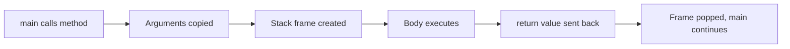
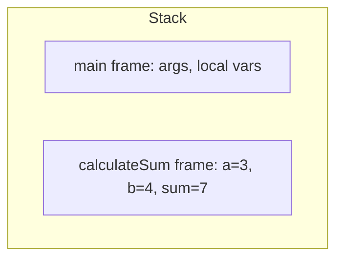

# Method Syntax

## 1. Introduction

A **method** is a named block of reusable code. It has a declaration (the signature) and a body (the statements). Calling a method executes its body wherever you need it.

---

## 2. Why This Topic Is Important

- Methods are the **primary unit of organization** in Java programs.
- Interviewers dissect method signatures (access modifiers, return types).
- Correct syntax avoids cryptic compile errors.
- Every real program — from hello world to Spring Boot — is built from methods.

---

## 3. Real-World Analogy

A method is like a **recipe stored in a cookbook**. The recipe title (method name) tells you what it does. The ingredient list (parameters) is what you must provide. The instructions (body) run step by step. And the finished dish (return value) is what you get back. You can use the same recipe any number of times.

---

## 4. Theory

### Anatomy of a Method

```java
[access modifier] [other modifiers] [return type] [name]([parameters]) {
    // body
}
```

```java
public static int calculateSum(int a, int b) {
    int sum = a + b;
    return sum;
}
```

| Part | Example | Meaning |
|------|---------|---------|
| Access modifier | `public` | Who can call it (Module 11) |
| Other modifiers | `static` | Belongs to the class (not an object) |
| Return type | `int` | What it gives back; `void` = nothing |
| Name | `calculateSum` | CamelCase verb phrase |
| Parameters | `(int a, int b)` | Inputs it needs |
| Body | `{ ... }` | The statements that run |
| Return | `return sum;` | Sends the result back |

### Method Signature
The **signature** = method name + parameter types (NOT the return type). Two methods with the same name but different parameter types = overloading.

---

## 5. Syntax

```java
// No parameters, no return
static void sayHello() {
    System.out.println("Hello!");
}

// With parameters and return
static int square(int x) {
    return x * x;
}
```

---

## 6. Flow Explanation



---

## 7. Memory Representation



Each call pushes a **stack frame**; returning pops it. Primitives live in the frame; object references point to the heap.

---

## 8. Simple Example

```java
public class MethodSyntaxDemo {
    static void greet() {
        System.out.println("Hello, Java!");
    }

    public static void main(String[] args) {
        greet();
        greet();
    }
}
```

---

## 9. Intermediate Example — Method with Parameters

```java
public class MethodParams {
    static void displayProfile(String name, int age) {
        System.out.println("Name: " + name + " | Age: " + age);
    }

    public static void main(String[] args) {
        displayProfile("Ajay", 25);
        displayProfile("Priya", 30);
    }
}
```

---

## 10. Advanced Example — Methods Calling Methods

```java
public class MethodChain {
    static double applyDiscount(double price, double percent) {
        return price - (price * percent / 100);
    }

    static double applyTax(double price, double taxRate) {
        return price + (price * taxRate / 100);
    }

    static double finalPrice(double price, double discount, double tax) {
        return applyTax(applyDiscount(price, discount), tax);
    }

    public static void main(String[] args) {
        System.out.println("Final price: " + finalPrice(1000, 20, 18));
    }
}
```

---

## 11. Output

For the **Intermediate Example**:

```
Name: Ajay | Age: 25
Name: Priya | Age: 30
```

For the **Advanced Example**:

```
Final price: 944.0
```

---

## 12. Common Mistakes

| Mistake | Correction |
|---------|------------|
| Forgetting the return type (`void` for nothing) | Every method needs a return type |
| Declaring a method inside `main` | Methods live at class level, not inside other methods |
| Wrong parameter order | Call with types matching the signature order |
| `return` outside a method | `return` only works inside methods |
| Method name not matching the call | Case-sensitive: `getSum` ≠ `getsum` |

---

## 13. Best Practices

- Use **verb** names: `calculateTotal`, `sendEmail`.
- Keep methods **small** — one clear responsibility.
- Limit parameters to ≤ 4; group related ones in an object.
- Declare methods at class level, never nested.
- Use `static` only when the method doesn't need instance state.

---

## 14. Interview Questions

**Q1. What is a method signature?**
*The method name plus its parameter types. It's what distinguishes overloaded methods.*

**Q2. What does `void` mean in a method?**
*The method returns no value.*

**Q3. Can a method have the same name as another?**
*Yes, if parameter types differ — that's overloading.*

**Q4. Where can methods be declared?**
*Inside a class, at class level — not inside other methods.*

**Q5. What is a stack frame?**
*The block of memory created per method call, holding its local variables and parameters.*

---

## 15. Practice Exercises

1. Create a method that prints your name.
2. Create a method that takes two numbers and prints their product.
3. Write a method that calls two other methods in sequence.
4. Identify the signature of `static double area(double r)`.

---

## 16. Coding Challenges

1. **Easy:** Write `printTable(int n)` that prints the multiplication table of n.
2. **Medium:** Write `power(int base, int exp)` using a loop.
3. **Hard:** Write `reverseNumber(int n)` and test with 12345 → 54321.

---

## 17. Summary

- Anatomy: modifiers, return type, name, parameters, body.
- `void` = no return; otherwise use `return value;`.
- Method signature = name + parameter types.
- Each call pushes a stack frame, popped on return.
- Keep methods small, single-purpose, verb-named.

➡️ Continue to: [Parameters and Arguments](Parameters-and-Arguments.md)