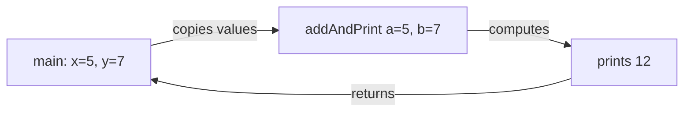
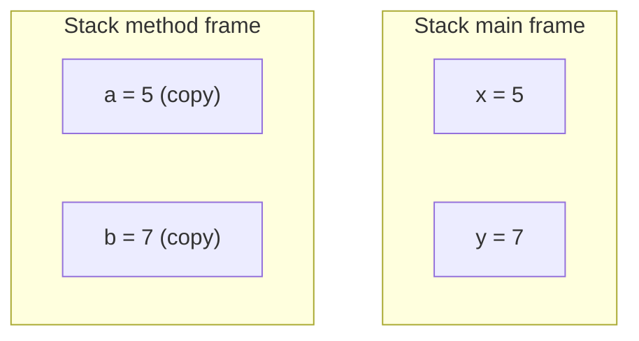

# Parameters and Arguments

## 1. Introduction

**Parameters** are the variables listed in a method's declaration; **arguments** are the actual values you pass when calling it. Understanding the parameter/argument relationship — especially Java's **pass-by-value** rule — prevents a huge class of bugs.

---

## 2. Why This Topic Is Important

- *"Is Java pass-by-value or pass-by-reference?"* is a **classic interview question**.
- Misunderstanding it causes "why didn't my method change the value?" bugs.
- Multi-parameter design affects API cleanliness.
- It's essential before OOP (Module 09), where objects get passed around.

---

## 3. Real-World Analogy

Think of ordering food by **photograph**: The recipe (method) requires ingredients — those are **parameters**. When you order, you hand over actual ingredients — those are **arguments**. The kitchen (method) works with *copies* of what you handed over; if the kitchen chops the vegetables (modifies a primitive), your original vegetables stay whole.

---

## 4. Theory

### Definitions
```java
static void greet(String name, int times) {   // name, times = parameters
    for (int i = 0; i < times; i++) {
        System.out.println("Hi " + name);
    }
}

greet("Ajay", 3);    // "Ajay", 3 = arguments
```

### Pass by Value
Java copies the **value** of each argument into the parameter:

- **Primitives**: the copy is the value itself → changes inside don't affect the caller.
- **References**: the copy is the *address* → the method can modify the object, but **cannot** make the caller's reference point elsewhere.

```java
static void trySwap(int a, int b) {
    int temp = a;
    a = b;             // only local copies change
    b = temp;
}
// caller's variables are NOT swapped!
```

---

## 5. Syntax

```java
static void addAndPrint(int a, int b) {
    System.out.println(a + b);
}

public static void main(String[] args) {
    int x = 5, y = 7;
    addAndPrint(x, y);   // arguments x, y
}
```

---

## 6. Flow Explanation



The caller's `x`, `y` are untouched.

---

## 7. Memory Representation



Two separate slots with the same values.

---

## 8. Simple Example

```java
public class ParamsDemo {
    static void greet(String name) {
        System.out.println("Hello, " + name + "!");
    }

    public static void main(String[] args) {
        greet("World");
        greet("Java");
    }
}
```

---

## 9. Intermediate Example — Pass-by-Value Proof

```java
public class PassByValue {
    static void modify(int x) {
        x = 100;
        System.out.println("Inside method, x = " + x);
    }

    public static void main(String[] args) {
        int x = 5;
        modify(x);
        System.out.println("After call, x = " + x);   // still 5!
    }
}
```

---

## 10. Advanced Example — Objects: value of the reference

```java
import java.util.Arrays;

public class ReferenceValue {
    static void addToArray(int[] arr) {
        arr[0] = 99;                      // modifies the SAME object
    }

    static void tryReassign(int[] arr) {
        arr = new int[]{0, 0, 0};         // only the local reference changes
        System.out.println("Inside tryReassign, arr[0] = " + arr[0]);
    }

    public static void main(String[] args) {
        int[] numbers = {1, 2, 3};
        addToArray(numbers);
        System.out.println("After addToArray: " + Arrays.toString(numbers));

        tryReassign(numbers);
        System.out.println("After tryReassign: " + Arrays.toString(numbers));
    }
}
```

---

## 11. Output

For the **Intermediate Example**:

```
Inside method, x = 100
After call, x = 5
```

For the **Advanced Example**:

```
After addToArray: [99, 2, 3]
Inside tryReassign, arr[0] = 0
After tryReassign: [99, 2, 3]
```

---

## 12. Common Mistakes

| Mistake | Correction |
|---------|------------|
| Expecting a method to swap two primitives | Java is pass-by-value; return a result instead |
| Expecting reassignment to affect the caller | Reassigning a reference only changes the local copy |
| Passing arguments in the wrong order | Match the parameter order exactly |
| Assuming primitives are passed by reference | They are always copied |
| Forgetting that objects passed in can be mutated | If you must not mutate, copy the object first |

---

## 13. Best Practices

- Keep parameter order logical and consistent across methods.
- For multiple related values, pass an object instead of many params.
- If a method must "return" several values, use an object or array.
- Document parameters with Javadoc `@param`.
- For read-only object params, copy defensively when needed.

---

## 14. Interview Questions

**Q1. Is Java pass-by-value or pass-by-reference?**
*Pass-by-value. Primitives copy the value; references copy the address. In both cases a copy is made.*

**Q2. Can a method swap two ints passed to it?**
*No — only the copies change. You'd need to return the swapped values.*

**Q3. Why can a method modify an object passed to it?**
*Because the copied reference points to the same object in the heap.*

**Q4. What is the difference between a parameter and an argument?**
*A parameter is declared in the method; an argument is the value passed at the call site.*

**Q5. Can a method change the caller's reference variable to point elsewhere?**
*No — the reference itself is passed by value.*

---

## 15. Practice Exercises

1. Write a method `printSum(a, b)` and call it with different arguments.
2. Prove primitives are copied (modify inside, observe outside).
3. Prove an array's contents change when modified inside a method.
4. Try to reassign an array inside a method and show it fails to affect the caller.

---

## 16. Coding Challenges

1. **Easy:** Write `multiply(int a, int b)` and test several argument pairs.
2. **Medium:** Write a method that returns a new array with elements doubled (don't mutate input).
3. **Hard:** Implement a `swap` that actually works by returning an array `[b, a]`.

---

## 17. Summary

- Parameters = declared inputs; arguments = actual values.
- Java is **pass-by-value** — always a copy.
- Primitives: copy of value. References: copy of address.
- You can mutate the object a reference points to, but not re-point the caller's reference.
- Order and count of arguments must match the parameters.

➡️ Continue to: [Return Types](Return-Types.md)