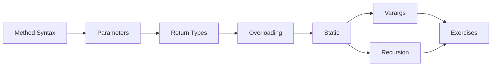

# 06 — Methods

> **Experience level: 🟡 Basic+ (6 months – 1 year)**

A **method** is a named block of code you can call from anywhere. Methods let you write code **once** and **reuse** it many times — the foundation of clean, maintainable programs. This module teaches method syntax, parameters, return values, overloading, recursion, and more.

---

## 📂 Files in This Module

| File | What You'll Learn |
|------|-------------------|
| [Method-Syntax.md](Method-Syntax.md) | Anatomy of a method: modifiers, return type, name, parameters |
| [Parameters-and-Arguments.md](Parameters-and-Arguments.md) | Pass by value, multiple params, named clarity |
| [Return-Types.md](Return-Types.md) | Returning values, `void`, early returns |
| [Method-Overloading.md](Method-Overloading.md) | Multiple methods with the same name but different parameters |
| [Recursion.md](Recursion.md) | A method calling itself — with stack-walk visualization |
| [Static-Methods.md](Static-Methods.md) | Class-level methods called without an object |
| [Varargs.md](Varargs.md) | Accept a variable number of arguments (`...`) |
| [Exercises.md](Exercises.md) | Practice tasks for this module |

---

## 🎯 Learning Objectives

By the end of this module, you will be able to:

1. ✅ Define and call methods with parameters and return values.
2. ✅ Understand Java's **pass-by-value** behavior.
3. ✅ Overload methods to keep APIs clean.
4. ✅ Write recursive methods and trace their call stack.
5. ✅ Use `static` methods and varargs correctly.

---

## 🧭 Module Map



---

## 🚀 Why Methods Matter

Without methods, your `main` would be thousands of lines long. Methods give you:

- **Reusability** — write once, call many times.
- **Readability** — names describe behavior (`calculateSalary()`).
- **Testability** — isolate and test one behavior.
- **Maintainability** — fix a bug in one place.

---

## 📌 Quick Preview

```java
public class Preview {
    static int add(int a, int b) {
        return a + b;
    }

    public static void main(String[] args) {
        System.out.println("3 + 4 = " + add(3, 4));
        System.out.println("10 + 20 = " + add(10, 20));
    }
}
```

You'll understand every line of this by the end of the module.

---

## Next Module

➡️ [07 — Arrays](../07-Arrays/README.md) — store many values in one structure.