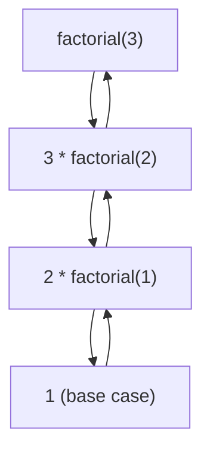

# Recursion

## 1. Introduction

**Recursion** is when a method calls **itself**. Each call solves a *smaller* version of the same problem until it reaches a **base case** that stops the recursion. It's an elegant alternative to loops for problems that are naturally self-similar.

---

## 2. Why This Topic Is Important

- Recursion powers **tree/graph algorithms** (DSA module 23), file-system traversal, and divide-and-conquer.
- Interviewers ask: factorial, Fibonacci, and "explain the call stack."
- Understanding recursion deepens your grasp of the **method stack**.
- Some problems (tree traversal, permutations) are far cleaner recursively.

---

## 3. Real-World Analogy

Recursion is like **Russian nesting dolls**. To open the biggest doll, you open it, find a smaller doll, open it, find an even smaller one... until you reach the tiniest doll (the base case). Then you close each doll back up in reverse order — just like the call stack unwinds.

---

## 4. Theory

### Two Essential Parts
| Part | Purpose | Example |
|------|---------|---------|
| **Base case** | Stops recursion | `if (n <= 1) return 1;` |
| **Recursive case** | Calls itself with smaller input | `return n * factorial(n - 1);` |

### The Call Stack
```java
factorial(4)
 -> 4 * factorial(3)
      -> 3 * factorial(2)
           -> 2 * factorial(1)
                -> 1            // base case
           <- 2 * 1 = 2
      <- 3 * 2 = 6
 -> 4 * 6 = 24
```

### Risk: Stack Overflow
Without a correct base case, recursion never ends → `StackOverflowError`.

---

## 5. Syntax

```java
static int factorial(int n) {
    if (n <= 1) {          // base case
        return 1;
    }
    return n * factorial(n - 1);   // recursive case
}
```

---

## 6. Flow Explanation



---

## 7. Memory Representation

```mermaid
flowchart TB
    subgraph Stack (grows downward)
        F1["factorial(3): n=3"]
        F2["factorial(2): n=2"]
        F3["factorial(1): n=1 (returns 1)"]
    end
```

Each call pushes a frame; unwinding pops them in LIFO order.

---

## 8. Simple Example — Factorial

```java
public class Factorial {
    static int factorial(int n) {
        if (n <= 1) return 1;
        return n * factorial(n - 1);
    }

    public static void main(String[] args) {
        System.out.println("5! = " + factorial(5));
    }
}
```

---

## 9. Intermediate Example — Fibonacci & Sum of Digits

```java
public class RecursionDemo {
    static int fib(int n) {
        if (n <= 1) return n;          // fib(0)=0, fib(1)=1
        return fib(n - 1) + fib(n - 2);
    }

    static int sumDigits(int n) {
        if (n < 10) return n;
        return (n % 10) + sumDigits(n / 10);
    }

    public static void main(String[] args) {
        System.out.println("fib(7) = " + fib(7));
        System.out.println("sumDigits(1234) = " + sumDigits(1234));
    }
}
```

---

## 10. Advanced Example — Palindrome Check & Power

```java
public class AdvancedRecursion {
    static boolean isPalindrome(String s, int start, int end) {
        if (start >= end) {
            return true;
        }
        if (s.charAt(start) != s.charAt(end)) {
            return false;
        }
        return isPalindrome(s, start + 1, end - 1);
    }

    static int power(int base, int exp) {
        if (exp == 0) return 1;
        if (exp % 2 == 0) {
            int half = power(base, exp / 2);   // fast exponentiation
            return half * half;
        }
        return base * power(base, exp - 1);
    }

    public static void main(String[] args) {
        System.out.println("'madam' palindrome? " + isPalindrome("madam", 0, 4));
        System.out.println("'java'  palindrome? " + isPalindrome("java", 0, 3));
        System.out.println("2^10 = " + power(2, 10));
    }
}
```

---

## 11. Output

For the **Intermediate Example**:

```
fib(7) = 13
sumDigits(1234) = 10
```

For the **Advanced Example**:

```
'madam' palindrome? true
'java'  palindrome? false
2^10 = 1024
```

---

## 12. Common Mistakes

| Mistake | Correction |
|---------|------------|
| Missing base case | Infinite recursion → `StackOverflowError` |
| Base case that never triggers | Ensure input shrinks toward the base case |
| Recursive case not smaller | Arguments must progress to the base case |
| Exponential blow-up (naive fib) | Use memoization or iteration for big inputs |
| Expecting recursion to be faster | Usually slower than loops; it's about clarity |

---

## 13. Best Practices

- **Always write the base case first.**
- Ensure each recursive call moves toward the base case.
- Use recursion for naturally recursive problems (trees, divide-and-conquer).
- Prefer **memoization** (caching) when subproblems repeat.
- For simple linear problems, a loop is usually better.

---

## 14. Interview Questions

**Q1. What is recursion?**
*A method calling itself to solve smaller instances of the same problem until a base case is reached.*

**Q2. What are the two parts of a recursive method?**
*The base case (stop condition) and the recursive case (call with smaller input).*

**Q3. What happens if there's no base case?**
*Infinite recursion → `StackOverflowError`.*

**Q4. Recursion vs iteration — which is better?**
*Iteration is more efficient (no stack overhead); recursion is clearer for self-similar problems (trees).*

**Q5. What is the memory cost of recursion?**
*Each call uses stack space — O(depth) memory; deep recursion risks overflow.*

---

## 15. Practice Exercises

1. Write `factorial(n)` recursively and iteratively; compare.
2. Write `fib(n)` recursively; try `fib(40)` and note the slowness.
3. Write `sumDigits(12345)` recursively.
4. Write `reverseString(String s)` recursively.

---

## 16. Coding Challenges

1. **Easy:** `int countDown(int n)` printing n to 1.
2. **Medium:** Implement `gcd(a, b)` recursively (Euclid's algorithm).
3. **Hard:** Print all permutations of a string using recursion.

---

## 17. Summary

- Recursion = a method calling itself with smaller inputs.
- Two parts: **base case** + **recursive case**.
- Uses the method stack; deep recursion → overflow.
- Best for self-similar problems: trees, palindromes, factorial.
- Add memoization for repeated subproblems.

➡️ Continue to: [Static Methods](Static-Methods.md)