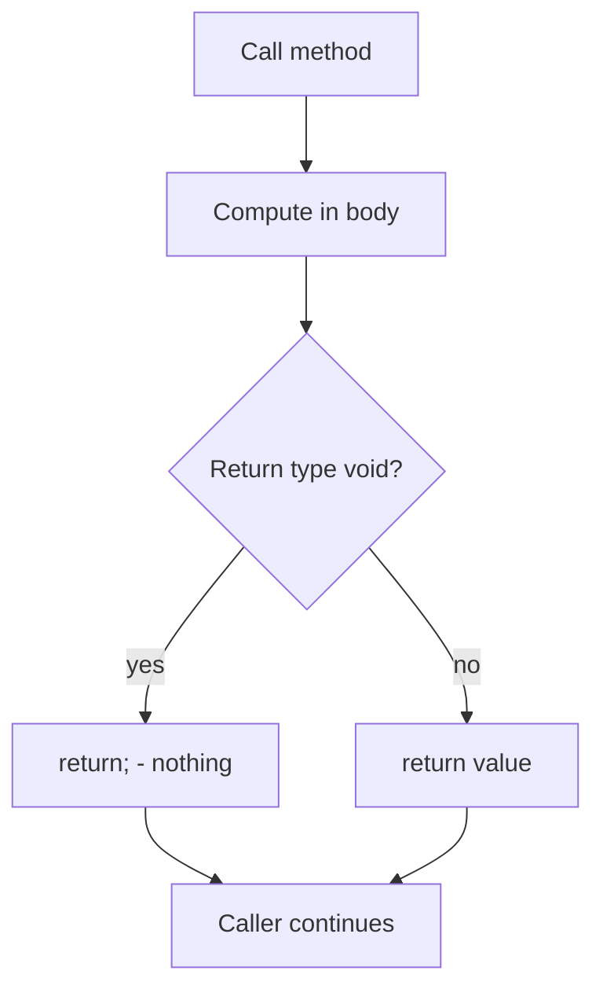

# Return Types

## 1. Introduction

The **return type** declares what a method gives back when it finishes. `void` methods return nothing; all others must produce a value of the declared type via the `return` statement.

---

## 2. Why This Topic Is Important

- Return values let methods **compute and hand back results** — that's how data flows through a program.
- Correct return type matching is a common compile error.
- Interviewers test early returns, return vs print, and type compatibility.
- Clean return design (one exit, meaningful values) marks professional code.

---

## 3. Real-World Analogy

Think of a **bakery counter**: you place an order (call the method) and the baker hands you a boxed cake (return value). If the baker just baked the cake and threw it away (no return), you'd leave empty-handed. `void` methods are like services that do work but hand you nothing back.

---

## 4. Theory

### The Return Statement
```java
static int add(int a, int b) {
    return a + b;      // method produces this value
}
```

### Rules
| Rule | Detail |
|------|--------|
| Type must match | `return 3.5;` won't fit an `int` return |
| `void` = no value | Use `return;` alone to exit early |
| All paths must return | The compiler checks every code path returns a value |
| Return ends the method | Statements after `return` are unreachable (compile warning) |

### Return vs Print
- **Return**: hands the value to the caller (usable for further computation).
- **Print**: writes to console (only for display).

```java
static int calc() { return 42; }        // usable
static void show() { System.out.println(42); }  // display only
```

---

## 5. Syntax

```java
static int square(int x) {
    return x * x;
}

static void log(String msg) {
    System.out.println(msg);
    return;            // optional, exits early
}
```

---

## 6. Flow Explanation



---

## 7. Memory Representation

Return values are passed back through the **stack**: the method's frame computes the value, and the JVM places it where the caller expects it, then pops the frame.

---

## 8. Simple Example

```java
public class ReturnDemo {
    static int multiply(int a, int b) {
        return a * b;
    }

    public static void main(String[] args) {
        int result = multiply(6, 7);
        System.out.println("6 x 7 = " + result);
    }
}
```

---

## 9. Intermediate Example — Early Return (Guard)

```java
public class EarlyReturn {
    static String classify(int n) {
        if (n > 0) return "positive";
        if (n < 0) return "negative";
        return "zero";                 // all paths return
    }

    public static void main(String[] args) {
        System.out.println(classify(5));
        System.out.println(classify(-3));
        System.out.println(classify(0));
    }
}
```

---

## 10. Advanced Example — Multiple Return Types of Methods

```java
public class ReturnTypes {
    static int max(int[] arr) {
        int m = arr[0];
        for (int v : arr) {
            if (v > m) m = v;
        }
        return m;
    }

    static double average(double[] arr) {
        double sum = 0;
        for (double v : arr) sum += v;
        return sum / arr.length;
    }

    static String formatResult(String label, double value) {
        return label + ": " + value;
    }

    public static void main(String[] args) {
        int[] nums = {4, 9, 2, 15, 6};
        double[] vals = {10.0, 20.0, 30.0};
        System.out.println(formatResult("Max", max(nums)));
        System.out.println(formatResult("Avg", average(vals)));
    }
}
```

---

## 11. Output

For the **Intermediate Example**:

```
positive
negative
zero
```

For the **Advanced Example**:

```
Max: 15.0
Avg: 20.0
```

---

## 12. Common Mistakes

| Mistake | Correction |
|---------|------------|
| Missing `return` on all paths | "missing return statement" — cover every branch |
| Returning the wrong type | `return 3.5` in an `int` method → compile error |
| Code after `return` | Unreachable — remove it |
| Using `void` when a value is needed | Change to the right type and `return` the value |
| `return` outside a method | Only valid inside methods |

---

## 13. Best Practices

- Prefer **single responsibility**: one method, one returned value.
- Use **early returns** (guards) for invalid inputs — flat code.
- Return immutable/meaningful values; avoid returning `null` when an empty result works.
- Choose return types that match intent (int for counts, boolean for checks).
- Return descriptive errors instead of silently returning 0.

---

## 14. Interview Questions

**Q1. What is a return type?**
*The type of value a method produces; `void` means no value.*

**Q2. Can a void method have a return statement?**
*Yes — `return;` exits the method early but returns no value.*

**Q3. What happens if a method with a return type misses a return on one path?**
*Compile error: "missing return statement."*

**Q4. Difference between return and print?**
*`return` gives a value to the caller; `print` only displays it.*

**Q5. Can a method return multiple values?**
*Not directly — return an object, array, or use a holder type.*

---

## 15. Practice Exercises

1. Write `int cube(int n)` and print its result.
2. Write `boolean isEven(int n)` returning true/false.
3. Write `String greet(String name)` returning a greeting.
4. Add early returns to a method that classifies numbers.

---

## 16. Coding Challenges

1. **Easy:** `int absolute(int n)` that returns |n|.
2. **Medium:** `double perimeter(double r)` for a circle.
3. **Hard:** `int secondLargest(int[] arr)` — return the 2nd biggest value.

---

## 17. Summary

- Return type = what the method hands back; `void` = nothing.
- Every non-void path must `return` a matching value.
- Early returns keep code flat and clear.
- Return vs print: usable data vs display only.
- Statements after `return` are unreachable.

➡️ Continue to: [Method Overloading](Method-Overloading.md)