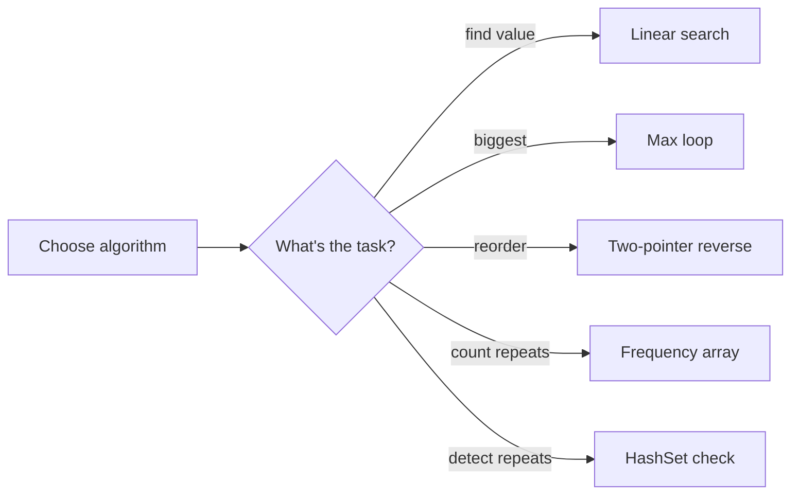

# Array Algorithms

## 1. Introduction

**Array algorithms** are the classic techniques for processing data in arrays: **searching**, finding **max/min**, **reversing**, counting **frequencies**, and checking **duplicates**. They form the bridge to DSA (Module 23).

---

## 2. Why This Topic Is Important

- These are the **most common coding interview questions**.
- They exercise the loop/index skills you'll use forever.
- They introduce complexity thinking (O(n), O(n²)).
- Almost every real application needs at least one of these.

---

## 3. Real-World Analogy

Think of a **store inventory list**:

- **Linear search**: check each shelf until you find the item.
- **Max/min**: find the most/least expensive product.
- **Reverse**: reorganize shelves from newest to oldest.
- **Frequency**: count how many times each product was sold.

These algorithms are the "common chores" of data handling.

---

## 4. Theory

### Linear Search — O(n)
```java
for (int i = 0; i < arr.length; i++) {
    if (arr[i] == target) return i;   // found
}
return -1;                            // not found
```

### Max/Min — O(n)
```java
int max = arr[0];
for (int v : arr) if (v > max) max = v;
```

### Reverse in Place — O(n)
```java
int left = 0, right = arr.length - 1;
while (left < right) {
    int temp = arr[left];
    arr[left] = arr[right];
    arr[right] = temp;
    left++; right--;
}
```

### Frequency (Counting) — O(n) with a helper array/Map
```java
int[] freq = new int[maxValue + 1];
for (int v : arr) freq[v]++;
```

### Duplicate Detection — O(n²) naive, O(n) with a Set

---

## 5. Syntax

The four core algorithms above are the "syntax" — reusable loops and swaps.

---

## 6. Flow Explanation



---

## 7. Memory Representation

- Linear search/max/reverse use **O(1)** extra space (a few locals).
- Frequency array uses **O(maxValue)** space.
- HashSet-based duplicate detection uses **O(n)** space.

---

## 8. Simple Example — Search & Max

```java
public class SearchMax {
    static int search(int[] arr, int target) {
        for (int i = 0; i < arr.length; i++) {
            if (arr[i] == target) return i;
        }
        return -1;
    }

    public static void main(String[] args) {
        int[] nums = {34, 12, 78, 45, 90};
        System.out.println("78 at index: " + search(nums, 78));
        System.out.println("99 at index: " + search(nums, 99));

        int max = nums[0];
        for (int v : nums) if (v > max) max = v;
        System.out.println("Max: " + max);
    }
}
```

---

## 9. Intermediate Example — Reverse & Frequency

```java
import java.util.Arrays;

public class ReverseFreq {
    static void reverse(int[] arr) {
        int left = 0, right = arr.length - 1;
        while (left < right) {
            int temp = arr[left];
            arr[left] = arr[right];
            arr[right] = temp;
            left++;
            right--;
        }
    }

    public static void main(String[] args) {
        int[] nums = {1, 2, 3, 4, 5};
        reverse(nums);
        System.out.println("Reversed: " + Arrays.toString(nums));

        int[] data = {1, 2, 2, 3, 1, 4, 2};
        int[] freq = new int[10];
        for (int v : data) freq[v]++;

        for (int i = 0; i < freq.length; i++) {
            if (freq[i] > 0) {
                System.out.println(i + " appears " + freq[i] + " time(s)");
            }
        }
    }
}
```

---

## 10. Advanced Example — Duplicates & Rotation

```java
import java.util.HashSet;
import java.util.Set;

public class Duplicates {
    static boolean hasDuplicates(int[] arr) {
        Set<Integer> seen = new HashSet<>();
        for (int v : arr) {
            if (!seen.add(v)) return true;   // add returns false if present
        }
        return false;
    }

    static void rotateRight(int[] arr, int k) {
        k = k % arr.length;
        int[] temp = new int[arr.length];
        for (int i = 0; i < arr.length; i++) {
            temp[(i + k) % arr.length] = arr[i];
        }
        System.arraycopy(temp, 0, arr, 0, arr.length);
    }

    public static void main(String[] args) {
        int[] a = {1, 2, 3, 4, 2};
        System.out.println("Has duplicates: " + hasDuplicates(a));

        int[] b = {1, 2, 3, 4, 5};
        rotateRight(b, 2);
        System.out.print("Rotated by 2: ");
        for (int v : b) System.out.print(v + " ");
        System.out.println();
    }
}
```

---

## 11. Output

For the **Simple Example**:

```
78 at index: 2
99 at index: -1
Max: 90
```

For the **Intermediate Example**:

```
Reversed: [5, 4, 3, 2, 1]
1 appears 2 time(s)
2 appears 3 time(s)
3 appears 1 time(s)
4 appears 1 time(s)
```

---

## 12. Common Mistakes

| Mistake | Correction |
|---------|------------|
| Search returns index but code treats it as boolean | Return `-1` and check `!= -1` |
| Reverse with `arr[i] = arr[j]` without temp | Data lost — use a temp variable |
| Off-by-one in frequency array size | Allocate `max + 1` |
| O(n²) duplicate checks when a Set gives O(n) | Use `HashSet` |
| Forgetting modulo in rotation | `k % length` handles k > length |

---

## 13. Best Practices

- State the **complexity** when solving — interviewers love it.
- Prefer `HashSet` for uniqueness checks.
- Use two-pointer technique for in-place reversals.
- Extract algorithms into **static utility methods**.
- Test edge cases: empty array, single element, all-same.

---

## 14. Interview Questions

**Q1. What is the time complexity of linear search?**
*O(n) — worst case you check every element.*

**Q2. How do you find the second largest element?**
*Track both max and secondMax in one pass — O(n).*

**Q3. How do you reverse an array without extra space?**
*Two-pointer swap from both ends — O(1) extra space.*

**Q4. How do you detect duplicates efficiently?**
*Use a HashSet — O(n) time, O(n) space.*

**Q5. What is the frequency-counting technique?**
*Use the element as an index into a count array/Map — O(n).*

---

## 15. Practice Exercises

1. Implement linear search returning the first and last index.
2. Find both min and max in one pass.
3. Reverse a String array.
4. Count frequency of letters in a word using an int[26] array.

---

## 16. Coding Challenges

1. **Easy:** Find the missing number in 1..n given n-1 values.
2. **Medium:** Move all zeros to the end preserving order.
3. **Hard:** Find the first non-repeating element in an array (use a frequency array + second pass).

---

## 17. Summary

- Core algorithms: search, max/min, reverse, frequency, duplicates.
- Linear search O(n); use sorted + binarySearch for O(log n).
- Two-pointer technique reverses in place.
- Frequency array/Map = powerful counting trick.
- HashSet detects duplicates in O(n).

➡️ Continue to: [Exercises](Exercises.md)