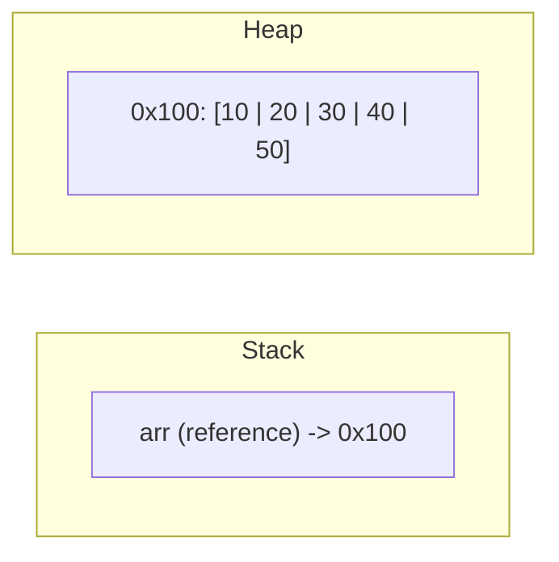

# Array Basics

## 1. Introduction

An **array** is a fixed-size, ordered collection of elements of the **same type**, accessed by an integer **index** starting at 0. It's the simplest data structure in Java.

---

## 2. Why This Topic Is Important

- Arrays are the **building block** of all data structures and algorithms.
- Interviewers test indexing, out-of-bounds errors, and reference semantics.
- Understanding arrays makes collections (Module 12) trivial.
- Real programs store scores, prices, users, and more in arrays.

---

## 3. Real-World Analogy

An array is a **row of numbered lockers**. Each locker holds exactly one item of the same kind (all ints, all Strings). The lockers are numbered 0, 1, 2, 3... and you access an item by its locker number: `lockers[2]`.

---

## 4. Theory

### Declaration
```java
int[] numbers;          // preferred — type[] name
int numbers[];          // legal but less readable
String[] names;
```

### Creation
```java
int[] numbers = new int[5];       // array of 5 ints, all 0
int[] scores = {85, 92, 78};      // array literal (size inferred = 3)
int[] nums = new int[]{1, 2, 3};  // anonymous array
```

### Default Values
| Type | Default element |
|------|-----------------|
| int/byte/short/long | 0 |
| double/float | 0.0 |
| char | '\u0000' |
| boolean | false |
| Reference (String...) | null |

### Indexing
- First element: `arr[0]`
- Last element: `arr[arr.length - 1]`
- `arr.length` — the size (a field, not a method!)
- Valid indices: `0` to `length - 1`

### The Classic Error
```java
int[] a = new int[3];   // indices 0,1,2
a[3] = 5;               // ArrayIndexOutOfBoundsException!
```

---

## 5. Syntax

```java
type[] name = new type[size];
type[] name = {v1, v2, v3};
name[index] = value;    // write
value = name[index];    // read
name.length             // size
```

---

## 6. Flow Explanation

```mermaid
flowchart TD
    A[new int[5]] --> B[JVM allocates heap block]
    B --> C[Fills with 0]
    C --> D[Returns reference]
    D --> E[Store in variable]
    E --> F[Access via index 0..4]
```

---

## 7. Memory Representation



The variable holds an **address** to a contiguous heap block. `arr[2]` = `0x100 + 2 * elementSize`.

---

## 8. Simple Example

```java
public class ArrayBasicsDemo {
    public static void main(String[] args) {
        int[] numbers = new int[4];
        numbers[0] = 10;
        numbers[1] = 20;
        numbers[2] = 30;
        numbers[3] = 40;

        System.out.println("Length: " + numbers.length);
        System.out.println("First : " + numbers[0]);
        System.out.println("Last  : " + numbers[numbers.length - 1]);
    }
}
```

---

## 9. Intermediate Example — Array Literal & Defaults

```java
import java.util.Arrays;

public class ArrayDefaults {
    public static void main(String[] args) {
        int[] marks = {85, 92, 78};            // literal
        double[] temps = new double[3];        // defaults 0.0
        boolean[] flags = new boolean[2];      // defaults false
        String[] names = new String[2];        // defaults null

        System.out.println("marks: " + Arrays.toString(marks));
        System.out.println("temps: " + Arrays.toString(temps));
        System.out.println("flags: " + Arrays.toString(flags));
        System.out.println("names: " + Arrays.toString(names));
    }
}
```

---

## 10. Advanced Example — Array of Objects & Pass by Reference

```java
public class ObjectArray {
    static void doubleAll(int[] arr) {
        for (int i = 0; i < arr.length; i++) {
            arr[i] *= 2;      // mutates the SAME array (reference passed)
        }
    }

    public static void main(String[] args) {
        String[] fruits = {"apple", "mango", "banana"};
        for (String f : fruits) {
            System.out.print(f.toUpperCase() + " ");
        }
        System.out.println();

        int[] nums = {1, 2, 3};
        doubleAll(nums);
        for (int n : nums) System.out.print(n + " ");   // 2 4 6
        System.out.println();
    }
}
```

---

## 11. Output

For the **Intermediate Example**:

```
marks: [85, 92, 78]
temps: [0.0, 0.0, 0.0]
flags: [false, false]
names: [null, null]
```

For the **Advanced Example**:

```
APPLE MANGO BANANA
2 4 6
```

---

## 12. Common Mistakes

| Mistake | Correction |
|---------|------------|
| `arr[arr.length]` (off by one) | Last index is `length - 1` |
| Using `length()` on arrays | Arrays use the field `length` (no parentheses) |
| Forgetting arrays are fixed-size | Resize by creating a new array (no add/remove) |
| Assigning an array variable to another | It copies the **reference**, not the elements |
| Creating `new int[5]` and expecting values | You get defaults (0), not garbage |

---

## 13. Best Practices

- Use array **literals** for fixed known data: `{"a", "b", "c"}`.
- Iterate with the **enhanced-for** when you don't need the index.
- Prefer `Arrays.toString` for quick printing.
- For dynamic sizes, use `ArrayList` (Module 12).
- Check bounds before indexing in critical code.

---

## 14. Interview Questions

**Q1. What is an array?**
*A fixed-size container storing multiple elements of the same type, accessed by index.*

**Q2. Are arrays objects in Java?**
*Yes — they live on the heap and have a `length` field.*

**Q3. What happens if you access an index out of bounds?**
*`ArrayIndexOutOfBoundsException` at runtime.*

**Q4. What are the default values of an int array?**
*All elements are 0.*

**Q5. Can arrays hold different types?**
*No — single type. (Object[] can hold any reference, but with care.)*

---

## 15. Practice Exercises

1. Create an int array of size 5, fill with squares of 1..5, print.
2. Create a String array of 3 cities and print each with index.
3. Print the default values of a double and boolean array.
4. Show what happens when you access index `length` (catch the exception).

---

## 16. Coding Challenges

1. **Easy:** Find the sum and average of array elements.
2. **Medium:** Reverse an array in place.
3. **Hard:** Move all zeros in an array to the end without changing order.

---

## 17. Summary

- `type[] name = new type[size];` or `{values}`.
- Indexed from **0** to `length - 1`.
- Arrays are **objects on the heap**; assignment shares references.
- Defaults: 0 / 0.0 / false / null.
- `length` is a field; out-of-bounds throws an exception.

➡️ Continue to: [Array Iteration](Array-Iteration.md)