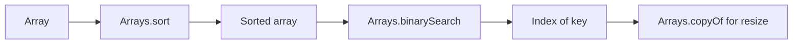

# Array Methods (the Arrays Utility Class)

## 1. Introduction

The **`java.util.Arrays`** class provides ready-made methods for common array operations: **sorting, searching, filling, copying, comparing**, and converting to strings. It saves you from writing these by hand.

---

## 2. Why This Topic Is Important

- `Arrays.sort` beats hand-written sorts in speed and safety.
- `binarySearch` gives O(log n) searching on sorted arrays.
- `copyOf` safely resizes arrays (arrays are fixed-size).
- Interviewers test these utility methods and their edge cases.

---

## 3. Real-World Analogy

`Arrays` is like a **fully equipped toolbox for arranging books**. Instead of manually sorting a shelf (slow, error-prone), you call one tool (`sort`), which arranges everything perfectly. `binarySearch` is the tool that jumps straight to the middle and halves the search each time.

---

## 4. Theory

### The Most-Used Methods

| Method | What It Does | Example |
|--------|--------------|---------|
| `toString(arr)` | Human-readable `[a, b, c]` | `[1, 2, 3]` |
| `sort(arr)` | Sorts ascending (primitives) | `{3,1,2}` → `{1,2,3}` |
| `sort(arr, from, to)` | Sort a sub-range | from/to indices |
| `binarySearch(arr, key)` | O(log n) search — **must be sorted** | returns index or negative |
| `fill(arr, val)` | Fill every slot | all set to val |
| `copyOf(arr, n)` | New array of length n | resize/trim |
| `copyOfRange(arr, from, to)` | Copy a slice | subarray |
| `equals(a1, a2)` | Deep element compare | same content? |
| `deepToString` / `deepEquals` | For nested arrays | 2D arrays |

### Sorting Objects
For object arrays, elements must be `Comparable` (like `String`) or you supply a `Comparator` (Module 12).

---

## 5. Syntax

```java
import java.util.Arrays;

Arrays.sort(arr);
int idx = Arrays.binarySearch(arr, key);
int[] bigger = Arrays.copyOf(arr, arr.length * 2);
Arrays.fill(arr, 0);
String s = Arrays.toString(arr);
```

---

## 6. Flow Explanation



---

## 7. Memory Representation

- `sort` reorders **in place** (mutates the same array; primitives use dual-pivot quicksort).
- `copyOf` allocates a **new** heap block and copies.
- `toString` allocates a temporary String.

---

## 8. Simple Example

```java
import java.util.Arrays;

public class ArraysDemo {
    public static void main(String[] args) {
        int[] numbers = {5, 2, 9, 1, 7};

        Arrays.sort(numbers);
        System.out.println("Sorted  : " + Arrays.toString(numbers));

        int index = Arrays.binarySearch(numbers, 7);
        System.out.println("Index of 7: " + index);
    }
}
```

---

## 9. Intermediate Example — Fill, Copy, Resize

```java
import java.util.Arrays;

public class ArraysOps {
    public static void main(String[] args) {
        int[] a = new int[5];
        Arrays.fill(a, 100);
        System.out.println("Filled : " + Arrays.toString(a));

        int[] bigger = Arrays.copyOf(a, 10);
        System.out.println("Copied : " + Arrays.toString(bigger));

        int[] slice = Arrays.copyOfRange(bigger, 2, 5);
        System.out.println("Slice  : " + Arrays.toString(slice));
    }
}
```

---

## 10. Advanced Example — Comparison & 2D Support

```java
import java.util.Arrays;

public class ArraysAdvanced {
    public static void main(String[] args) {
        int[] x = {1, 2, 3};
        int[] y = {1, 2, 3};
        int[] z = {3, 2, 1};

        System.out.println("x equals y : " + Arrays.equals(x, y));
        System.out.println("x equals z : " + Arrays.equals(x, z));

        int[][] grid1 = {{1, 2}, {3, 4}};
        int[][] grid2 = {{1, 2}, {3, 4}};
        System.out.println("grid1 deep equals grid2 : "
                + Arrays.deepEquals(grid1, grid2));
        System.out.println("grid1 as string: " + Arrays.deepToString(grid1));

        char[] chars = "Java".toCharArray();
        System.out.println("chars : " + Arrays.toString(chars));
    }
}
```

---

## 11. Output

For the **Simple Example**:

```
Sorted  : [1, 2, 5, 7, 9]
Index of 7: 3
```

For the **Advanced Example**:

```
x equals y : true
x equals z : false
grid1 deep equals grid2 : true
grid1 as string: [[1, 2], [3, 4]]
chars : [J, a, v, a]
```

---

## 12. Common Mistakes

| Mistake | Correction |
|---------|------------|
| `binarySearch` on an **unsorted** array | Result is undefined — sort first |
| Printing an array with `println(arr)` | Prints `[I@hash` — use `Arrays.toString` |
| Using `==` to compare arrays | Compares references; use `Arrays.equals` |
| Forgetting `import java.util.Arrays` | Compile error |
| Using `copyOf(arr, smaller)` expecting truncation loss | It does truncate — that's expected |

---

## 13. Best Practices

- Always `Arrays.sort` before `binarySearch`.
- Use `Arrays.copyOf` to "resize" fixed-size arrays.
- Use `Arrays.equals`/`deepEquals` for content comparison.
- Remember: `sort` mutates the array — copy first if you need the original.

---

## 14. Interview Questions

**Q1. What does Arrays.sort use?**
*Dual-pivot Quicksort for primitives; TimSort (stable) for objects.*

**Q2. Why does binarySearch require a sorted array?**
*It halves the search range each step; unsorted data breaks that assumption.*

**Q3. What does binarySearch return if not found?**
*A negative value: `-(insertion point) - 1`.*

**Q4. How do you resize an array?**
*Arrays are fixed-size; create a new one with `Arrays.copyOf`.*

**Q5. How do you compare two arrays' contents?**
*`Arrays.equals` for 1D, `Arrays.deepEquals` for nested arrays.*

---

## 15. Practice Exercises

1. Sort an array and print both sorted and original.
2. Search for a present and an absent value with binarySearch.
3. Fill, then copy a larger and smaller version.
4. Compare two equal and two unequal arrays.

---

## 16. Coding Challenges

1. **Easy:** Sort a String array alphabetically.
2. **Medium:** Merge two sorted arrays into one sorted array.
3. **Hard:** Remove duplicates from a sorted array in place using Arrays methods + index loop.

---

## 17. Summary

- `Arrays` = utility class for arrays.
- Key methods: `sort`, `binarySearch`, `fill`, `copyOf`, `equals`, `toString`.
- binarySearch needs a **sorted** array.
- `==` compares references; use `Arrays.equals`.
- `sort` mutates in place; `copyOf` creates new arrays.

➡️ Continue to: [Multi-Dimensional Arrays](Multi-Dimensional-Arrays.md)