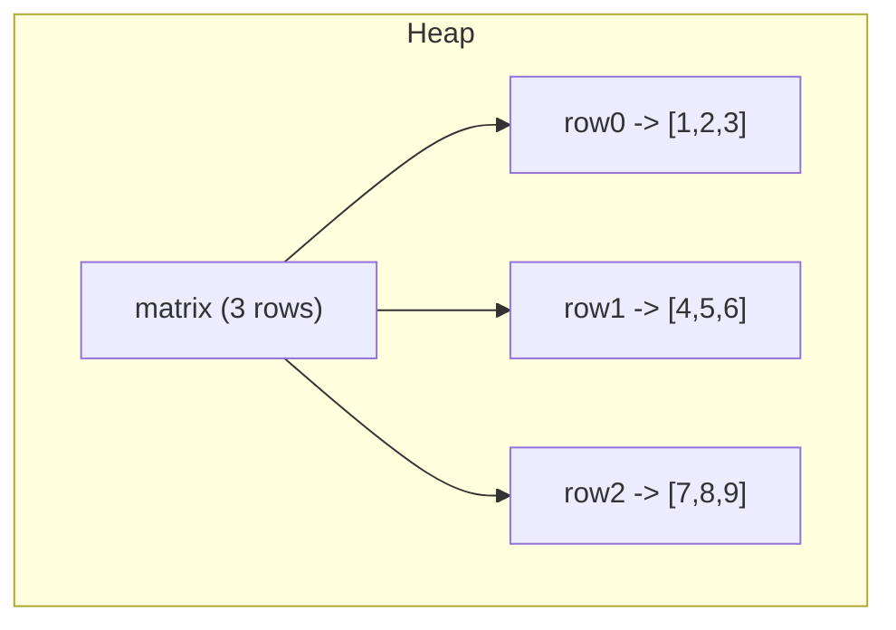

# Multi-Dimensional Arrays

## 1. Introduction

A **multi-dimensional array** is an array of arrays. The most common is the **2D array** — a matrix of rows and columns — used for grids, tables, images, and boards.

---

## 2. Why This Topic Is Important

- **Matrices and grids** are everywhere: spreadsheets, games (Tic-Tac-Toe), image pixels, graph adjacency.
- Interviewers love 2D traversal problems (spiral, diagonal, borders).
- Understanding "array of arrays" clears up a confusing topic for many learners.
- DSA module 23 builds directly on these skills.

---

## 3. Real-World Analogy

A 2D array is like a **classroom seating chart**. Rows and columns identify each seat: `seat[row][col]`. `seat[1][2]` means row 1, column 2. A 3D array is like a **building** — floor (row), row (col), and seat (depth).

---

## 4. Theory

### Declaration & Creation
```java
int[][] matrix = new int[3][4];        // 3 rows, 4 cols, all 0
int[][] grid = {
    {1, 2, 3},
    {4, 5, 6},
    {7, 8, 9}
};
```

### Structure
- `matrix.length` → number of **rows**.
- `matrix[0].length` → number of **columns** (in row 0).
- Each row is itself an array → "array of arrays".

### Jagged Arrays
Rows can have **different lengths**:
```java
int[][] jagged = {
    {1},
    {2, 3},
    {4, 5, 6}
};
```

---

## 5. Syntax

```java
int[][] a = new int[rows][cols];
int value = a[row][col];     // read
a[row][col] = value;         // write

// nested loops
for (int i = 0; i < a.length; i++) {
    for (int j = 0; j < a[i].length; j++) {
        System.out.print(a[i][j] + " ");
    }
    System.out.println();
}
```

---

## 6. Flow Explanation

```mermaid
flowchart TD
    A[i = 0] --> B{i < rows?}
    B -->|yes| C[j = 0]
    C --> D{j < cols?}
    D -->|yes| E[process a[i][j]]
    E --> F[j++]
    F --> D
    D -->|no| G[newline]
    G --> H[i++]
    H --> B
    B -->|no| I[Done]
```

---

## 7. Memory Representation



The outer array holds **references to row arrays**. Rows may be non-contiguous in memory.

---

## 8. Simple Example — Print a Matrix

```java
public class MatrixDemo {
    public static void main(String[] args) {
        int[][] grid = {
            {1, 2, 3},
            {4, 5, 6},
            {7, 8, 9}
        };

        for (int i = 0; i < grid.length; i++) {
            for (int j = 0; j < grid[i].length; j++) {
                System.out.print(grid[i][j] + " ");
            }
            System.out.println();
        }
    }
}
```

---

## 9. Intermediate Example — Sum, Diagonal, Transpose

```java
public class MatrixOps {
    public static void main(String[] args) {
        int[][] m = {
            {1, 2, 3},
            {4, 5, 6},
            {7, 8, 9}
        };

        int sum = 0, mainDiag = 0;
        for (int i = 0; i < m.length; i++) {
            for (int j = 0; j < m[i].length; j++) {
                sum += m[i][j];
                if (i == j) mainDiag += m[i][j];
            }
        }
        System.out.println("Sum of all elements : " + sum);
        System.out.println("Main diagonal sum   : " + mainDiag);
    }
}
```

---

## 10. Advanced Example — Jagged Array & 2D with Scanner

```java
import java.util.Scanner;

public class JaggedArray {
    public static void main(String[] args) {
        Scanner sc = new Scanner(System.in);
        int[][] jagged = new int[3][];
        jagged[0] = new int[2];
        jagged[1] = new int[3];
        jagged[2] = new int[4];

        System.out.println("Enter " + (2 + 3 + 4) + " numbers:");
        for (int i = 0; i < jagged.length; i++) {
            for (int j = 0; j < jagged[i].length; j++) {
                jagged[i][j] = sc.nextInt();
            }
        }

        for (int[] row : jagged) {
            for (int v : row) System.out.print(v + " ");
            System.out.println();
        }
        sc.close();
    }
}
```

---

## 11. Output

For the **Simple Example**:

```
1 2 3
4 5 6
7 8 9
```

For the **Intermediate Example**:

```
Sum of all elements : 45
Main diagonal sum   : 15
```

---

## 12. Common Mistakes

| Mistake | Correction |
|---------|------------|
| Using `matrix.length` for columns | `matrix.length` = rows; columns = `matrix[0].length` |
| Assuming all rows have equal length | Jagged arrays are valid |
| Confusing row/col order in loops | Outer = rows, inner = columns |
| `matrix[i][j]` vs `matrix[j][i]` (transpose mixup) | Careful with index roles |
| 3D thinking when 2D suffices | Keep it simple |

---

## 13. Best Practices

- Use descriptive names: `seat[row][col]`, `pixel[x][y]`.
- Validate that `matrix` and `matrix[0]` are non-null before `length`.
- Use nested enhanced-for for read-only traversal.
- For grids, keep row/col meaning consistent across the codebase.

---

## 14. Interview Questions

**Q1. What is a 2D array in Java?**
*An array of arrays — `int[][]` holds references to `int[]` rows.*

**Q2. How do you get the number of columns?**
*`matrix[0].length` (all rows usually share it).*

**Q3. What is a jagged array?**
*A 2D array whose rows have different lengths.*

**Q4. How do you traverse a 2D array?**
*Nested loops: outer for rows, inner for columns.*

**Q5. Are 2D arrays stored contiguously?**
*No — each row is a separate array object.*

---

## 15. Practice Exercises

1. Create and print a 3x3 identity-like matrix (1 on diagonal).
2. Find the sum of each row and each column.
3. Print a matrix's borders only.
4. Build a jagged array where row i has i+1 elements.

---

## 16. Coding Challenges

1. **Easy:** Print a 4x4 matrix of 0s.
2. **Medium:** Compute and print the transpose of a 3x3 matrix.
3. **Hard:** Implement matrix multiplication for two 3x3 matrices.

---

## 17. Summary

- 2D array = **array of arrays**; index `[row][col]`.
- `length` = rows; `matrix[0].length` = columns.
- Jagged arrays have varying row lengths.
- Traverse with nested loops (outer rows, inner cols).
- Powers grids, tables, games, and matrices.

➡️ Continue to: [Array Algorithms](Array-Algorithms.md)