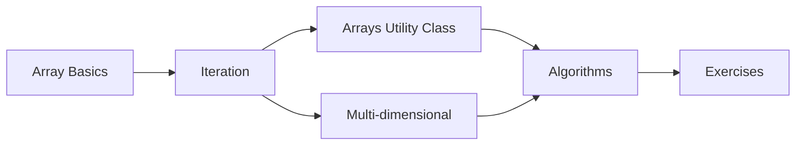

# 07 — Arrays

> **Experience level: 🟡 Basic+ (6 months – 1 year)**

An **array** is a container that holds **multiple values of the same type** in one named variable. Instead of `marks1, marks2, marks3...`, you get `marks[0], marks[1], marks[2]...`. Arrays are the foundation of data structures (Module 23).

---

## 📂 Files in This Module

| File | What You'll Learn |
|------|-------------------|
| [Array-Basics.md](Array-Basics.md) | Declaring, creating, and initializing arrays |
| [Array-Iteration.md](Array-Iteration.md) | Looping through arrays (index, enhanced-for) |
| [Array-Methods.md](Array-Methods.md) | Sorting, copying, filling with the `Arrays` class |
| [Multi-Dimensional-Arrays.md](Multi-Dimensional-Arrays.md) | Matrices and 2D grids |
| [Array-Algorithms.md](Array-Algorithms.md) | Search, max/min, reverse, frequency |
| [Exercises.md](Exercises.md) | Practice tasks for this module |

---

## 🎯 Learning Objectives

By the end of this module, you will be able to:

1. ✅ Create and initialize 1D arrays of primitives and references.
2. ✅ Iterate arrays with index loops and enhanced-for.
3. ✅ Use the `Arrays` utility class (sort, fill, copy, binarySearch).
4. ✅ Work with 2D arrays / matrices.
5. ✅ Implement common array algorithms (search, max, reverse).

---

## 🧭 Module Map



---

## 🚀 Quick Preview

```java
import java.util.Arrays;

public class Preview {
    public static void main(String[] args) {
        int[] marks = {85, 92, 78, 66, 95};
        int total = 0;
        for (int m : marks) total += m;

        Arrays.sort(marks);
        System.out.println("Total : " + total);
        System.out.println("Sorted: " + Arrays.toString(marks));
        System.out.println("Highest: " + marks[marks.length - 1]);
    }
}
```

You'll understand every line by the end of the module.

---

## Next Module

➡️ [08 — Strings](../08-Strings/README.md) — Java's most-used class.