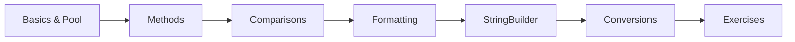

# 08 — Strings

> **Experience level: 🟡 Basic+ (6 months – 1 year)**

**Strings** are sequences of characters and the most-used class in Java. This module covers String creation, **immutability** and the **String pool**, essential methods, comparisons (`==` vs `equals`), formatting, and the mutable `StringBuilder`.

---

## 📂 Files in This Module

| File | What You'll Learn |
|------|-------------------|
| [String-Basics.md](String-Basics.md) | Creating strings, immutability, and the String pool |
| [String-Methods.md](String-Methods.md) | The most useful methods: length, substring, split, replace... |
| [String-Comparisons.md](String-Comparisons.md) | `==` vs `.equals()` and `compareTo` |
| [String-Formatting.md](String-Formatting.md) | `printf`, `String.format`, and formatted output |
| [StringBuilder.md](StringBuilder.md) | Mutable strings for efficient concatenation |
| [String-Conversion.md](String-Conversion.md) | String ↔ numbers, char arrays, and vice versa |
| [Exercises.md](Exercises.md) | Practice tasks for this module |

---

## 🎯 Learning Objectives

By the end of this module, you will be able to:

1. ✅ Explain **immutability** and the **String pool**.
2. ✅ Use the 20 most common String methods confidently.
3. ✅ Compare strings correctly with `.equals()`.
4. ✅ Format output with `printf`/`String.format`.
5. ✅ Choose `String` vs `StringBuilder` wisely.
6. ✅ Convert between strings, numbers, and char arrays.

---

## 🧭 Module Map



---

## 🚀 Quick Preview

```java
public class Preview {
    public static void main(String[] args) {
        String name = "Java Programming";
        System.out.println("Length  : " + name.length());
        System.out.println("Upper   : " + name.toUpperCase());
        System.out.println("Substr  : " + name.substring(0, 4));
        System.out.println("Contains: " + name.contains("Programming"));
    }
}
```

---

## ⚠️ Key Idea — Immutability

Once a String is created, it **cannot be changed**. Every "modifying" method returns a **new** String. This is what enables the String pool and thread safety.

---

## Next Module

➡️ [09 — Object-Oriented Programming](../09-Object-Oriented-Programming/README.md) — the heart of Java.