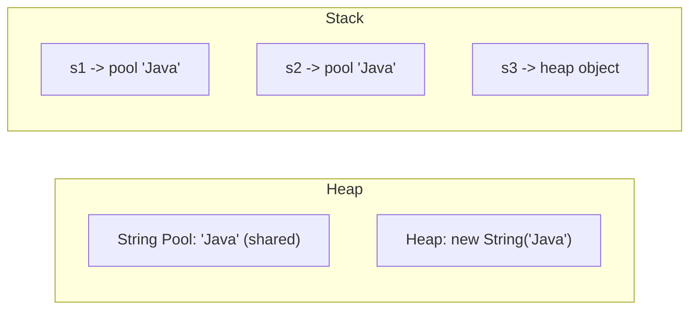

# String Basics

## 1. Introduction

A **String** in Java is an immutable sequence of characters, implemented as a `final` class backed by a `char[]` (or `byte[]` in newer JDKs). You use strings for names, messages, text files, JSON, URLs — nearly everything user-facing.

---

## 2. Why This Topic Is Important

- Strings are the **most-used type** in real applications.
- **Immutability** and the **String pool** are guaranteed interview topics.
- Misunderstanding immutability causes bugs (concatenation in loops).
- String knowledge unlocks JSON, parsing, regex, and file processing.

---

## 3. Real-World Analogy

A String is like a **printed nameplate** on a door. Once printed (created), you cannot edit it — if you want a new name, you print a **new** nameplate and replace the old one. The old plate is never modified; it's simply discarded. That's immutability.

---

## 4. Theory

### Creating Strings — Two Ways
```java
String a = "Java";                    // literal -> String pool
String b = new String("Java");        // new object -> heap (NOT pooled)
```

### The String Pool
- String literals are stored in the **String Constant Pool** (in the heap).
- Identical literals **share** one object.

```java
String x = "Java";
String y = "Java";
// x == y is true — same pooled object
```

### The `new` Keyword Bypasses the Pool
```java
String p = new String("Java");
String q = "Java";
// p == q is false — different objects, same content
```

### Immutability Rules
| Rule | Meaning |
|------|---------|
| No setters | You cannot change a String's content |
| Methods return new strings | `toUpperCase()` gives a NEW string |
| `final` class | Cannot be subclassed |
| Thread-safe | Safe to share across threads |

### Text Blocks (Java 15+)
```java
String html = """
    <html>
      <body>Hello</body>
    </html>
    """;
```

---

## 5. Syntax

```java
String name = "Ajay";
String empty = "";
String withNew = new String("hello");
char[] letters = name.toCharArray();
```

---

## 6. Flow Explanation

```mermaid
flowchart TD
    A[Literal "Java"] --> B[Check String pool]
    B -->|exists| C[Reuse pooled object]
    B -->|missing| D[Create in pool]
    A2[new String "Java"] --> E[Always new heap object]
```

---

## 7. Memory Representation



`s1` and `s2` share the pooled object; `s3` points to a distinct heap object.

---

## 8. Simple Example

```java
public class StringBasicsDemo {
    public static void main(String[] args) {
        String greeting = "Hello";
        String name = new String("World");

        System.out.println(greeting + ", " + name + "!");
        System.out.println("Length of greeting: " + greeting.length());
    }
}
```

---

## 9. Intermediate Example — Pool vs new

```java
public class PoolDemo {
    public static void main(String[] args) {
        String a = "Java";
        String b = "Java";
        String c = new String("Java");

        System.out.println("a == b     : " + (a == b));       // true (pooled)
        System.out.println("a == c     : " + (a == c));       // false (new)
        System.out.println("a.equals(c): " + a.equals(c));    // true (content)
    }
}
```

---

## 10. Advanced Example — Immutability Proof & Text Blocks

```java
public class ImmutableDemo {
    public static void main(String[] args) {
        String s = "Hello";
        String upper = s.toUpperCase();

        System.out.println("Original : " + s);      // unchanged!
        System.out.println("Uppercased: " + upper); // new string

        String json = """
                {
                  "name": "Java",
                  "type": "language"
                }
                """;
        System.out.println(json);
    }
}
```

---

## 11. Output

For the **Intermediate Example**:

```
a == b     : true
a == c     : false
a.equals(c): true
```

For the **Advanced Example**:

```
Original : Hello
Uppercased: HELLO
{
  "name": "Java",
  "type": "language"
}
```

---

## 12. Common Mistakes

| Mistake | Correction |
|---------|------------|
| Comparing with `==` | Use `.equals()` for content |
| Modifying a string in a loop with `+` | Terribly slow — use `StringBuilder` |
| Expecting `toUpperCase()` to change the original | It returns a new string — reassign it |
| Assuming `new String(...)` equals a literal | Different objects; compare with `.equals()` |
| Concatenating `null` | `"x" + null` → "xnull" — handle nulls |

---

## 13. Best Practices

- Use **literals** over `new String()`.
- Compare content with **`.equals()`**.
- Use `StringBuilder` for repeated concatenation.
- Reassign results of string methods: `s = s.trim();`
- Use text blocks for multi-line strings (Java 15+).

---

## 14. Interview Questions

**Q1. Why are strings immutable in Java?**
*For security, caching (String pool), thread safety, and performance (safe sharing).*

**Q2. What is the String pool?**
*A pool of string literals in the heap so identical literals share one object, saving memory.*

**Q3. Difference between `String s = "a"` and `new String("a")`?**
*The literal is pooled/reused; `new` always creates a new object.*

**Q4. What is a text block?**
*A triple-quoted multi-line string literal introduced in Java 15.*

**Q5. How is a String stored internally?**
*As a `final` char[] (Java 8) or byte[] with a charset flag (Java 9+, compact strings).*

---

## 15. Practice Exercises

1. Create a string with a literal and one with `new`, compare with `==` and `.equals()`.
2. Demonstrate immutability: uppercase a string, show the original unchanged.
3. Use a text block to store and print a small HTML snippet.
4. Prove two literals with the same content are the same object (`==`).

---

## 16. Coding Challenges

1. **Easy:** Print the first, middle, and last character of your name.
2. **Medium:** Count how many times the letter 'a' appears in a sentence.
3. **Hard:** Reverse a string without using the built-in reverse, then verify it's a palindrome.

---

## 17. Summary

- Strings are **immutable** sequences of characters.
- Literals live in the **String pool**; `new` creates heap objects.
- Use `.equals()` for content comparison.
- Methods return new strings — reassign when needed.
- Text blocks handle multi-line strings cleanly.

➡️ Continue to: [String Methods](String-Methods.md)