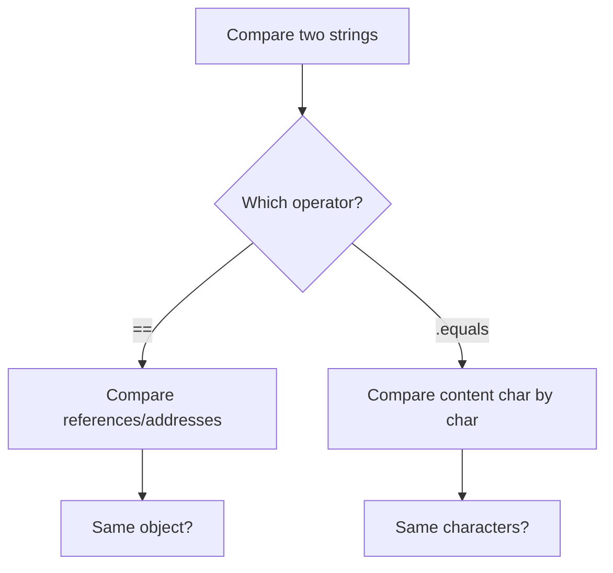

# String Comparisons

## 1. Introduction

Comparing strings is a **classic source of bugs**. `==` compares *references*; `.equals()` compares *content*. New developers almost always start with `==` and get surprising results. This topic makes the difference unforgettable.

---

## 2. Why This Topic Is Important

- "Why doesn't `s1 == s2` work?" is asked daily on forums.
- Interviewers love this question — it tests fundamentals.
- Correct comparison prevents login, validation, and sorting bugs.
- It reinforces the String pool concept from String Basics.

---

## 3. Real-World Analogy

Think of **two people named "Ajay Kumar"**. `==` asks: *"Are these the same person?"* (same identity). `.equals()` asks: *"Do they have the same name?"* (same content). Two different people can share a name — same content, different identity.

---

## 4. Theory

### `==` on References
```java
String a = "Java";
String b = "Java";              // same pooled object
System.out.println(a == b);     // true — same identity

String c = new String("Java");  // new object
System.out.println(a == c);     // false — different identity
```

### `.equals()` on Content
```java
System.out.println(a.equals(b));   // true — same content
System.out.println(a.equals(c));   // true — same content
```

### Rules of Thumb
| Rule | Detail |
|------|--------|
| Always use `.equals()` for content | Compares character-by-character |
| `==` compares object identity | Only reliable for pool literals (rarely wanted) |
| `equalsIgnoreCase` | Case-insensitive content comparison |
| `compareTo` | Lexicographic ordering (negative/0/positive) |
| `Objects.equals(a, b)` | Null-safe equality (Java 7+) |

### compareTo
```java
"apple".compareTo("banana")  // negative: apple < banana
"java".compareTo("java")     // 0: equal
"banana".compareTo("apple")  // positive
```

---

## 5. Syntax

```java
if (userInput.equals("admin")) { ... }        // correct
if (userInput == "admin") { ... }             // WRONG in general

if (input.equalsIgnoreCase("yes")) { ... }    // case-insensitive
Objects.equals(a, b);                          // null-safe
```

---

## 6. Flow Explanation



---

## 7. Memory Representation

`==` compares the **addresses** (stack values). `.equals()` walks the heap objects' character arrays.

---

## 8. Simple Example

```java
public class CompareDemo {
    public static void main(String[] args) {
        String a = "Java";
        String b = "Java";
        String c = new String("Java");

        System.out.println("a == b      : " + (a == b));     // true
        System.out.println("a == c      : " + (a == c));     // false
        System.out.println("a.equals(c) : " + a.equals(c));  // true
    }
}
```

---

## 9. Intermediate Example — Real Bug Fix

```java
import java.util.Scanner;

public class Login {
    public static void main(String[] args) {
        Scanner sc = new Scanner(System.in);
        System.out.print("Enter password: ");
        String input = sc.nextLine();

        String stored = "secret123";

        // BUG: if (input == stored) — never works reliably for user input
        if (input.equals(stored)) {
            System.out.println("Access granted!");
        } else {
            System.out.println("Access denied.");
        }
        sc.close();
    }
}
```

---

## 10. Advanced Example — compareTo & Sorting

```java
import java.util.Arrays;

public class CompareAdvanced {
    public static void main(String[] args) {
        String[] names = {"Ravi", "Anil", "Binu", "anil"};
        Arrays.sort(names);
        System.out.println("Sorted: " + Arrays.toString(names));

        String x = "Java", y = "java";
        System.out.println("x.equalsIgnoreCase(y): " + x.equalsIgnoreCase(y));
        System.out.println("x.compareTo(y)       : " + x.compareTo(y));

        System.out.println("Null-safe equal: " +
                java.util.Objects.equals(null, null));
    }
}
```

---

## 11. Output

For the **Simple Example**:

```
a == b      : true
a == c      : false
a.equals(c) : true
```

For the **Advanced Example**:

```
Sorted: [Anil, Binu, Ravi, anil]
x.equalsIgnoreCase(y): true
x.compareTo(y)       : -32
Null-safe equal: true
```

---

## 12. Common Mistakes

| Mistake | Correction |
|---------|------------|
| `input == "yes"` | Use `.equals("yes")` |
| Calling `.equals()` on a null variable | NPE — use `"yes".equals(input)` or `Objects.equals` |
| Forgetting case sensitivity | Use `equalsIgnoreCase` when needed |
| Using `compareTo` for equality | Use it for ordering; `== 0` means equal but equals() is clearer |
| Comparing content with `==` after interning confusion | Just use `.equals()` always for content |

---

## 13. Best Practices

- **Always** use `.equals()` for content comparison.
- Flip the constant: `"admin".equals(input)` avoids NPE.
- Use `Objects.equals` for null-safe comparison.
- Use `equalsIgnoreCase` for case-insensitive checks.
- Use `compareTo` only when you need ordering.

---

## 14. Interview Questions

**Q1. What is the difference between `==` and `.equals()` for strings?**
*`==` compares references (identity); `.equals()` compares content.*

**Q2. Why does `"Java" == "Java"` sometimes return true?**
*Both literals reference the same pooled object in the String pool.*

**Q3. What does `compareTo` return?**
*A negative int if this < other, 0 if equal, positive if this > other.*

**Q4. How do you compare strings case-insensitively?**
*`equalsIgnoreCase()`, or `toLowerCase().equals(...)` for older code.*

**Q5. How do you avoid NPE when comparing?**
*Call `.equals()` on a known non-null constant, or use `Objects.equals(a, b)`.*

---

## 15. Practice Exercises

1. Compare 3 strings with `==` and `.equals()` — record your predictions.
2. Build a login check using `.equals()`.
3. Sort a String array and observe case ordering.
4. Use `equalsIgnoreCase` for a yes/no prompt.

---

## 16. Coding Challenges

1. **Easy:** Check if two strings are equal ignoring case.
2. **Medium:** Sort a list of country names (case-insensitive) using compareToIgnoreCase.
3. **Hard:** Implement a case-insensitive search that returns the matching word count.

---

## 17. Summary

- `==` compares **identity**; `.equals()` compares **content**.
- String pool literals may make `==` "work" — don't rely on it.
- Use `equalsIgnoreCase` for case-insensitive checks.
- Use `compareTo` for ordering.
- Use `Objects.equals` for null safety.

➡️ Continue to: [String Formatting](String-Formatting.md)