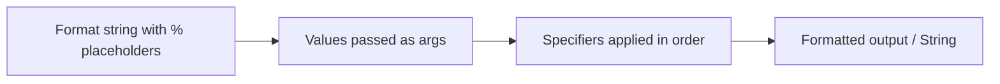

# String Formatting

## 1. Introduction

**String formatting** produces neatly arranged output by combining a **format string** with values. Java offers `System.out.printf`, `String.format`, and formatted string literals (`str.formatted()`). It's the professional way to print tables, currency, and padded text.

---

## 2. Why This Topic Is Important

- Clean output matters in reports, logs, and user interfaces.
- `printf`-style formatting appears in logging frameworks and database tools.
- Interviewers test format specifiers and their pitfalls.
- It replaces messy string concatenation.

---

## 3. Real-World Analogy

Formatting is like using a **pre-printed receipt template**. The template has slots: "Name: ___  Total: ___  Date: ___". You fill the slots with values, and every receipt looks identical and professional. The format string is that template.

---

## 4. Theory

### The Format Specifier
```
%[flags][width][.precision]conversion
```

### Common Conversions
| Specifier | Meaning | Example |
|-----------|---------|---------|
| `%d` | decimal integer | `%5d` pads to width 5 |
| `%f` | float/double | `%.2f` = 2 decimals |
| `%s` | string | `%10s` right-justifies |
| `%c` | character | `%c` |
| `%b` | boolean | `%b` |
| `%n` | newline | platform-safe |
| `%x` / `%o` | hex / octal | `%x` |

### Flags
| Flag | Meaning |
|------|---------|
| `-` | left-justify |
| `0` | pad with zeros |
| `+` | show sign |
| `,` | group thousands |
| `.precision` | decimals (floats) or max chars (strings) |

### Two Ways to Format
```java
System.out.printf("Hi %s, you are %d years old.%n", name, age);
String msg = String.format("Total: %.2f", 99.99);
String msg2 = "Value: %d".formatted(42);   // Java 15+
```

---

## 5. Syntax

```java
System.out.printf("format", args...);
String s = String.format("format", args...);
```

---

## 6. Flow Explanation



---

## 7. Memory Representation

Formatted strings create new heap String objects. Numbers are converted using the locale.

---

## 8. Simple Example

```java
public class FormatDemo {
    public static void main(String[] args) {
        String name = "Ajay";
        int age = 25;
        double marks = 87.4567;

        System.out.printf("Name: %s, Age: %d%n", name, age);
        System.out.printf("Marks: %.2f%n", marks);
        System.out.printf("Price: $%,.2f%n", 1234567.5);
    }
}
```

---

## 9. Intermediate Example — Tables

```java
public class FormatTable {
    public static void main(String[] args) {
        System.out.printf("%-10s %-10s %10s%n", "Product", "Category", "Price");
        System.out.printf("%-10s %-10s %10s%n", "---------", "---------", "----------");
        System.out.printf("%-10s %-10s %10.2f%n", "Laptop", "Electronics", 55000.0);
        System.out.printf("%-10s %-10s %10.2f%n", "Shirt", "Clothing", 1200.5);
        System.out.printf("%-10s %-10s %10.2f%n", "Milk", "Grocery", 60.0);
    }
}
```

---

## 10. Advanced Example — Currency, Dates, Dynamic Width

```java
import java.util.Date;
import java.util.Locale;

public class FormatAdvanced {
    public static void main(String[] args) {
        String name = "Java Book";
        double price = 1499.9;
        int qty = 3;

        // Left/right justification and zero padding
        System.out.printf("Item: %-12s| Qty: %02d | Rate: %8.2f%n", name, qty, price);

        // Grouping and currency with locale
        System.out.printf(Locale.US, "Total: %,.2f USD%n", price * qty);

        // Dates
        System.out.printf("Today: %tF %<tT%n", new Date());

        // String.format reusability
        String receipt = String.format("%s x %d = %.2f", name, qty, price * qty);
        System.out.println(receipt);
    }
}
```

---

## 11. Output

For the **Intermediate Example**:

```
Product     Category          Price
---------   ---------   ----------
Laptop      Electronics   55000.00
Shirt       Clothing       1200.50
Milk        Grocery          60.00
```

For the **Advanced Example** (sample):

```
Item: Java Book    | Qty: 03 | Rate:   1499.90
Total: 4,499.70 USD
Today: 2026-08-14 14:30:00
Java Book x 3 = 4499.70
```

---

## 12. Common Mistakes

| Mistake | Correction |
|---------|------------|
| Using `%d` with a double | `%f` for floats; `%d` for integers |
| Passing arguments in wrong order | Match specifier order |
| Forgetting `%n` for newlines | `%n` is platform-safe (vs `\n`) |
| Mismatched argument count | `MissingFormatArgumentException` |
| Using `println` when you want padding | Use `printf` with width flags |

---

## 13. Best Practices

- Use `%n` instead of `\n` for portability.
- Use `%.2f` for currency-display rounding (but `BigDecimal` for math).
- Left-justify text (`%-12s`) and right-justify numbers (`%12.2f`).
- Prefer `String.format` when reusing a template.
- Specify a `Locale` for currency/grouping consistency.

---

## 14. Interview Questions

**Q1. What is the difference between printf and String.format?**
*`printf` prints to the console; `String.format` returns a formatted String.*

**Q2. What does `%.2f` do?**
*Formats a float/double with 2 decimal places.*

**Q3. What is `%n` and why use it?**
*The platform-independent newline specifier.*

**Q4. What does the `-` flag do?**
*Left-justifies within the width.*

**Q5. How do you print a number with thousands separators?**
*Use the comma flag: `%,d` or `%,.2f`.*

---

## 15. Practice Exercises

1. Print your name, age, and marks with proper formatting.
2. Build a 4-column table of cities, countries, and populations.
3. Format a bill with currency and totals.
4. Print a date in `yyyy-MM-dd` format using `%tF`.

---

## 16. Coding Challenges

1. **Easy:** Print 1..10 in a right-aligned column (width 3).
2. **Medium:** Print a multiplication table formatted as a grid.
3. **Hard:** Build a receipt generator that takes item, qty, price and produces a formatted receipt with totals and GST.

---

## 17. Summary

- Format specifiers: `%d %f %s %c %b %n`.
- Flags: `-` justify, `0` pad, `,` group, `.precision`.
- `printf` prints; `String.format` returns.
- Use `%n` for newlines; match arg order.
- Add a Locale for currency/grouping.

➡️ Continue to: [StringBuilder](StringBuilder.md)