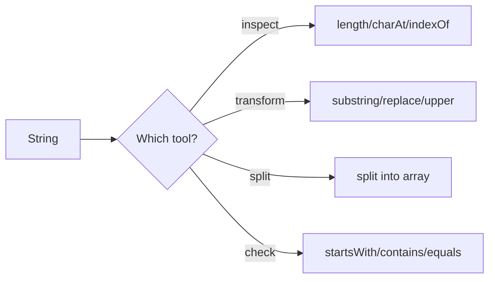

# String Methods

## 1. Introduction

The `String` class offers **dozens of methods** for inspection and transformation. Mastering the ~20 most common ones lets you handle text processing like a pro. Remember: every transformation returns a **new** String.

---

## 2. Why This Topic Is Important

- Text processing is a daily task: cleaning input, parsing, validation.
- Interviewers test methods and their edge cases (empty strings, indices).
- String methods power JSON handling, URLs, file parsing, and more.
- Knowing them saves hours of manual loops.

---

## 3. Real-World Analogy

String methods are like the **tools in a text-editing toolbar**: find (indexOf), select part (substring), replace (replace), count words (split), tidy up (trim), change case (toUpperCase). Each tool operates on the text and hands you a new result.

---

## 4. Theory

### The Essential Method Toolkit

| Method | Returns | Example |
|--------|---------|---------|
| `length()` | int | `"abc".length()` → 3 |
| `charAt(i)` | char | `"abc".charAt(1)` → 'b' |
| `substring(a, b)` | String | `"hello".substring(1, 3)` → "el" |
| `toUpperCase()` / `toLowerCase()` | String | case transforms |
| `trim()` / `strip()` | String | removes whitespace ends |
| `contains(s)` | boolean | `"hello".contains("ell")` → true |
| `startsWith(s)` / `endsWith(s)` | boolean | prefix/suffix checks |
| `indexOf(s)` | int | first index, or -1 |
| `lastIndexOf(s)` | int | last index, or -1 |
| `replace(a, b)` | String | all occurrences |
| `split(regex)` | String[] | breaks into parts |
| `join(delim, parts)` | String | joins parts |
| `isEmpty()` / `isBlank()` | boolean | empty / whitespace-only |
| `equals(s)` / `equalsIgnoreCase(s)` | boolean | content equality |
| `compareTo(s)` | int | lexical order |
| `repeat(n)` | String | repeats n times |
| `toCharArray()` | char[] | char version |
| `matches(regex)` | boolean | full regex match |

---

## 5. Syntax

```java
String s = "Java Programming";
s.length();
s.substring(0, 4);
s.split(" ");
s.replace("a", "x");
```

---

## 6. Flow Explanation



---

## 7. Memory Representation

Every method that returns a String allocates a **new object** in the heap. `length()`/`charAt()` don't allocate.

---

## 8. Simple Example

```java
public class StringMethods {
    public static void main(String[] args) {
        String s = "Hello, Java World!";
        System.out.println("Length     : " + s.length());
        System.out.println("Char at 1  : " + s.charAt(1));
        System.out.println("Substring  : " + s.substring(7, 11));
        System.out.println("Upper      : " + s.toUpperCase());
        System.out.println("Contains 'Java': " + s.contains("Java"));
        System.out.println("Index of 'W': " + s.indexOf('W'));
    }
}
```

---

## 9. Intermediate Example — split & join

```java
public class SplitJoin {
    public static void main(String[] args) {
        String sentence = "Java is a powerful language";
        String[] words = sentence.split(" ");
        System.out.println("Word count: " + words.length);
        for (String w : words) System.out.println("  - " + w);

        String joined = String.join(" | ", words);
        System.out.println("Joined: " + joined);
    }
}
```

---

## 10. Advanced Example — Cleaning & Validation

```java
public class StringClean {
    public static void main(String[] args) {
        String email = "  Ajay.Kumar@Example.COM ";
        String clean = email.trim().toLowerCase();
        System.out.println("Clean email: " + clean);

        if (clean.endsWith(".com") && clean.contains("@")) {
            System.out.println("Valid email format.");
        }

        String csv = "id,name,age";
        String[] cols = csv.split(",");
        System.out.println("CSV columns: " + cols.length);

        String masked = clean.replace("a", "*");
        System.out.println("Masked: " + masked);
    }
}
```

---

## 11. Output

For the **Intermediate Example**:

```
Word count: 5
  - Java
  - is
  - a
  - powerful
  - language
Joined: Java | is | a | powerful | language
```

For the **Advanced Example**:

```
Clean email: ajay.kumar@example.com
Valid email format.
CSV columns: 3
Masked: *j*y.kum*r@ex*mple.com
```

---

## 12. Common Mistakes

| Mistake | Correction |
|---------|------------|
| `substring(7, 11)` confusing end index | End is **exclusive** |
| `indexOf` returning -1 treated as valid | Check for -1 first |
| `split(".")` splitting nothing | `.` is a regex — use `split("\\.")` |
| Forgetting to reassign `trim()` results | `s.trim();` does nothing without reassignment |
| `charAt` on empty string | `StringIndexOutOfBoundsException` — check length first |

---

## 13. Best Practices

- Chain calls for clean pipelines: `s.trim().toLowerCase().split(",")`.
- Use `isBlank()` (Java 11+) over `isEmpty()` for whitespace.
- Prefer `String.join` over manual concatenation.
- Remember `split` takes a **regex** — escape dots and special chars.

---

## 14. Interview Questions

**Q1. Why does `"a.b".split(".")` return an empty array?**
*Because `.` is a regex metacharacter; escape it: `split("\\.")`.*

**Q2. What does `substring(0, 4)` return for `"Java"`?**
*`"Java"` — indices 0 to 3 inclusive (end exclusive).*

**Q3. Difference between `trim()` and `strip()`?**
*`strip()` (Java 11+) also removes Unicode whitespace; `trim()` only ≤ U+0020.*

**Q4. What does `indexOf` return when not found?**
*-1.*

**Q5. Is `String.join` available for lists?**
*Yes — `String.join(delimiter, iterable)` works with lists/arrays.*

---

## 15. Practice Exercises

1. Extract the domain from an email using `substring` + `indexOf`.
2. Count vowels in a sentence.
3. Split a comma-separated string and print each field.
4. Reverse a string using `toCharArray` and a loop.

---

## 16. Coding Challenges

1. **Easy:** Check if a string starts with "Java" and ends with "!".
2. **Medium:** Capitalize the first letter of each word in a sentence.
3. **Hard:** Write a method that returns the initials of a full name ("Ajay Kumar Singh" → "AKS").

---

## 17. Summary

- Know the ~20 core methods: length, charAt, substring, split, replace, indexOf...
- Methods return **new** strings — reassign to keep changes.
- `split` uses regex; escape dots.
- `substring` end index is exclusive.
- Chain methods for clean text pipelines.

➡️ Continue to: [String Comparisons](String-Comparisons.md)