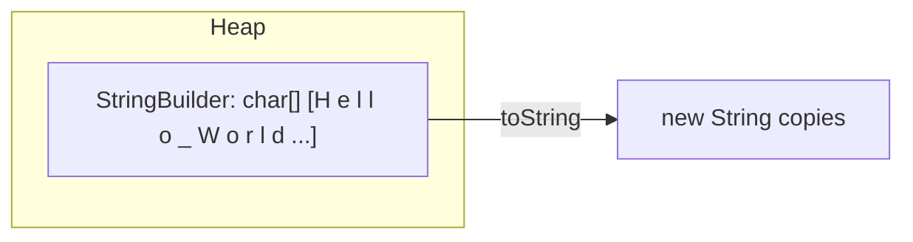

# StringBuilder

## 1. Introduction

**`StringBuilder`** is a **mutable** sequence of characters. Unlike `String`, you can modify it in place. It's the standard choice for building strings through **repeated concatenation** — where plain `String +` would be slow.

---

## 2. Why This Topic Is Important

- String concatenation in a loop is **O(n²)** — a classic performance trap.
- `StringBuilder` fixes it with **O(n)** amortized appends.
- Interviewers ask: *"Why is StringBuilder preferred in loops?"*
- Logging, JSON building, and text processing rely on it.

---

## 3. Real-World Analogy

A String is a **printed newspaper** — you can't edit it, you reprint. A `StringBuilder` is a **whiteboard** — you can write, erase, and rewrite on the same board. For lots of edits, a whiteboard is far more efficient than reprinting.

---

## 4. Theory

### Why String Concatenation Is Slow
```java
String s = "";
for (int i = 0; i < 10000; i++) {
    s += i;          // creates a NEW string each iteration!
}
```
Each `+=` allocates a new String and copies all previous content → O(n²).

### StringBuilder to the Rescue
```java
StringBuilder sb = new StringBuilder();
for (int i = 0; i < 10000; i++) {
    sb.append(i);    // modifies the SAME buffer
}
String result = sb.toString();
```

### Key Methods
| Method | What It Does |
|--------|--------------|
| `append(x)` | Add any value to the end |
| `insert(index, x)` | Insert at a position |
| `replace(a, b, s)` | Replace a range |
| `delete(a, b)` | Remove a range |
| `reverse()` | Reverse in place |
| `length()` | Current length |
| `toString()` | Convert to immutable String |

### StringBuilder vs StringBuffer
| Aspect | StringBuilder | StringBuffer |
|--------|---------------|--------------|
| Thread-safe | No | Yes (synchronized) |
| Speed | Faster | Slower |
| Use | Single-threaded | Multi-threaded (rare) |

---

## 5. Syntax

```java
StringBuilder sb = new StringBuilder();          // empty
StringBuilder sb2 = new StringBuilder("Hello");  // initial content
sb.append("x").append(42).append('!');           // chaining
String s = sb.toString();
```

---

## 6. Flow Explanation

```mermaid
flowchart LR
    A[new StringBuilder] --> B[Internal char[] buffer]
    B --> C[append grows buffer when needed]
    C --> D[toString produces final String]
```

---

## 7. Memory Representation



The buffer is a growable char[]; `toString` creates an immutable copy.

---

## 8. Simple Example

```java
public class SbDemo {
    public static void main(String[] args) {
        StringBuilder sb = new StringBuilder("Java");
        sb.append(" is");
        sb.append(" powerful");
        System.out.println(sb);
        System.out.println("Length: " + sb.length());
    }
}
```

---

## 9. Intermediate Example — Reverse & Insert

```java
public class SbOps {
    public static void main(String[] args) {
        StringBuilder sb = new StringBuilder("racecar");
        StringBuilder rev = new StringBuilder(sb).reverse();
        System.out.println("Original: " + sb);
        System.out.println("Reversed: " + rev);
        System.out.println("Is palindrome? " + sb.toString().equals(rev.toString()));

        sb.insert(4, " ");
        System.out.println("After insert: " + sb);

        sb.delete(4, 5);
        System.out.println("After delete: " + sb);
    }
}
```

---

## 10. Advanced Example — The Loop Performance Fix

```java
public class LoopBuilder {
    public static void main(String[] args) {
        int n = 100_000;

        // Slow way (avoid) - comment out for large n
        long start1 = System.nanoTime();
        String slow = "";
        for (int i = 0; i < n; i++) {
            slow += "a";
        }
        long end1 = System.nanoTime();
        System.out.println("String +=   : " + (end1 - start1) / 1_000_000 + " ms");

        // Fast way
        long start2 = System.nanoTime();
        StringBuilder sb = new StringBuilder();
        for (int i = 0; i < n; i++) {
            sb.append("a");
        }
        String fast = sb.toString();
        long end2 = System.nanoTime();
        System.out.println("StringBuilder: " + (end2 - start2) / 1_000_000 + " ms");

        System.out.println("Both lengths equal: " + (slow.length() == fast.length()));
    }
}
```

---

## 11. Output

For the **Intermediate Example**:

```
Original: racecar
Reversed: racecar
Is palindrome? true
After insert: race car
After delete: racecar
```

For the **Advanced Example**, StringBuilder will typically be **orders of magnitude faster** (milliseconds vs many seconds).

---

## 12. Common Mistakes

| Mistake | Correction |
|---------|------------|
| Using `String +=` in loops | Use `StringBuilder.append` |
| Forgetting `toString()` before returning | Return a String, not the builder |
| Expecting StringBuilder to be immutable | It's mutable — methods change the same object |
| Using StringBuffer when thread safety isn't needed | StringBuilder is faster |
| Not sizing the initial capacity for large builds | `new StringBuilder(n)` avoids resizes |

---

## 13. Best Practices

- Use StringBuilder for **loops and multi-step string building**.
- Set an initial capacity when the final size is known.
- Chain appends for readability: `sb.append(a).append(b)`.
- Convert to String only when done.
- Use StringBuffer only in shared multi-threaded contexts.

---

## 14. Interview Questions

**Q1. Why is String concatenation in a loop slow?**
*Each `+=` creates a new String and copies the whole content — O(n²) total.*

**Q2. What is StringBuilder?**
*A mutable sequence of characters that grows in place, making repeated appends efficient.*

**Q3. StringBuilder vs StringBuffer?**
*StringBuffer is synchronized (thread-safe but slower); StringBuilder is not. Use StringBuilder by default.*

**Q4. Is StringBuilder thread-safe?**
*No.*

**Q5. How do you reverse a string efficiently?**
*`new StringBuilder(s).reverse().toString()`.*

---

## 15. Practice Exercises

1. Build "Java, Python, C++" using StringBuilder append.
2. Reverse a string using StringBuilder.
3. Insert a middle name into a full name.
4. Measure `String +=` vs StringBuilder for 50,000 iterations.

---

## 16. Coding Challenges

1. **Easy:** Remove all vowels from a string using StringBuilder.
2. **Medium:** Reverse each word's characters but keep word order.
3. **Hard:** Compress a string ("aaabbc" → "a3b2c1") using StringBuilder.

---

## 17. Summary

- `StringBuilder` is **mutable** and fast for repeated edits.
- Appends are amortized O(1); String `+=` is O(n) each.
- Key methods: append, insert, delete, reverse, toString.
- Not thread-safe; use StringBuffer if shared.
- Always finish with `.toString()`.

➡️ Continue to: [String Conversion](String-Conversion.md)